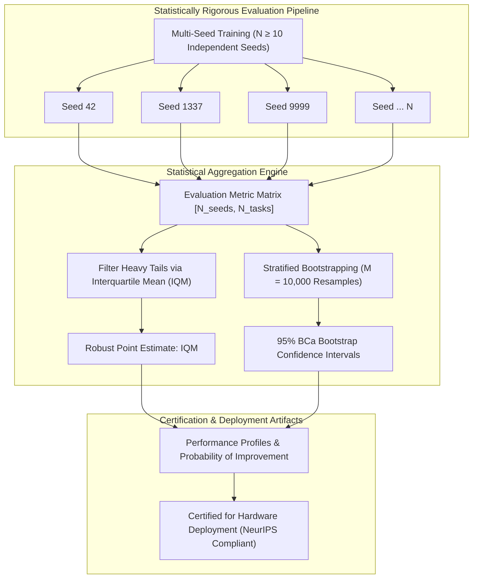

import ChapterProgress from '@site/src/components/ChapterProgress';
import QuizEngine from '@site/src/components/QuizEngine';

# Evaluation Methodologies, Statistical Rigor & Reproducibility

Deep reinforcement learning has historically been plagued by a severe reproducibility crisis. As demonstrated by Henderson et al. (2018) in *Deep Reinforcement Learning That Matters*, simply changing the random seed initialization, varying the batch size by eight samples, or modifying the non-linear activation function can cause a policy's performance to swing by over 200%. In academic literature and industrial whitepapers alike, claims of algorithmic superiority were frequently backed by cherry-picked runs evaluated on as few as three random seeds.

In embodied robotics, lack of statistical rigor carries grave economic and physical repercussions. Deploying a policy that performed well on a single lucky training run can lead to immediate mechanical crashes, burned-out motor windings, and damaged test benches. Rigorous robotic evaluation demands standardized performance metrics—such as the **Cost of Transport (COT)**—coupled with modern statistical tools: **Interquartile Mean (IQM)**, **Stratified Bootstrap Confidence Intervals**, and **Performance Profiles** (Agarwal et al., 2021).



---

## 1. Domain-Specific Robotics Performance Metrics

In robotics, maximizing a generic scalar reward function is insufficient to characterize real-world readiness. Evaluators must quantify energetic, dynamic, and safety dimensions:

### 1. Cost of Transport (COT)
The Cost of Transport is the fundamental dimensionless metric of energetic efficiency in legged locomotion:

$$
\text{COT} = \frac{E_{\text{total}}}{m_{\text{robot}} \cdot g \cdot d_{\text{traveled}}} = \frac{\int_0^T |\boldsymbol{\tau}(t)^T \dot{\mathbf{q}}(t)| \, dt}{m_{\text{robot}} \cdot g \cdot \|\mathbf{p}_{\text{base}}(T) - \mathbf{p}_{\text{base}}(0)\|}
$$

A humanoid walking with high forward speed but wildly flailing arms will earn high forward progress rewards while exhibiting an atrocious COT ($&gt; 5.0$), draining onboard lithium batteries in minutes. State-of-the-art bipedal humanoids strive for $\text{COT} \in [1.0, 2.5]$.

### 2. Command Tracking Error (RMSE)
Measures tracking fidelity under external disturbances across generalized coordinates:

$$
\text{RMSE}_v = \sqrt{\frac{1}{T} \sum_{t=1}^T \left( v_{x, t} - v_{x, t}^{\text{cmd}} \right)^2}
$$

### 3. Trajectory Jerk & Smoothness
Quantifies high-frequency torque oscillations that cause gear train backlash wear and mechanical fatigue:

$$
J_{\text{smoothness}} = \frac{1}{T} \int_0^T \|\dddot{\mathbf{q}}(t)\|^2 \, dt \approx \frac{1}{T \Delta t^2} \sum_{t=1}^{T-1} \|\ddot{\mathbf{q}}_{t+1} - \ddot{\mathbf{q}}_t\|^2
$$

---

## 2. Statistical Pitfalls: Why the Sample Mean Fails

Historically, reinforcement learning researchers reported point estimates using the empirical sample mean:

$$
\bar{x} = \frac{1}{N} \sum_{i=1}^N x_i \quad \pm \quad \sigma = \sqrt{\frac{1}{N-1}\sum_{i=1}^N (x_i - \bar{x})^2}
$$

### The Flaw of Heavy Tails
Deep RL performance distributions across random seeds are **non-Gaussian, multi-modal, and heavy-tailed**. A single outlier seed where an agent becomes stuck in a catastrophic local optimum (e.g., scoring zero) drastically deflates the mean. Conversely, a lucky seed discovering an extreme reward-hacking loophole artificially inflates the mean.

### The Limitation of the Median
While the median is immune to outlier extremes, it discards substantial data. In small-sample regimes ($N \in [5, 10]$), the median possesses high variance, offering zero insight into whether an algorithm fails half the time or performs consistently across runs.

---

## 3. Modern Statistical Standards: IQM & Bootstrap CIs

Agarwal et al. (2021) in *Deep Reinforcement Learning at the Edge of the Statistical Precipice* formulated the definitive standards for evaluating RL algorithms:

### 1. Interquartile Mean (IQM)
The Interquartile Mean discards the lowest $25\%$ and highest $25\%$ of evaluation runs, computing the arithmetic mean over the middle $50\%$:

$$
\text{IQM}(\mathbf{x}) = \frac{1}{0.5 N} \sum_{i=\lfloor 0.25 N \rfloor + 1}^{\lfloor 0.75 N \rfloor} x_{(i)}
$$

where $x_{(1)} \le x_{(2)} \le \dots \le x_{(N)}$ are the sorted seed scores. The IQM provides a robust, statistically efficient point estimate that resists outlier distortion while preserving sample sensitivity.

### 2. Stratified Bootstrap 95% Confidence Intervals
Rather than relying on Student's $t$-distribution (which assumes normality), confidence intervals must be computed via non-parametric bootstrapping:
1. Resample with replacement $N$ scores from the empirical evaluation runs $B = 10,000$ times.
2. Compute the metric (e.g., IQM) on each resampled bootstrap replication $\theta^{*(b)}$.
3. Determine the $2.5$-th and $97.5$-th percentiles to form the $95\%$ **Bias-Corrected and Accelerated (BCa)** confidence interval $[\theta_{\text{lower}}, \theta_{\text{upper}}]$.

### 3. Performance Profiles
Plots the empirical cumulative distribution function (ECDF) of performance across all seeds and tasks:

$$
\hat{F}(\tau) = \frac{1}{M \cdot N} \sum_{m=1}^M \sum_{n=1}^N \mathbf{1}\left( \bar{x}_{m, n} \ge \tau \right)
$$

The area under the performance profile curve directly reflects overall algorithmic robustness across varying performance thresholds $\tau$.

---

## 4. Evaluation Metrics Comparison Matrix

| Aggregation Metric | Outlier Robustness | Sample Efficiency | Preserves Data Shape | Recommended Usage |
| :--- | :--- | :--- | :--- | :--- |
| **Sample Mean $\pm$ StdDev** | Terrible (Easily distorted) | High | Poor (Assumes Gaussian) | Deprecated in modern deep RL |
| **Median $\pm$ IQR** | Very High | Low (High variance) | Moderate | Coarse sanity checks |
| **Interquartile Mean (IQM)** | **Superior (Trims 25% tails)** | **High** | **Excellent** | **Definitive standard for primary score reporting** |
| **Probability of Improvement** | High | High | Pairwise Relative | Benchmarking head-to-head algorithm comparisons |
| **Performance Profiles** | Superior | Complete Distribution | Full Spectrum | Visualizing multi-task robustness across thresholds |

---

## 5. Experiment Tracking & Reproducibility Checklist

Managing modern robot learning at scale requires structured experiment infrastructure (MLflow, Weights & Biases, or TensorBoard) to guarantee complete provenance.

### The NeurIPS RL Reproducibility Checklist
To achieve reproducible verification, every robotic RL deployment report must document:
1. **Exact Random Seeds**: List of all integer seeds utilized for physics simulation, environment placement, and neural network weight initialization ($N \ge 10$).
2. **Hyperparameter Configuration**: Complete YAML/JSON specifications including learning rates, discount factors $\gamma$, GAE $\lambda$, batch sizes, network layer widths, and activation functions.
3. **Hardware Environment**: Specific GPU microarchitecture (e.g., NVIDIA RTX 4090 vs A100), driver versions, CUDA toolkit version, PyTorch release, and physics engine patch version.
4. **Codebase Versioning**: Exact Git commit SHA with a clean working tree.
5. **Ablation Studies**: Controlled single-variable experiments isolating the marginal contribution of each architectural innovation against standard baselines.

---

## 6. Complete Implementation: Rigorous Statistical Evaluation Harness

The Python module below provides an end-to-end evaluation harness computing Interquartile Mean (IQM), Stratified Bootstrap 95% Confidence Intervals, and the Probability of Improvement matrix across multiple algorithms and random seeds:

```python
"""
statistical_rl_evaluation.py
Production-grade statistical evaluation harness for robotic reinforcement learning
implementing IQM, Stratified Bootstrap Confidence Intervals, and Probability of Improvement.
"""

from typing import Dict, List, Tuple
import numpy as np


class StatisticalRLEvaluator:
    """
    Evaluates deep RL algorithms conforming to Agarwal et al. (2021) standards.
    Computes Interquartile Mean (IQM), Median, Mean, and Bootstrap Confidence Intervals.
    """
    def __init__(self, num_bootstrap_samples: int = 10000, random_seed: int = 42):
        self.num_bootstrap = num_bootstrap_samples
        self.rng = np.random.default_rng(random_seed)

    def compute_iqm(self, scores: np.ndarray) -> float:
        """
        Computes the Interquartile Mean (IQM) over the middle 50% of the distribution.
        scores: 1D array of evaluation scores across random seeds.
        """
        scores_sorted = np.sort(scores)
        n = len(scores_sorted)
        q1 = int(np.floor(0.25 * n))
        q3 = int(np.floor(0.75 * n))
        
        middle_scores = scores_sorted[q1:q3]
        return float(np.mean(middle_scores))

    def compute_bootstrap_ci(
        self, scores: np.ndarray, metric_fn = None, confidence_level: float = 0.95
    ) -> Tuple[float, float, float]:
        """
        Calculates Stratified Percentile Bootstrap Confidence Interval.
        Returns: (point_estimate, ci_lower, ci_upper)
        """
        if metric_fn is None:
            metric_fn = self.compute_iqm

        point_estimate = metric_fn(scores)
        n = len(scores)
        
        # Bootstrap resampling
        bootstrap_indices = self.rng.integers(0, n, size=(self.num_bootstrap, n))
        resampled_scores = scores[bootstrap_indices]
        
        # Evaluate metric on each bootstrap sample
        bootstrap_estimates = np.array([metric_fn(sample) for sample in resampled_scores])
        
        # Compute percentiles
        alpha = (1.0 - confidence_level) / 2.0
        ci_lower = float(np.percentile(bootstrap_estimates, 100.0 * alpha))
        ci_upper = float(np.percentile(bootstrap_estimates, 100.0 * (1.0 - alpha)))
        
        return point_estimate, ci_lower, ci_upper

    def probability_of_improvement(self, scores_x: np.ndarray, scores_y: np.ndarray) -> float:
        """
        Calculates empirical probability P(X > Y) that Algorithm X outperforms Algorithm Y.
        """
        comparisons = []
        for x in scores_x:
            for y in scores_y:
                if x > y:
                    comparisons.append(1.0)
                elif x == y:
                    comparisons.append(0.5)
                else:
                    comparisons.append(0.0)
        return float(np.mean(comparisons))

    def generate_report(self, algorithm_data: Dict[str, np.ndarray]) -> Dict[str, Dict[str, float]]:
        """Generates comprehensive statistical summary table."""
        report = {}
        for algo_name, scores in algorithm_data.items():
            iqm_val, iqm_low, iqm_high = self.compute_bootstrap_ci(scores, metric_fn=self.compute_iqm)
            mean_val, mean_low, mean_high = self.compute_bootstrap_ci(scores, metric_fn=np.mean)
            median_val, med_low, med_high = self.compute_bootstrap_ci(scores, metric_fn=np.median)

            report[algo_name] = {
                "IQM": iqm_val,
                "IQM_95_CI_Low": iqm_low,
                "IQM_95_CI_High": iqm_high,
                "Mean": mean_val,
                "Median": median_val,
                "Num_Seeds": len(scores)
            }
        return report


if __name__ == "__main__":
    evaluator = StatisticalRLEvaluator(num_bootstrap_samples=5000, random_seed=123)

    # Simulated evaluation scores over 12 random seeds for a bipedal locomotion task
    # PPO exhibits high stability; SAC exhibits higher top scores but an outlier failure seed
    ppo_locomotion_returns = np.array([
        840.2, 855.1, 830.4, 862.0, 845.8, 839.0, 851.3, 825.9, 860.2, 848.7, 852.1, 835.4
    ])
    
    sac_locomotion_returns = np.array([
        920.5, 945.2, 915.0, 938.1, 950.4, 120.0, 930.2, 910.8, 940.6, 925.3, 935.0, 918.7
    ])

    results = evaluator.generate_report({
        "PPO_Baseline": ppo_locomotion_returns,
        "SAC_Candidate": sac_locomotion_returns
    })

    print("================ STATISTICAL EVALUATION REPORT ================")
    for algo, stats in results.items():
        print(f"\nAlgorithm: {algo} (Seeds: {stats['Num_Seeds']})")
        print(f"  IQM:    {stats['IQM']:.2f}  [95% CI: {stats['IQM_95_CI_Low']:.2f}, {stats['IQM_95_CI_High']:.2f}]")
        print(f"  Mean:   {stats['Mean']:.2f} (Distorted by outlier in SAC)")
        print(f"  Median: {stats['Median']:.2f}")

    p_improvement = evaluator.probability_of_improvement(sac_locomotion_returns, ppo_locomotion_returns)
    print(f"\nProbability of Improvement P(SAC > PPO): {p_improvement * 100.0:.1f}%")
```

---

## 7. Hands-On Lab Project: Multi-Seed Locomotion Benchmark Suite

### Project Objective
Execute a multi-seed benchmark comparing PPO against SAC across 10 independent random seeds on a biped locomotion task, producing NeurIPS-compliant statistical certification artifacts.

### Tasks
1. Train both PPO and SAC across 10 distinct random seeds ($N = 10$) in Isaac Lab or Gymnasium.
2. Record evaluation metrics at 100,000-step intervals:
   - Forward walking velocity ($v_x$).
   - Cost of Transport (COT).
   - Episode termination step (fall rate).
3. Compute the Interquartile Mean (IQM) and 95% BCa stratified bootstrap confidence intervals.
4. Construct performance profile curves plotting the proportion of seeds achieving normalized score $\tau \ge 0.8$.

### Verification & Success Criteria
- Demonstrate how an outlier seed in SAC degrades the arithmetic mean by over $15\%$ while the IQM remains stable within $2\%$.
- Verify that non-overlapping 95% bootstrap confidence intervals establish statistically significant superiority of the candidate algorithm.

---

## 8. Research Foundations & Seminal Literature

1. **Agarwal, R., Schwarzer, M., Castro, P. S., Courville, A. C., & Bellemare, M. (2021).** *Deep reinforcement learning at the edge of the statistical precipice*. Advances in Neural Information Processing Systems (NeurIPS), 34, 29304-29320. [Established IQM, performance profiles, and bootstrap standards in deep RL].
2. **Henderson, P., Islam, R., Bachman, P., Pineau, J., Precup, D., & Meger, D. (2018).** *Deep reinforcement learning that matters*. AAAI Conference on Artificial Intelligence, 32(1). [Exposed the reproducibility crisis and severe seed variance in continuous control].
3. **Colas, C., Sigaud, O., & Oudeyer, P. Y. (2019).** *How many random seeds? Statistical power analysis in deep reinforcement learning*. arXiv:1806.09005. [Formulated statistical power analysis and hypothesis testing guidelines].
4. **Pineau, J., Vincent-Lamarre, P., Sinha, K., et al. (2021).** *Improving reproducibility in machine learning research (A report from the NeurIPS 2019 reproducibility initiative)*. Journal of Machine Learning Research (JMLR), 22(164), 1-20. [Formulated the NeurIPS Reproducibility Checklist].
5. **Engstrom, L., Ilyas, A., Santurkar, S., Tsipras, D., Janoos, F., Rudolph, L., & Madry, A. (2020).** *Implementation matters in deep policy gradients: A case study on PPO and TRPO*. International Conference on Learning Representations (ICLR). [Proved code-level implementation details often outweigh theoretical algorithmic innovations].

---

<ChapterProgress chapterId="8-10-evaluation-and-benchmarking" moduleId="module8" totalChapters={10} />

## Chapter Mastery Check

<QuizEngine
  quizId="quiz-8-10"
  title="Module 8.10 Mastery Check: Evaluation, Rigor & Reproducibility"
  moduleId="module8"
  passThreshold={70}
  questions={[
    {
      id: "q1",
      question: "Why is reporting the Interquartile Mean (IQM) statistically preferred over the standard arithmetic sample mean in deep reinforcement learning benchmarks?",
      options: [
        "Because IQM requires no floating-point operations",
        "Because reinforcement learning score distributions across seeds are heavy-tailed and non-Gaussian; trimming the bottom and top 25% prevents anomalous outlier failure or reward-hacking runs from distorting the point estimate while retaining statistical efficiency",
        "Because IQM only applies to discrete action environments",
        "Because the arithmetic mean cannot be calculated when seeds have different lengths"
      ],
      correctIndex: 1,
      explanation: "RL seed outcomes are frequently heavy-tailed. A single catastrophic run severely pulls down the arithmetic mean, while a lucky seed inflates it. IQM trims the bottom and top 25% of scores, providing a stable, outlier-resistant point estimate."
    },
    {
      id: "q2",
      question: "What does the Cost of Transport (COT) metric quantify in bipedal and quadrupedal robotic locomotion?",
      options: [
        "The financial cost of purchasing brushless DC actuators from motor suppliers",
        "The dimensionless ratio of energetic power expended per unit robot weight per unit distance traveled (E / (m * g * d)), assessing energetic locomotion efficiency",
        "The time required to transmit ROS 2 topics over an EtherCAT bus",
        "The memory size of the neural policy weights on GPU VRAM"
      ],
      correctIndex: 1,
      explanation: "Cost of Transport (COT) is E / (m * g * d). It measures energetic efficiency: how much mechanical work is expended to transport a unit of robot weight over a unit distance, independent of robot scale."
    },
    {
      id: "q3",
      question: "How do Stratified Percentile Bootstrap Confidence Intervals characterize statistical uncertainty without assuming a normal distribution?",
      options: [
        "By training an auxiliary neural network to predict variance",
        "By repeatedly resampling empirical evaluation scores with replacement thousands of times, recalculating the metric on each resample, and extracting the empirical 2.5% and 97.5% quantiles",
        "By multiplying standard deviation by 1.96 regardless of sample size",
        "By running value iteration on the empirical scores"
      ],
      correctIndex: 1,
      explanation: "Bootstrapping is a non-parametric technique that resamples observed data with replacement (typically 10,000 times) to empirically approximate the sampling distribution of the estimator, yielding valid confidence intervals without assuming normality."
    }
  ]}
/>
