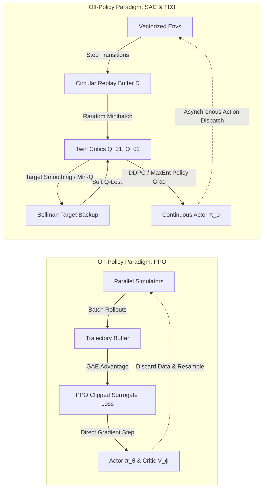

import ChapterProgress from '@site/src/components/ChapterProgress';
import QuizEngine from '@site/src/components/QuizEngine';

# Deep RL Algorithms for Robotics: PPO, SAC & TD3

In high-degree-of-freedom robotic systems—such as 20-DoF bipedal humanoids or 24-DoF dexterous multi-fingered hands—tabular reinforcement learning breaks down under the curse of dimensionality. To generalize motor commands across continuous state spaces comprising joint encoders, 6-axis force-torque load cells, and IMU angular velocities, modern robot learning parameterizes policies and value functions with deep neural networks.

However, deep reinforcement learning applied to physical hardware introduces severe instability. The interplay of function approximation, temporal difference bootstrapping, and off-policy data collection constitutes the *deadly triad*. Overestimating contact impulses or experiencing catastrophic policy collapse during physical interaction can permanently damage actuators or harmonic drive gear teeth. Consequently, robotics research has converged upon three dominant policy optimization algorithms: Proximal Policy Optimization (PPO), Soft Actor-Critic (SAC), and Twin Delayed Deep Deterministic Policy Gradient (TD3).



---

## 1. Value-Based Foundations: Deep Q-Networks (DQN)

Mnih et al. (2015) demonstrated that non-linear neural networks could approximate optimal action-value functions $Q(s, a; \theta) \approx Q^*(s, a)$ by mitigating correlation across sequential samples.

### The Loss Function & Target Networks
To prevent non-stationary targets during gradient descent, DQN maintains two distinct networks: the online network $\theta$ and a periodic frozen target network $\theta^-$:

$$
\mathcal{L}_{DQN}(\theta) = \mathbb{E}_{(s, a, r, s') \sim \mathcal{D}} \left[ \left( r + \gamma \max_{a' \in \mathcal{A}} Q(s', a'; \theta^-) - Q(s, a; \theta) \right)^2 \right]
$$

### Huber Loss for Robustness
To safeguard the network against gradient explosion induced by impulsive contact force spikes, standard quadratic loss is substituted with the Huber loss:

$$
\mathcal{L}_\delta(e) = \begin{cases} 
\frac{1}{2} e^2 & \text{if } |e| \le \delta \\ 
\delta \left(|e| - \frac{1}{2}\delta\right) & \text{otherwise} 
\end{cases}
$$

While revolutionary for discrete decision problems (e.g., discrete gait selection or high-level navigation primitives), finding $\max_{a \in \mathcal{A}} Q(s, a)$ over continuous joint torque spaces $\mathcal{A} \subset \mathbb{R}^n$ requires continuous policy gradient architectures.

---

## 2. The Policy Gradient Theorem & Actor-Critic Architectures

In policy gradient methods, the robot's control policy is parameterized as a probability distribution $\pi_\theta(a \mid s)$ with trainable weights $\theta \in \mathbb{R}^d$. The expected cumulative trajectory return is:

$$
J(\theta) = \mathbb{E}_{\tau \sim \pi_\theta} [R(\tau)] = \int P(\tau; \theta) R(\tau) \, d\tau
$$

### Derivation of the Policy Gradient
Using the log-derivative trick $\nabla_\theta P(\tau; \theta) = P(\tau; \theta) \nabla_\theta \log P(\tau; \theta)$:

$$
\nabla_\theta J(\theta) = \int \nabla_\theta P(\tau; \theta) R(\tau) \, d\tau = \int P(\tau; \theta) \nabla_\theta \log P(\tau; \theta) R(\tau) \, d\tau = \mathbb{E}_{\tau \sim \pi_\theta} \left[ \nabla_\theta \log P(\tau; \theta) R(\tau) \right]
$$

Since the transition dynamics $\mathcal{P}(s_{t+1} \mid s_t, a_t)$ are independent of $\theta$, expanding trajectory probability $P(\tau; \theta) = \mu(s_0) \prod_{t=0}^T \pi_\theta(a_t \mid s_t) \mathcal{P}(s_{t+1} \mid s_t, a_t)$ yields:

$$
\nabla_\theta \log P(\tau; \theta) = \sum_{t=0}^T \nabla_\theta \log \pi_\theta(a_t \mid s_t)
$$

### Baseline Variance Reduction & Advantage Estimation
Subtracting a state-dependent baseline $b(s_t) = V^\pi(s_t)$ preserves expectation ($\mathbb{E}[\nabla_\theta \log \pi_\theta(a_t \mid s_t) b(s_t)] = 0$) while dramatically decreasing estimator variance:

$$
\nabla_\theta J(\theta) = \mathbb{E}_{\tau \sim \pi_\theta} \left[ \sum_{t=0}^T \nabla_\theta \log \pi_\theta(a_t \mid s_t) A^\pi(s_t, a_t) \right]
$$

where the **Advantage Function** $A^\pi(s, a) = Q^\pi(s, a) - V^\pi(s)$ quantifies whether choosing action $a$ outperforms the average action under policy $\pi$.

---

## 3. Proximal Policy Optimization (PPO)

Standard policy gradient methods suffer from erratic step sizes: a single bad parameter update $\theta_{k+1} \leftarrow \theta_k + \alpha \nabla J$ can degrade policy performance irreversibly.

### Trust Region Policy Optimization (TRPO)
TRPO bounds policy divergence by constraining the Kullback-Leibler (KL) divergence between old and new policies:

$$
\max_\theta \hat{\mathbb{E}}_t \left[ \frac{\pi_\theta(a_t \mid s_t)}{\pi_{\theta_{\text{old}}}(a_t \mid s_t)} \hat{A}_t \right] \quad \text{s.t.} \quad \hat{\mathbb{E}}_t \left[ D_{\text{KL}}\left(\pi_{\theta_{\text{old}}}(\cdot \mid s_t) \,\Big\|\, \pi_\theta(\cdot \mid s_t)\right) \right] \le \delta
$$

### PPO Clipped Surrogate Objective
Schulman et al. (2017) simplified TRPO by introducing a first-order clipped surrogate loss that penalizes excessively large probability ratios:

$$
r_t(\theta) = \frac{\pi_\theta(a_t \mid s_t)}{\pi_{\theta_{\text{old}}}(a_t \mid s_t)}
$$

$$
L^{\text{CLIP}}(\theta) = \hat{\mathbb{E}}_t \left[ \min\left( r_t(\theta) \hat{A}_t, \, \text{clip}\left(r_t(\theta), 1 - \epsilon, 1 + \epsilon\right) \hat{A}_t \right) \right]
$$

where $\epsilon \approx 0.2$. When the advantage $\hat{A}_t &gt; 0$, the ratio $r_t(\theta)$ is prevented from exceeding $1 + \epsilon$; when $\hat{A}_t &lt; 0$, $r_t(\theta)$ cannot drop below $1 - \epsilon$.

### Generalized Advantage Estimation (GAE-$\lambda$)
To compute high-accuracy advantages with minimal variance, PPO computes the exponentially discounted sum of TD errors $\delta_t^V = r_t + \gamma V(s_{t+1}) - V(s_t)$:

$$
\hat{A}_t^{\text{GAE}(\gamma, \lambda)} = \sum_{l=0}^{\infty} (\gamma \lambda)^l \delta_{t+l}^V
$$

---

## 4. Soft Actor-Critic (SAC): Maximum Entropy RL

While PPO is on-policy, **Soft Actor-Critic** (Haarnoja et al., 2018) is an off-policy actor-critic algorithm grounded in the **Maximum Entropy Reinforcement Learning** framework.

### Maximum Entropy Objective
In addition to maximizing reward, the agent is incentivized to maximize the Shannon entropy of its policy:

$$
J(\pi) = \sum_{t=0}^T \mathbb{E}_{(s_t, a_t) \sim \rho_\pi} \left[ r(s_t, a_t) + \alpha \mathcal{H}\left(\pi(\cdot \mid s_t)\right) \right]
$$

where $\mathcal{H}(\pi(\cdot \mid s_t)) = \mathbb{E}_{a \sim \pi}[-\log \pi(a \mid s_t)]$ is policy entropy, and $\alpha &gt; 0$ is the temperature parameter governing the trade-off between reward maximization and behavioral exploration.

### Twin Soft Q-Functions & Soft Bellman Backup
To suppress positive value overestimation bias, SAC maintains two independent critic networks $Q_{\theta_1}$ and $Q_{\theta_2}$, utilizing the minimum during target computation:

$$
y = r(s, a) + \gamma \mathbb{E}_{s' \sim \mathcal{P}, a' \sim \pi_\phi} \left[ \min_{i \in \{1, 2\}} Q_{\bar{\theta}_i}(s', a') - \alpha \log \pi_\phi(a' \mid s') \right]
$$

Critics minimize the mean squared Bellman error:

$$
J_Q(\theta_i) = \mathbb{E}_{(s, a, r, s') \sim \mathcal{D}} \left[ \frac{1}{2} \left( Q_{\theta_i}(s, a) - y \right)^2 \right]
$$

### Policy Optimization with Reparameterization Trick
For a Gaussian policy $a_\phi(s, \xi) = \tanh(\mu_\phi(s) + \sigma_\phi(s) \odot \xi)$ where $\xi \sim \mathcal{N}(0, I)$, the policy parameters $\phi$ are optimized via:

$$
J_\pi(\phi) = \mathbb{E}_{s \sim \mathcal{D}, \xi \sim \mathcal{N}} \left[ \alpha \log \pi_\phi(a_\phi(s, \xi) \mid s) - \min_{i \in \{1, 2\}} Q_{\theta_i}(s, a_\phi(s, \xi)) \right]
$$

### Automatic Temperature Adjustment
Rather than keeping $\alpha$ fixed, $\alpha$ is tuned dynamically to maintain a target entropy $\bar{\mathcal{H}} = -\dim(\mathcal{A})$:

$$
J(\alpha) = \mathbb{E}_{s \sim \mathcal{D}, a \sim \pi} \left[ -\alpha \left( \log \pi(a \mid s) + \bar{\mathcal{H}} \right) \right]
$$

---

## 5. Twin Delayed DDPG (TD3)

Fujimoto et al. (2018) identified that function approximation errors in Deep Deterministic Policy Gradient (DDPG) lead to severe overestimation of Q-values. TD3 introduces three critical architectural mechanisms:

1. **Clipped Double Q-Learning**: Evaluates targets using two critics and selects the minimum:
   
   $$
   y = r + \gamma \min_{i=1, 2} Q_{\bar{\theta}_i}\left(s', \pi_{\bar{\phi}}(s') + \epsilon\right)
   $$

2. **Target Policy Smoothing**: Appends clipped Gaussian noise to the target action to enforce smooth value landscapes around target actions:
   
   $$
   \epsilon \sim \text{clip}\left(\mathcal{N}(0, \tilde{\sigma}^2), -c, c\right)
   $$

3. **Delayed Policy Updates**: Updates the actor network and target networks once every $d$ critic updates (typically $d = 2$), reducing variance accumulation in the policy gradients.

---

## 6. Algorithmic Trade-off Matrix

| Metric / Dimension | PPO (Proximal Policy Opt) | SAC (Soft Actor-Critic) | TD3 (Twin Delayed DDPG) | DQN (Deep Q-Network) |
| :--- | :--- | :--- | :--- | :--- |
| **Sample Paradigm** | On-Policy (Discards buffer) | Off-Policy (Circular buffer) | Off-Policy (Circular buffer) | Off-Policy (Circular buffer) |
| **Sample Efficiency** | Moderate ($\sim 10^7$ steps) | Very High ($\sim 10^5 - 10^6$ steps) | High ($\sim 10^6$ steps) | High (Discrete only) |
| **Action Space** | Continuous &amp; Discrete | Continuous (Gaussian/Tanh) | Continuous (Deterministic) | Strictly Discrete |
| **Exploration Mode** | Action entropy bonus | Max-Entropy Regularization | Explicit Target Action Noise | $\epsilon$-greedy exploration |
| **Parallel Scaling** | Superb ($&gt;4096$ envs on GPU) | Moderate (Memory bound) | Moderate (Memory bound) | Poor (Single agent) |
| **Primary Robotic Use** | Isaac Gym Humanoid Locomotion | Real-robot Dexterous Grasping | Robotic Arm Trajectory Tracking | High-level Task Planning |

---

## 7. Production Implementation: Modular Soft Actor-Critic (SAC)

The listing below provides a complete, clean PyTorch implementation of SAC featuring squashed Gaussian policy distributions, twin Q-critics, and automatic temperature tuning:

```python
"""
sac_continuous_robotics.py
Production-grade Soft Actor-Critic (SAC) implementation with automatic temperature tuning.
"""

from typing import Tuple
import numpy as np
import torch
import torch.nn as nn
import torch.nn.functional as F


class ReplayBuffer:
    """Fixed-size circular memory buffer for storing transitions."""
    def __init__(self, state_dim: int, action_dim: int, capacity: int = 1_000_000):
        self.capacity = capacity
        self.ptr = 0
        self.size = 0
        
        self.states = np.zeros((capacity, state_dim), dtype=np.float32)
        self.actions = np.zeros((capacity, action_dim), dtype=np.float32)
        self.rewards = np.zeros((capacity, 1), dtype=np.float32)
        self.next_states = np.zeros((capacity, state_dim), dtype=np.float32)
        self.dones = np.zeros((capacity, 1), dtype=np.float32)

    def add(self, s: np.ndarray, a: np.ndarray, r: float, ns: np.ndarray, d: bool):
        self.states[self.ptr] = s
        self.actions[self.ptr] = a
        self.rewards[self.ptr] = r
        self.next_states[self.ptr] = ns
        self.dones[self.ptr] = float(d)
        
        self.ptr = (self.ptr + 1) % self.capacity
        self.size = min(self.size + 1, self.capacity)

    def sample(self, batch_size: int) -> Tuple[torch.Tensor, ...]:
        idx = np.random.randint(0, self.size, size=batch_size)
        return (
            torch.as_tensor(self.states[idx]),
            torch.as_tensor(self.actions[idx]),
            torch.as_tensor(self.rewards[idx]),
            torch.as_tensor(self.next_states[idx]),
            torch.as_tensor(self.dones[idx])
        )


class TwinQCritic(nn.Module):
    """Twin Q-network to mitigate overestimation bias."""
    def __init__(self, state_dim: int, action_dim: int, hidden_dim: int = 256):
        super().__init__()
        self.q1 = nn.Sequential(
            nn.Linear(state_dim + action_dim, hidden_dim),
            nn.ReLU(),
            nn.Linear(hidden_dim, hidden_dim),
            nn.ReLU(),
            nn.Linear(hidden_dim, 1)
        )
        self.q2 = nn.Sequential(
            nn.Linear(state_dim + action_dim, hidden_dim),
            nn.ReLU(),
            nn.Linear(hidden_dim, hidden_dim),
            nn.ReLU(),
            nn.Linear(hidden_dim, 1)
        )

    def forward(self, state: torch.Tensor, action: torch.Tensor) -> Tuple[torch.Tensor, torch.Tensor]:
        sa = torch.cat([state, action], dim=-1)
        return self.q1(sa), self.q2(sa)


class SquashedGaussianActor(nn.Module):
    """Actor network outputting squashed Gaussian continuous motor commands."""
    def __init__(self, state_dim: int, action_dim: int, hidden_dim: int = 256, log_std_min: float = -20.0, log_std_max: float = 2.0):
        super().__init__()
        self.net = nn.Sequential(
            nn.Linear(state_dim, hidden_dim),
            nn.ReLU(),
            nn.Linear(hidden_dim, hidden_dim),
            nn.ReLU()
        )
        self.mu_head = nn.Linear(hidden_dim, action_dim)
        self.log_std_head = nn.Linear(hidden_dim, action_dim)
        
        self.log_std_min = log_std_min
        self.log_std_max = log_std_max

    def forward(self, state: torch.Tensor) -> Tuple[torch.Tensor, torch.Tensor]:
        features = self.net(state)
        mu = self.mu_head(features)
        log_std = torch.clamp(self.log_std_head(features), self.log_std_min, self.log_std_max)
        std = torch.exp(log_std)
        return mu, std

    def sample(self, state: torch.Tensor) -> Tuple[torch.Tensor, torch.Tensor]:
        mu, std = self.forward(state)
        dist = torch.distributions.Normal(mu, std)
        u = dist.rsample()  # Reparameterization trick
        action = torch.tanh(u)
        
        # Enforcing Action Bounds correction for log likelihood
        log_prob = dist.log_prob(u) - torch.log(1.0 - action.pow(2) + 1e-6)
        log_prob = log_prob.sum(dim=-1, keepdim=True)
        return action, log_prob


class SACAgent:
    """Full Soft Actor-Critic agent with dual Q-networks and adaptive entropy."""
    def __init__(self, state_dim: int, action_dim: int, gamma: float = 0.99, tau: float = 0.005, lr: float = 3e-4):
        self.device = torch.device("cuda" if torch.cuda.is_available() else "cpu")
        self.gamma = gamma
        self.tau = tau
        self.action_dim = action_dim

        self.actor = SquashedGaussianActor(state_dim, action_dim).to(self.device)
        self.critic = TwinQCritic(state_dim, action_dim).to(self.device)
        self.critic_target = TwinQCritic(state_dim, action_dim).to(self.device)
        self.critic_target.load_state_dict(self.critic.state_dict())

        self.actor_optimizer = torch.optim.Adam(self.actor.parameters(), lr=lr)
        self.critic_optimizer = torch.optim.Adam(self.critic.parameters(), lr=lr)

        # Automatic Entropy Tuning
        self.target_entropy = -float(action_dim)
        self.log_alpha = torch.zeros(1, requires_grad=True, device=self.device)
        self.alpha_optimizer = torch.optim.Adam([self.log_alpha], lr=lr)

    @property
    def alpha(self) -> torch.Tensor:
        return self.log_alpha.exp()

    def select_action(self, state: np.ndarray, evaluate: bool = False) -> np.ndarray:
        state_t = torch.as_tensor(state, dtype=torch.float32, device=self.device).unsqueeze(0)
        with torch.no_grad():
            if evaluate:
                mu, _ = self.actor(state_t)
                action = torch.tanh(mu)
            else:
                action, _ = self.actor.sample(state_t)
        return action.squeeze(0).cpu().numpy()

    def update(self, buffer: ReplayBuffer, batch_size: int = 256):
        states, actions, rewards, next_states, dones = [x.to(self.device) for x in buffer.sample(batch_size)]

        # 1. Update Critic Networks
        with torch.no_grad():
            next_actions, next_log_probs = self.actor.sample(next_states)
            q1_target, q2_target = self.critic_target(next_states, next_actions)
            min_q_target = torch.min(q1_target, q2_target) - self.alpha * next_log_probs
            y = rewards + (1.0 - dones) * self.gamma * min_q_target

        q1, q2 = self.critic(states, actions)
        critic_loss = F.mse_loss(q1, y) + F.mse_loss(q2, y)

        self.critic_optimizer.zero_grad()
        critic_loss.backward()
        self.critic_optimizer.step()

        # 2. Update Actor Network
        new_actions, log_probs = self.actor.sample(states)
        q1_new, q2_new = self.critic(states, new_actions)
        min_q_new = torch.min(q1_new, q2_new)
        actor_loss = (self.alpha * log_probs - min_q_new).mean()

        self.actor_optimizer.zero_grad()
        actor_loss.backward()
        self.actor_optimizer.step()

        # 3. Update Temperature Alpha
        alpha_loss = -(self.log_alpha * (log_probs + self.target_entropy).detach()).mean()
        self.alpha_optimizer.zero_grad()
        alpha_loss.backward()
        self.alpha_optimizer.step()

        # 4. Soft Target Update (Polyak averaging)
        for param, target_param in zip(self.critic.parameters(), self.critic_target.parameters()):
            target_param.data.copy_(self.tau * param.data + (1.0 - self.tau) * target_param.data)


if __name__ == "__main__":
    torch.manual_seed(0)
    agent = SACAgent(state_dim=12, action_dim=6)
    buf = ReplayBuffer(state_dim=12, action_dim=6, capacity=1000)
    
    # Populate buffer with dummy transitions
    for _ in range(300):
        buf.add(np.random.randn(12), np.random.uniform(-1, 1, 6), 1.0, np.random.randn(12), False)
        
    agent.update(buf, batch_size=64)
    print("SAC Agent step update completed successfully. Alpha value:", agent.alpha.item())
```

---

## 8. Hands-On Lab Project: PPO vs. SAC Sample Efficiency Benchmark

### Project Objective
Benchmark the sample efficiency, asymptotic reward, and wall-clock training duration of On-Policy PPO versus Off-Policy SAC on a simulated 2-DoF robotic pendulum swing-up task (`InvertedDoublePendulum-v4`).

### Tasks
1. Initialize identical multi-layer perceptron (MLP) architectures: Actor [256, 256], Critic [256, 256].
2. Train both agents for 300,000 environment steps across 5 independent random seeds.
3. Track:
   - Episode return vs. environment step count.
   - Wall-clock compute time on GPU vs. CPU.
   - Final policy stability (standard deviation of angular error in holding upright equilibrium).

### Verification & Success Criteria
- SAC achieves positive swing-up returns within the first 40,000 steps ($5\times$ sample efficiency advantage).
- PPO converges smoothly by 200,000 steps with minimal reward variance across seeds.
- Document the empirical wall-clock scaling when switching from 1 worker environment to 64 parallel vectorized environments.

---

## 9. Research Foundations & Seminal Literature

1. **Mnih, V., Kavukcuoglu, K., Silver, D., et al. (2015).** *Human-level control through deep reinforcement learning*. Nature, 518(7540), 529-533. [Demonstrated stable deep Q-learning via target networks and experience replay].
2. **Sutton, R. S., McAllester, D., Singh, S., & Mansour, Y. (1999).** *Policy gradient methods for reinforcement learning with function approximation*. Advances in Neural Information Processing Systems (NeurIPS), 12. [Established the fundamental Policy Gradient Theorem].
3. **Schulman, J., Wolski, F., Dhariwal, P., Radford, A., & Klimov, O. (2017).** *Proximal Policy Optimization Algorithms*. arXiv:1707.06347. [Introduced clipped surrogate objectives for stable trust-region optimization].
4. **Haarnoja, T., Zhou, A., Abbeel, P., & Levine, S. (2018).** *Soft Actor-Critic: Off-policy maximum entropy deep reinforcement learning with a stochastic actor*. International Conference on Machine Learning (ICML), pp. 1861-1870. [Pioneered maximum entropy continuous control with twin Q-critics].
5. **Fujimoto, S., Hoof, H., & Meger, D. (2018).** *Addressing Function Approximation Error in Actor-Critic Methods*. International Conference on Machine Learning (ICML), pp. 1587-1596. [Introduced TD3 with clipped double Q-learning and delayed updates].

---

<ChapterProgress chapterId="8-2-deep-rl-algorithms" moduleId="module8" totalChapters={10} />

## Chapter Mastery Check

<QuizEngine
  quizId="quiz-8-2"
  title="Module 8.2 Mastery Check: Deep RL Algorithms for Robotics"
  moduleId="module8"
  passThreshold={70}
  questions={[
    {
      id: "q1",
      question: "Why does the PPO clipped surrogate objective incorporate a min() operator between the unclipped and clipped advantage terms?",
      options: [
        "To enforce that gradient descent steps are always orthogonal to the Hessian matrix",
        "To establish a pessimistic lower bound that prevents the policy from excessively updating when the objective would otherwise reward overly optimistic probability shifts",
        "To eliminate the need for value function critics",
        "To automatically normalize input sensor observations"
      ],
      correctIndex: 1,
      explanation: "Taking the minimum between the unclipped surrogate r_t(theta)*A_t and clipped surrogate clip(r_t(theta), 1-eps, 1+eps)*A_t creates a pessimistic lower bound, ensuring that when an action is advantageous, the policy doesn't move too far away from the old policy."
    },
    {
      id: "q2",
      question: "What is the primary operational purpose of the automatic temperature tuning mechanism in Soft Actor-Critic (SAC)?",
      options: [
        "To regulate hardware motor temperatures across high-torque knee joints",
        "To dynamically balance exploration and exploitation by adjusting alpha so that policy entropy matches a designated target entropy bar_H = -dim(A)",
        "To speed up matrix multiplication inside the replay buffer",
        "To switch dynamically between PPO and DQN based on reward magnitude"
      ],
      correctIndex: 1,
      explanation: "Automatic temperature tuning optimizes alpha dynamically: when policy entropy drops below the target bar_H, alpha increases to promote exploration; as the policy encounters noisy regions with high entropy, alpha decreases to exploit high-reward paths."
    },
    {
      id: "q3",
      question: "Which of the following is NOT one of the three core architectural mechanisms introduced in Twin Delayed DDPG (TD3)?",
      options: [
        "Clipped Double Q-learning to minimize overestimation bias",
        "Delayed policy and target network updates relative to critic updates",
        "Categorical Q-value distribution projection via Wasserstein distance",
        "Target policy smoothing regularization using clipped Gaussian noise"
      ],
      correctIndex: 2,
      explanation: "TD3 introduces clipped double Q-learning, delayed policy updates, and target policy smoothing. Categorical distribution projection is a hallmark of distributional RL algorithms such as C51, not TD3."
    }
  ]}
/>
