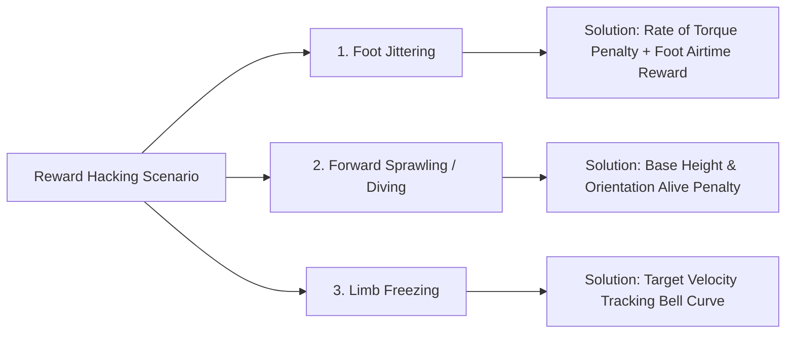

import ChapterProgress from '@site/src/components/ChapterProgress';
import QuizEngine from '@site/src/components/QuizEngine';

# RL for Continuous Control: Action Space Design & Reward Engineering

Training deep reinforcement learning policies for physical robots introduces challenges absent from video games and toy benchmarks. While an agent playing Atari selects from a small set of discrete button presses, an articulated humanoid robot must continuously coordinate dozens of electric motors at frequencies ranging from 50 Hz to 1,000 Hz. The manner in which the action space is parameterized dictates whether a policy produces fluid, energy-efficient locomotion or self-destructive, high-frequency joint chatter.

Furthermore, defining the scalar reward function $R(s, a, s')$ is notoriously difficult. If the reward function is too sparse, policy gradients vanish and exploration stalls; if the reward function is densely shaped without mathematical rigor, the agent inevitably discovers pathological local optima—a phenomenon known as *reward hacking*. Achieving robust sim-to-real transfer requires rigorous action space formulation, potential-based reward shaping, and privileged asymmetric actor-critic architectures.

```mermaid
flowchart TD
    subgraph ActionHierarchy["Continuous Action Space Execution Hierarchy"]
        Policy["Actor Policy π_θ(a|o)"]
        RawAction["Normalized Action a_t ∈ [-1, 1]^n"]
        DeltaScale["Scale by Max Delta: Δq = K_scale * a_t"]
        TargetGen["Commanded Position: q_cmd = q_nominal + Δq"]
        LowLevelPD["Actuator PD Controller: τ = K_p(q_cmd - q) - K_d(q_dot)"]
        HardwareDrive["Physical Motor Drives / Inverters"]

        Policy --> RawAction
        RawAction --> DeltaScale
        DeltaScale --> TargetGen
        TargetGen --> LowLevelPD
        LowLevelPD --> HardwareDrive
    end

    subgraph AsymmetricCritic["Privileged Asymmetric Actor-Critic"]
        Sim["Physics Engine (Isaac Sim / PhysX)"]
        Sim -->|Privileged State s_priv (Heightmap, Friction, Ext Wrench)| Critic["Privileged Critic Q(s_priv, a)"]
        Sim -->|Noisy Onboard State o_t (IMU, Encoders)| Actor["Onboard Policy Actor π(a|o_t)"]
    end
```

---

## 1. Continuous Action Space Parameterization

In continuous robotics domains, policies must output bounded actions $a \in [\mathbf{a}_{\min}, \mathbf{a}_{\max}]^D$. Directly outputting unbounded Gaussian commands $\mathbf{u} \sim \mathcal{N}(\boldsymbol{\mu}(s), \boldsymbol{\Sigma}(s))$ and clipping them produces zero gradients at the boundaries, destroying policy optimization.

### The Squashed Gaussian Policy
To enforce bounded actions smoothly, state-of-the-art continuous control algorithms pass unbounded latent actions through an element-wise invertible tanh non-linearity:

$$
\mathbf{u} \sim \mathcal{N}(\boldsymbol{\mu}_\theta(s), \boldsymbol{\Sigma}_\theta(s)), \quad \mathbf{a} = \tanh(\mathbf{u})
$$

### Change of Variables & Log-Likelihood Correction
Computing policy gradients requires the exact log-probability density $\log \pi(\mathbf{a} \mid s)$. By the multivariate change of variables theorem, the probability density of the transformed random variable $\mathbf{a}$ relates to $\mathbf{u}$ via the Jacobian determinant:

$$
\pi(\mathbf{a} \mid s) = \mu(\mathbf{u} \mid s) \cdot \left| \det \left( \frac{\partial \mathbf{a}}{\partial \mathbf{u}} \right) \right|^{-1}
$$

Since the mapping $a_i = \tanh(u_i)$ is diagonal, its Jacobian matrix is diagonal:

$$
\frac{\partial a_i}{\partial u_j} = \begin{cases} 
1 - \tanh^2(u_i) & \text{if } i = j \\ 
0 & \text{if } i \neq j 
\end{cases}
$$

Taking the logarithm yields the exact squashed log-likelihood:

$$
\log \pi(\mathbf{a} \mid s) = \log \mu(\mathbf{u} \mid s) - \sum_{i=1}^D \log\left(1 - \tanh^2(u_i) + \epsilon\right)
$$

where $\epsilon \approx 10^{-6}$ prevents numerical singularities when $u_i \rightarrow \pm \infty$.

---

## 2. Action Space Taxonomy for Articulated Robots

The choice of what physical quantity the action vector $\mathbf{a}_t$ represents is one of the most critical engineering decisions in robot learning:

### 1. Direct Joint Torques ($\boldsymbol{\tau}_{\text{cmd}} = \mathbf{a}_t$)
- **Mechanism**: The policy outputs raw motor efforts in Newton-meters ($N \cdot m$).
- **Disadvantages**: The policy must implicitly learn the robot's mass matrix $\mathbf{M}(\mathbf{q})$, Coriolis matrix $\mathbf{C}(\mathbf{q}, \dot{\mathbf{q}})$, and gravity vector $\mathbf{g}(\mathbf{q})$. Random exploration leads to motor overheating and rapid collapse. Severe vulnerability to latency.

### 2. Absolute Joint Positions ($\mathbf{q}_{\text{cmd}} = \mathbf{a}_t$)
- **Mechanism**: The policy outputs desired joint angles sent directly to high-gain actuator PD controllers.
- **Disadvantages**: Discontinuous jumps between consecutive policy steps cause explosive torque spikes, triggering hardware overcurrent trips.

### 3. Delta Joint Positions ($\Delta \mathbf{q}_{\text{cmd}} = \mathbf{a}_t$)
- **Mechanism**: The policy outputs offsets relative to a stable nominal default configuration $\mathbf{q}_{\text{default}}$ or the current joint state:
  
  $$
  \mathbf{q}_{\text{cmd}}[k] = \mathbf{q}_{\text{default}} + \kappa \cdot \mathbf{a}_t[k]
  $$
  
  where $\kappa$ is a scaling factor (e.g., $0.2\text{--}0.5\text{ rad}$).
- **Advantages**: Restricts exploration around safe postures; guarantees continuous, band-limited trajectory generation; dominant paradigm in modern quadrupedal and bipedal locomotion (`legged_gym`).

### 4. Operational Space Cartesian Impedance Actions ($\Delta \mathbf{x}_{\text{EE}}, \mathbf{K}_p, \mathbf{K}_d$)
- **Mechanism**: The policy commands Cartesian end-effector displacement vectors and adjustable mechanical stiffness/damping gains.
- **Advantages**: Natural for contact-rich dexterous manipulation and peg-in-hole assembly; automatically handles kinematic singularities via nullspace projection.

---

## 3. Potential-Based Reward Shaping (PBRS)

Reward engineering balances encouraging task progression against discouraging undesirable side-effects.

### The Problem of Reward Distortion
Arbitrarily augmenting a reward function with heuristic bonuses (e.g., granting points whenever a robot's foot is off the ground) alters the optimal policy $\pi^*$, frequently causing pathological behaviors.

### Ng et al. (1999) Invariance Theorem
Ng, Harada, and Russell proved that an auxiliary shaping function $F(s, a, s')$ guarantees that **every optimal policy of the shaped MDP remains an optimal policy of the original MDP** if and only if $F$ is formulated as the difference of a potential function $\Phi: \mathcal{S} \rightarrow \mathbb{R}$:

$$
F(s, a, s') = \gamma \Phi(s') - \Phi(s)
$$

### Proof of Policy Invariance
Let the transformed MDP have reward $\tilde{R}(s, a, s') = R(s, a, s') + F(s, a, s')$. The shaped Q-value satisfies:

$$
\begin{aligned}
\tilde{Q}^*(s, a) &= \mathbb{E} \left[ \sum_{t=0}^\infty \gamma^t \left( R(s_t, a_t, s_{t+1}) + \gamma \Phi(s_{t+1}) - \Phi(s_t) \right) \;\middle|\; s_0 = s, a_0 = a \right] \\
&= \mathbb{E} \left[ \sum_{t=0}^\infty \gamma^t R(s_t, a_t, s_{t+1}) \;\middle|\; s_0 = s, a_0 = a \right] + \mathbb{E} \left[ \sum_{t=0}^\infty \left( \gamma^{t+1} \Phi(s_{t+1}) - \gamma^t \Phi(s_t) \right) \;\middle|\; s_0 = s, a_0 = a \right]
\end{aligned}
$$

The second term is a telescoping sum collapsing to $-\Phi(s_0)$:

$$
\tilde{Q}^*(s, a) = Q^*(s, a) - \Phi(s)
$$

Since the subtraction of $\Phi(s)$ is strictly independent of action $a$:

$$
\arg\max_{a \in \mathcal{A}} \tilde{Q}^*(s, a) = \arg\max_{a \in \mathcal{A}} \left[ Q^*(s, a) - \Phi(s) \right] = \arg\max_{a \in \mathcal{A}} Q^*(s, a)
$$

Hence, the optimal policy set is completely invariant under potential-based reward shaping.

---

## 4. Reward Hacking in Robotics & Mitigation Strategies

Reward hacking occurs when a learning agent exploits unintended mathematical loopholes in the reward formulation to accumulate high return without accomplishing the task.



### Manifestations & Solutions:
1. **Foot Jittering / Actuator Shivering**:
   - *Cause*: A reward term rewarding forward velocity $v_x$ combined with an unpenalized action space leads the policy to cycle joint commands at high frequency to exploit simulator contact chatter.
   - *Fix*: Penalize joint acceleration and torque rate:
     
     $$
     r_{\text{smooth}} = -w_{\Delta \tau} \|\boldsymbol{\tau}_t - \boldsymbol{\tau}_{t-1}\|^2 - w_{\ddot{q}} \|\ddot{\mathbf{q}}_t\|^2
     $$

2. **Forward Diving / Sprawling**:
   - *Cause*: A linear forward progression reward causes a bipedal robot to fling itself forward like a fallen tree, gaining large $x$-displacement within a single episode before termination.
   - *Fix*: Exponential bell-curve tracking and upright posture constraints:
     
     $$
     r_{\text{tracking}} = \exp\left(-\frac{\|v_x - v_{\text{target}}\|^2}{\sigma_v^2}\right) \cdot \mathbb{I}(z_{\text{base}} &gt; z_{\text{min}}) \cdot \exp\left(-\frac{\|\boldsymbol{\theta}_{\text{roll, pitch}}\|^2}{\sigma_\theta^2}\right)
     $$

3. **Limb Freezing / Lazy Robot**:
   - *Cause*: An excessively weighted negative energy penalty $-w_e \|\boldsymbol{\tau} \dot{\mathbf{q}}\|$ causes the agent to remain completely motionless to minimize power consumption.
   - *Fix*: Curriculum-based gain scheduling for energy penalties and positive survival incentives.

---

## 5. Privileged Asymmetric Actor-Critic Architectures

In simulated training, the physics engine possesses complete, noiseless access to environmental properties that physical sensors cannot measure directly on real robots.

### Asymmetry Principle
- **Actor Network $\pi_\theta(a_t \mid \mathbf{o}_t)$**: Receives only **degraded, realistic onboard observations** $\mathbf{o}_t$ (encoder positions, velocities, noisy IMU readouts, historical action buffers).
- **Critic Network $Q_\phi(\mathbf{s}_t^{\text{priv}}, a_t)$**: Receives the **full privileged simulation state** $\mathbf{s}_t^{\text{priv}}$ (ground-truth linear velocity, foot contact normal forces, ground friction coefficients $\mu_{\text{friction}}$, restitution parameters, and external push disturbance wrenches).

Because the critic is strictly discarded at test time and only used to guide policy gradient descent during training, the policy achieves high performance without requiring impractical state estimation hardware on the real robot.

---

## 6. Action Space Comparative Analysis

| Action Parameterization | Execution Frequency | Sim-to-Real Robustness | Sample Efficiency | Safety &amp; Smoothness | Primary Robot Application |
| :--- | :--- | :--- | :--- | :--- | :--- |
| **Direct Torque ($\boldsymbol{\tau}$)** | 500 Hz – 1 kHz | Low (High reality gap) | Very Poor | Dangerous without software clamps | Dynamic backflips, ballistic jumping |
| **Absolute Position ($\mathbf{q}$)** | 20 Hz – 50 Hz | Moderate | Moderate | Moderate (Step discontinuities) | Industrial robotic pick-and-place |
| **Delta Position ($\Delta \mathbf{q}$)** | 50 Hz – 100 Hz | High (Actuator PD absorbs impacts) | High | Excellent (Continuity guaranteed) | Quadruped / Biped locomotion |
| **Operational Impedance ($\mathbf{x}, \mathbf{K}$)** | 100 Hz – 500 Hz | Very High (Compliant contacts) | High | Superior (Forces bounded by stiffness) | Peg-in-hole assembly, wiping surfaces |

---

## 7. Production Implementation: Continuous Control Environment Wrapper

The script below implements a production-grade Gym/Gymnasium continuous control wrapper integrating delta action mapping, potential-based reward shaping, and action smoothness penalties:

```python
"""
continuous_control_wrapper.py
Production Gymnasium wrapper for continuous robotics action space mapping and reward shaping.
"""

from typing import Any, Dict, SupportsFloat, Tuple
import gymnasium as gym
import numpy as np


class ContinuousRoboticWrapper(gym.Wrapper):
    """
    Standardizes action spaces for robotics:
    - Maps normalized [-1, 1] actions to delta position setpoints.
    - Applies Potential-Based Reward Shaping (PBRS).
    - Penalizes action rate-of-change (smoothness).
    """
    def __init__(
        self,
        env: gym.Env,
        default_joint_angles: np.ndarray,
        delta_scale: float = 0.3,
        smoothness_weight: float = 0.05,
        energy_weight: float = 0.001,
        gamma: float = 0.99
    ):
        super().__init__(env)
        self.default_joints = np.array(default_joint_angles, dtype=np.float32)
        self.num_joints = len(default_joint_angles)
        self.delta_scale = delta_scale
        self.smoothness_weight = smoothness_weight
        self.energy_weight = energy_weight
        self.gamma = gamma

        # Action space is strictly normalized to [-1, 1]
        self.action_space = gym.spaces.Box(
            low=-1.0, high=1.0, shape=(self.num_joints,), dtype=np.float32
        )

        self.last_action = np.zeros(self.num_joints, dtype=np.float32)
        self.last_potential = 0.0

    def _compute_potential(self, obs: np.ndarray) -> float:
        """
        Calculates task potential Phi(s) for PBRS.
        Example: Negative Euclidean distance to target end-effector location.
        """
        # Assume obs[0:3] represents current end-effector position
        ee_pos = obs[0:3]
        target_pos = np.array([0.5, 0.0, 0.4], dtype=np.float32)
        distance = np.linalg.norm(ee_pos - target_pos)
        return -float(distance)

    def reset(self, **kwargs) -> Tuple[np.ndarray, Dict[str, Any]]:
        obs, info = self.env.reset(**kwargs)
        self.last_action = np.zeros(self.num_joints, dtype=np.float32)
        self.last_potential = self._compute_potential(obs)
        return obs, info

    def step(self, action: np.ndarray) -> Tuple[np.ndarray, SupportsFloat, bool, bool, Dict[str, Any]]:
        # 1. Action Normalization & Delta Mapping
        action_clipped = np.clip(action, -1.0, 1.0)
        commanded_joints = self.default_joints + self.delta_scale * action_clipped

        # 2. Compute Action Smoothness Penalty
        action_diff = action_clipped - self.last_action
        smoothness_penalty = self.smoothness_weight * float(np.sum(np.square(action_diff)))

        # 3. Step Underlying Physical Environment
        obs, base_reward, terminated, truncated, info = self.env.step(commanded_joints)

        # 4. Compute Potential-Based Reward Shaping: F = gamma * Phi(s') - Phi(s)
        current_potential = self._compute_potential(obs)
        shaping_reward = self.gamma * current_potential - self.last_potential
        self.last_potential = current_potential

        # 5. Compute Energy Dissipation Penalty
        # Assume obs[3:3+num_joints] contains joint velocities
        velocities = obs[3:3 + self.num_joints]
        energy_penalty = self.energy_weight * float(np.sum(np.abs(commanded_joints * velocities)))

        # 6. Synthesize Total Reward
        total_reward = base_reward + shaping_reward - smoothness_penalty - energy_penalty

        # Cache last action for next step difference calculation
        self.last_action = np.copy(action_clipped)
        
        info["base_reward"] = base_reward
        info["pbrs_reward"] = shaping_reward
        info["smoothness_penalty"] = smoothness_penalty

        return obs, total_reward, terminated, truncated, info


if __name__ == "__main__":
    # Demonstration on dummy continuous observation environment
    class MockRobotEnv(gym.Env):
        def __init__(self):
            super().__init__()
            self.observation_space = gym.spaces.Box(-np.inf, np.inf, shape=(9,), dtype=np.float32)
            self.action_space = gym.spaces.Box(-np.pi, np.pi, shape=(6,), dtype=np.float32)
            self.state = np.zeros(9, dtype=np.float32)

        def reset(self, **kwargs):
            self.state = np.random.uniform(-0.1, 0.1, size=(9,)).astype(np.float32)
            return self.state, {}

        def step(self, action):
            self.state += 0.05 * np.random.randn(9).astype(np.float32)
            return self.state, 1.0, False, False, {}

    nominal_posture = np.array([0.0, -0.4, 0.8, -0.4, 0.0, 0.0], dtype=np.float32)
    wrapped_env = ContinuousRoboticWrapper(MockRobotEnv(), default_joint_angles=nominal_posture)
    
    init_obs, _ = wrapped_env.reset()
    test_action = np.random.uniform(-1, 1, size=(6,)).astype(np.float32)
    next_obs, reward, done, trunc, metadata = wrapped_env.step(test_action)
    
    print("Environment step executed successfully.")
    print(f"Total Shaped Reward: {reward:.4f} (Base: {metadata['base_reward']}, PBRS: {metadata['pbrs_reward']:.4f})")
```

---

## 8. Hands-On Lab Project: Mitigating Reward Hacking in Humanoid Balance

### Project Objective
Diagnose and eliminate reward hacking behaviors in a bipedal robot balancing on an oscillating platform.

### Tasks
1. Set up a biped robot simulation environment with a naive reward function:
   
   $$
   R_{\text{naive}} = v_x - 0.01 \|\boldsymbol{\tau}\|^2
   $$

2. Observe and record policy behavior under PPO training for 500,000 steps. Note how the agent exploits the physics engine (e.g., foot vibration, forward fall dive).
3. Reformulate the reward using Potential-Based Reward Shaping and auxiliary regularizers:
   - Target height maintenance potential: $\Phi(s) = -k_z (z_{\text{base}} - z_{\text{nominal}})^2$.
   - Joint velocity smoothness penalty: $-k_{\Delta a} \|\mathbf{a}_t - \mathbf{a}_{t-1}\|^2$.
   - Contact impulse penalty on high-frequency foot chattering.
4. Compare training curves, tracking error, and frequency spectrum of joint torques.

### Verification & Success Criteria
- Eliminate joint command chatter: Power spectral density of torque commands above 20 Hz must drop by at least $15\text{ dB}$.
- Upright balance duration exceeds 30 seconds on random platform disturbances without diving or falling.

---

## 9. Research Foundations & Seminal Literature

1. **Ng, A. Y., Harada, D., & Russell, S. (1999).** *Policy invariance under reward transformations: Theory and application to reward shaping*. International Conference on Machine Learning (ICML), 99, 278-287. [Proved that potential-based shaping is both necessary and sufficient for optimal policy invariance].
2. **Peng, X. B., Abbeel, P., Levine, S., & van de Panne, M. (2018).** *DeepMimic: Example-guided deep reinforcement learning of physics-based character skills*. ACM Transactions on Graphics (TOG), 37(4), 1-14. [Established state-of-the-art reference tracking rewards for dynamic biomechanical movements].
3. **Hwangbo, J., Lee, J., Dosovitskiy, A., et al. (2019).** *Learning agile and dynamic motor skills for legged robots*. Science Robotics, 4(26), eaau5872. [Demonstrated delta joint position action spaces for real-world quadrupedal sim-to-real transfer].
4. **Kumar, N., Malik, J., & Levine, S. (2021).** *RMA: Rapid Motor Adaptation for bipedal and quadrupedal robots*. Robotics: Science and Systems (RSS). [Pioneered privileged asymmetric critic training combined with online adaptation modules].
5. **Amodei, D., Olah, C., Steinhardt, J., Christiano, P., Schulman, J., & Mané, D. (2016).** *Concrete Problems in AI Safety*. arXiv:1606.06565. [Formalized the taxonomies of reward hacking and negative side effects in autonomous systems].

---

<ChapterProgress chapterId="8-3-rl-for-continuous-control" moduleId="module8" totalChapters={10} />

## Chapter Mastery Check

<QuizEngine
  quizId="quiz-8-3"
  title="Module 8.3 Mastery Check: RL for Continuous Control"
  moduleId="module8"
  passThreshold={70}
  questions={[
    {
      id: "q1",
      question: "Why is a Potential-Based Reward Shaping function F(s, a, s') = gamma * Phi(s') - Phi(s) guaranteed to preserve the optimal policy pi* of the original MDP?",
      options: [
        "Because it forces the discount factor gamma to equal 1.0",
        "Because the infinite-horizon sum of shaping rewards telescopes into a state-dependent potential difference -Phi(s_0), shifting Q*(s, a) by a constant independent of action a",
        "Because it eliminates the need to calculate the Jacobian determinant",
        "Because potential functions are always positive definite matrices"
      ],
      correctIndex: 1,
      explanation: "By telescoping the infinite sum, the cumulative shaped return simplifies to Q*(s, a) - Phi(s). Since Phi(s) depends strictly on state s and not on action a, argmax_a [Q*(s, a) - Phi(s)] = argmax_a Q*(s, a), preserving the set of optimal policies."
    },
    {
      id: "q2",
      question: "In squashed Gaussian policies where action a = tanh(u) with u ~ N(mu, Sigma), why must the log-likelihood calculation include a Jacobian determinant correction term?",
      options: [
        "To compensate for the non-linear change of variables from the unbounded Gaussian variable u to the bounded support [-1, 1] of tanh(u)",
        "To prevent gradient explosion in the Adam optimizer",
        "To ensure that motor torques do not exceed thermal thresholds",
        "To convert floating-point tensors from FP32 to INT8"
      ],
      correctIndex: 0,
      explanation: "By the probability change-of-variables theorem, transforming a continuous random variable through a non-linear function requires multiplying its density by the inverse absolute determinant of the Jacobian matrix, which resolves to subtracting sum(log(1 - tanh(u_i)^2)) in log space."
    },
    {
      id: "q3",
      question: "What is the primary rationale for utilizing an Asymmetric Actor-Critic architecture in robotics?",
      options: [
        "The actor is executed on CPU while the critic is executed on GPU",
        "The critic can leverage privileged simulation ground-truth (e.g. friction coefficients, contact forces, obstacle maps) during training to accurately evaluate state values, while the actor uses only onboard sensor inputs available on the physical robot",
        "The actor uses discrete actions and the critic uses continuous actions",
        "It eliminates the need for an experience replay buffer"
      ],
      correctIndex: 1,
      explanation: "The critic is solely utilized during centralized training to optimize value targets and calculate advantages; thus it can ingest privileged simulation variables. The actor, which is deployed on physical hardware, only receives real-world onboard sensor streams."
    }
  ]}
/>
