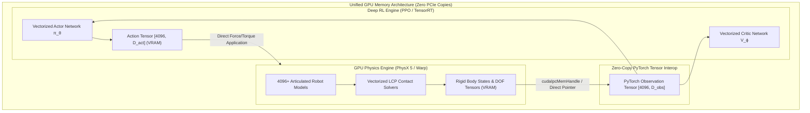

import ChapterProgress from '@site/src/components/ChapterProgress';
import QuizEngine from '@site/src/components/QuizEngine';

# Massively Parallel GPU Training: Isaac Gym & Isaac Lab

For decades, robotic reinforcement learning was constrained by the wall-clock speed of CPU-based physics simulation. Conventional pipelines—such as ROS paired with Gazebo, PyBullet, or multi-process CPU MuJoCo—rely on inter-process communication (IPC) and serialized system calls. In such architectures, simulating a 20-degree-of-freedom humanoid robot across 64 parallel CPU processes saturates memory bandwidth, bottlenecked by continuous serialization across the host-to-device PCIe bus. Training a dynamic locomotion policy required weeks of wall-clock compute.

The advent of **massively parallel GPU simulation**—spearheaded by NVIDIA Isaac Gym and its modern modular successor, **Isaac Lab** (formerly Orbit)—has fundamentally rewritten this paradigm. By executing both the numerical multi-body physics integration and the deep neural network policy optimization entirely within unified GPU Video RAM (VRAM), data copying is completely eliminated. A single workstation GPU can simulate 4,096 to 16,384 robot environments concurrently, gathering over 100,000 environment steps per wall-clock second and compressing months of real-world physical experience into twenty minutes.



---

## 1. Physics Engine Vectorization: PhysX 5 & NVIDIA Warp

In standard multi-body simulation, each environment maintains an isolated world graph, advancing time via sequential loops:

$$
\text{for } i \in [1, \dots, N_{\text{envs}}]: \quad \mathbf{s}_{t+1}^{(i)} \leftarrow \text{SolvePhysics}\left(\mathbf{s}_t^{(i)}, \mathbf{a}_t^{(i)}\right)
$$

### Vectorized Multi-Environment Articulations
Isaac Gym and Isaac Lab restructure the physics pipeline into wide, contiguous memory layouts. Instead of evaluating $N$ distinct simulation loops, all $N_{\text{envs}}$ robots are merged into a single monolithic articulation tensor:

- **DOF Position Tensor**: $\mathbf{Q} \in \mathbb{R}^{N_{\text{envs}} \times n_{\text{dof}}}$
- **DOF Velocity Tensor**: $\dot{\mathbf{Q}} \in \mathbb{R}^{N_{\text{envs}} \times n_{\text{dof}}}$
- **Root State Tensor**: $\mathbf{X}_{\text{root}} \in \mathbb{R}^{N_{\text{envs}} \times 13}$ (Position $[x, y, z]$, Quaternion $[q_x, q_y, q_z, q_w]$, Linear Velocity $[\dot{x}, \dot{y}, \dot{z}]$, Angular Velocity $[\omega_x, \omega_y, \omega_z]$)
- **Net Contact Force Tensor**: $\mathbf{F}_{\text{contact}} \in \mathbb{R}^{N_{\text{envs}} \times n_{\text{bodies}} \times 3}$

### Warp CUDA Just-In-Time Compilation
NVIDIA Warp provides kernel-level programmability for custom spatial mathematics, cloth dynamics, and soft-contact mechanics. Physics kernels are compiled directly to native CUDA binaries targeting NVIDIA Streaming Multiprocessors (SMs), achieving near-theoretical memory bandwidth saturation.

---

## 2. Simulation Throughput & Scaling Mathematics

Simulation efficiency in GPU-accelerated RL is quantified by **Frames Per Second (FPS)**:

$$
\text{FPS} = \frac{N_{\text{environments}} \times N_{\text{steps}}}{\Delta t_{\text{wall\_clock}}}
$$

### Amdahl's Law of RL Pipelines
The total wall-clock duration of a single PPO policy rollout step $\Delta t_{\text{step}}$ decomposes into:

$$
\Delta t_{\text{step}} = \tau_{\text{sim}} + \tau_{\text{obs}} + \tau_{\text{policy}} + \tau_{\text{reward}} + \tau_{\text{reset}}
$$

where:
- $\tau_{\text{sim}}$ is the numerical integration time of the physics engine.
- $\tau_{\text{obs}}$ is sensor observation computation (e.g., coordinate transforms, noise injection).
- $\tau_{\text{policy}}$ is the forward inference pass through the neural network.
- $\tau_{\text{reward}}$ is vectorized reward calculation.
- $\tau_{\text{reset}}$ is the conditional masking and reset of terminated environments.

In legacy CPU architectures, $\tau_{\text{transfer}} = \tau_{\text{device\_to\_host}} + \tau_{\text{host\_to\_device}}$ dominated the loop ($\tau_{\text{transfer}} \approx 0.6 \Delta t_{\text{step}}$). In Isaac Lab, $\tau_{\text{transfer}} = 0$, leading to near-linear throughput scaling up to the memory and computation ceilings of the GPU:

$$
\text{Speedup} = \frac{\Delta t_{\text{CPU\_pipeline}}}{\Delta t_{\text{GPU\_pipeline}}} = \frac{N_{\text{envs}} (\tau_{\text{sim}}^{\text{CPU}} + \tau_{\text{transfer}})}{\max\left(\tau_{\text{sim}}^{\text{GPU}}(N_{\text{envs}}), \tau_{\text{policy}}^{\text{GPU}}(N_{\text{envs}})\right)}
$$

---

## 3. Mixed-Precision Training: FP16 Rollouts & FP32 Updates

Modern GPU Tensor Cores (such as those in the NVIDIA Ada Lovelace and Hopper architectures) deliver over $4\times$ higher throughput for half-precision floating-point arithmetic (FP16 or BF16) compared to single-precision (FP32).

### Numerical Precision Trade-offs in Robotics
- **FP16 Physics Caution**: Running rigid-body contact equations in pure FP16 triggers numerical instability, penetration explosions, and singular matrix inversions in linear complementarity problem (LCP) solvers. Consequently, PhysX executes core articulation integration in FP32.
- **Mixed-Precision Neural Rollouts**: Policy inference during environment stepping operates in FP16 / BF16. Activations are downscaled, drastically accelerating memory access throughput.
- **FP32 Policy Optimization**: During the PPO backward pass, gradients are accumulated in FP32. This prevents gradient underflow when aggregating advantages across 4,096 environments:
  
  $$
  \mathbf{g}_\theta = \frac{1}{N_{\text{envs}} \cdot T} \sum_{i=1}^{N_{\text{envs}}} \sum_{t=1}^T \nabla_\theta \mathcal{L}_t^{(i)}(\theta)
  $$

---

## 4. Architectural Comparison: CPU vs. GPU RL Architectures

| Characteristic | Legacy CPU Cluster (ROS + Gazebo) | Multi-Process CPU (Ray + MuJoCo) | Monolithic GPU (NVIDIA Isaac Gym) | Modular GPU (Isaac Lab / Warp) |
| :--- | :--- | :--- | :--- | :--- |
| **Max Environments** | 16 – 32 | 64 – 128 | 4,096 – 16,384 | 4,096 – 32,768+ |
| **Simulation FPS** | $500\text{--}1,500$ | $5,000\text{--}15,000$ | $100,000\text{--}300,000$ | $150,000\text{--}500,000+$ |
| **Memory Architecture** | Host RAM (POSIX Shm) | Host RAM (Plasma Store) | Unified VRAM | Unified VRAM + Warp Tensors |
| **PCIe Bus Bottleneck** | Massive (Every step) | High (Batch sync) | Zero (Pure in-memory) | Zero (Pure in-memory) |
| **Sim-to-Real Iteration** | 3 to 7 days | 12 to 24 hours | 20 to 45 minutes | 15 to 30 minutes |
| **Sensor Simulation** | Slow software rasterizer | CPU raycasting | GPU RTX Raytracing | Hardware OptiX / Vulkan |

---

## 5. Production Implementation: 4096-Environment Vectorized Simulator

The following standalone script demonstrates the fundamental tensor architecture of Isaac Gym/Isaac Lab. It implements a fully GPU-vectorized multi-environment physics simulator in pure PyTorch, executing 4,096 parallel inverted double pendulums with in-VRAM resets, parallel step dynamics, and PPO buffer staging:

```python
"""
vectorized_gpu_simulator.py
Demonstration of monolithic GPU vectorized environment architecture (Isaac Gym / Isaac Lab paradigm).
"""

from typing import Dict, Tuple
import time
import torch
import torch.nn as nn


class VectorizedCartpoleEnvGPU:
    """
    Simulates thousands of parallel Cartpole balancing environments entirely in GPU memory.
    State: [Cart Position, Cart Velocity, Pole Angle (rad), Pole Angular Velocity]
    """
    def __init__(self, num_envs: int = 4096, device: str = "cuda" if torch.cuda.is_available() else "cpu"):
        self.num_envs = num_envs
        self.device = torch.device(device)

        # Physical constants
        self.gravity = 9.81
        self.masscart = 1.0
        self.masspole = 0.1
        self.total_mass = self.masscart + self.masspole
        self.length = 0.5  # Half-pole length
        self.polemass_length = self.masspole * self.length
        self.force_mag = 10.0
        self.dt = 0.02

        # Thresholds for termination
        self.x_threshold = 2.4
        self.theta_threshold_radians = 12 * 2 * 3.14159265 / 360

        # State tensors allocated permanently in GPU VRAM
        # Shape: [num_envs, 4] -> [x, x_dot, theta, theta_dot]
        self.states = torch.zeros((self.num_envs, 4), dtype=torch.float32, device=self.device)
        self.episode_lengths = torch.zeros(self.num_envs, dtype=torch.long, device=self.device)
        self.max_episode_length = 500

        self.reset_all()

    def reset_all(self):
        """Full reset of all environments."""
        self.states = torch.empty((self.num_envs, 4), device=self.device).uniform_(-0.05, 0.05)
        self.episode_lengths.zero_()

    def reset_idx(self, env_ids: torch.Tensor):
        """Vectorized conditional reset for terminated environments only."""
        if len(env_ids) == 0:
            return
        num_resets = len(env_ids)
        self.states[env_ids] = torch.empty((num_resets, 4), device=self.device).uniform_(-0.05, 0.05)
        self.episode_lengths[env_ids] = 0

    def step(self, actions: torch.Tensor) -> Tuple[torch.Tensor, torch.Tensor, torch.Tensor, Dict]:
        """
        Executes one synchronized parallel integration step across all 4096 environments.
        actions: Tensor of shape [num_envs] with values in [-1.0, 1.0]
        """
        x = self.states[:, 0]
        x_dot = self.states[:, 1]
        theta = self.states[:, 2]
        theta_dot = self.states[:, 3]

        force = actions * self.force_mag

        costh = torch.cos(theta)
        sinth = torch.sin(theta)

        temp = (force + self.polemass_length * theta_dot.pow(2) * sinth) / self.total_mass
        thetaacc = (self.gravity * sinth - costh * temp) / (
            self.length * (4.0 / 3.0 - self.masspole * costh.pow(2) / self.total_mass)
        )
        xacc = temp - self.polemass_length * thetaacc * costh / self.total_mass

        # Semi-implicit Euler integration
        x_dot = x_dot + self.dt * xacc
        x = x + self.dt * x_dot
        theta_dot = theta_dot + self.dt * thetaacc
        theta = theta + self.dt * theta_dot

        self.states[:, 0] = x
        self.states[:, 1] = x_dot
        self.states[:, 2] = theta
        self.states[:, 3] = theta_dot
        self.episode_lengths += 1

        # Vectorized termination condition
        dones = (
            (x < -self.x_threshold)
            | (x > self.x_threshold)
            | (theta < -self.theta_threshold_radians)
            | (theta > self.theta_threshold_radians)
            | (self.episode_lengths >= self.max_episode_length)
        )

        # Potential-based upright reward
        rewards = 1.0 - (theta.pow(2) / self.theta_threshold_radians**2) - 0.1 * (x.pow(2) / self.x_threshold**2)
        rewards = torch.where(dones, -10.0 * torch.ones_like(rewards), rewards)

        # Trigger auto-resets in-place on GPU
        reset_env_ids = torch.nonzero(dones, as_tuple=False).squeeze(-1)
        if len(reset_env_ids) > 0:
            self.reset_idx(reset_env_ids)

        return self.states.clone(), rewards, dones, {}


def benchmark_gpu_throughput(num_envs: int = 4096, total_steps: int = 1000):
    print(f"Initializing {num_envs} GPU environments...")
    env = VectorizedCartpoleEnvGPU(num_envs=num_envs)
    
    # Warmup
    dummy_actions = torch.empty(num_envs, device=env.device).uniform_(-1.0, 1.0)
    for _ in range(20):
        env.step(dummy_actions)
    if torch.cuda.is_available():
        torch.cuda.synchronize()

    print("Beginning benchmark...")
    start_time = time.perf_counter()
    
    for _ in range(total_steps):
        actions = torch.empty(num_envs, device=env.device).uniform_(-1.0, 1.0)
        env.step(actions)
        
    if torch.cuda.is_available():
        torch.cuda.synchronize()
        
    elapsed = time.perf_counter() - start_time
    total_frames = num_envs * total_steps
    fps = total_frames / elapsed

    print(f"\nBenchmark Complete:")
    print(f"  Environments: {num_envs}")
    print(f"  Total Steps: {total_steps}")
    print(f"  Total Simulated Transitions: {total_frames:,}")
    print(f"  Wall-Clock Time: {elapsed:.3f} s")
    print(f"  Throughput: {fps:,.0f} FPS")


if __name__ == "__main__":
    benchmark_gpu_throughput(num_envs=4096, total_steps=500)
```

---

## 6. Distributed Multi-GPU Scaling with Ray RLlib

When training complex full-body humanoid locomotion over procedurally generated 3D obstacle courses, a single GPU's memory may be saturated by geometry meshes and contact buffers.

### Data-Parallel Policy Synchronization
To scale across multiple GPUs (e.g., an 8-GPU node with NVIDIA NVLink):
1. Each GPU runs an isolated instance of the vectorized simulator hosting 4,096 environments (yielding $32,768$ parallel robots).
2. During policy rollout, each GPU accumulates a localized rollout tensor $\mathcal{D}_k$.
3. When computing policy updates, gradients are averaged across all GPUs using NCCL (NVIDIA Collective Communications Library) `AllReduce`:
   
   $$
   \mathbf{g}_{\text{global}} = \frac{1}{K} \sum_{k=1}^K \mathbf{g}_k
   $$

4. The updated policy parameters $\theta_{k+1}$ are broadcast back to all GPU actor instances synchronously.

---

## 7. Hands-On Lab Project: Isaac Lab Locomotion Scaling Profiler

### Project Objective
Benchmark simulation throughput, memory allocation, and PPO training convergence across varying environment counts in Isaac Lab.

### Tasks
1. Set up an articulated biped robot locomotion task in Isaac Lab.
2. Run benchmark sweeps across environment counts:
   
   $$
   N_{\text{envs}} \in \{64, 256, 1024, 4096, 8192\}
   $$

3. Monitor:
   - GPU VRAM consumption via `nvidia-smi`.
   - Simulation throughput in FPS.
   - PPO wall-clock duration to reach an average forward velocity of $1.5\text{ m/s}$.
4. Plot the scaling efficiency curve against ideal linear speedup.

### Verification & Success Criteria
- Throughput must scale from $&lt; 5,000\text{ FPS}$ at $N=64$ to over $120,000\text{ FPS}$ at $N=4096$ on an NVIDIA RTX 4090 / A100.
- Wall-clock convergence time to stable walking decreases by at least $80\%$ when moving from 256 to 4096 environments.

---

## 8. Research Foundations & Seminal Literature

1. **Makoviychuk, V., Wawrzyniak, L., Guo, Y., et al. (2021).** *Isaac Gym: High performance GPU-based physics simulation for robot learning*. arXiv:2108.10470. [Pioneered monolithic GPU simulation for deep reinforcement learning].
2. **Mittal, M., Yu, C., Yu, Q., Liu, J., et al. (2023).** *Orbit: A unified simulation framework for interactive robot learning via Isaac Sim*. IEEE Robotics and Automation Letters (RA-L), 8(6), 3740-3747. [Established modular, component-based robot learning architectures on NVIDIA Omniverse].
3. **Rudin, N., Hoeller, D., Reist, P., & Hutter, M. (2022).** *Learning to walk in minutes using massively parallel deep reinforcement learning*. Science Robotics, 7(68), eabk2822. [Demonstrated real-world sim-to-real transfer of quadrupedal locomotion trained in minutes on a single GPU].
4. **Liang, J., Makoviychuk, V., Handa, A., et al. (2018).** *GPU-accelerated robotic simulation for distributed reinforcement learning*. Conference on Robot Learning (CoRL), pp. 270-282. [Introduced early GPU-accelerated multi-body physics architectures].
5. **Moritz, P., Nishihara, R., Wang, S., et al. (2018).** *Ray: A distributed framework for emerging AI applications*. USENIX Symposium on Operating Systems Design and Implementation (OSDI), pp. 561-577. [Provided the standard distributed scaling runtime for multi-node RL].

---

<ChapterProgress chapterId="8-4-massively-parallel-training" moduleId="module8" totalChapters={10} />

## Chapter Mastery Check

<QuizEngine
  quizId="quiz-8-4"
  title="Module 8.4 Mastery Check: Massively Parallel GPU Training"
  moduleId="module8"
  passThreshold={70}
  questions={[
    {
      id: "q1",
      question: "What is the primary architectural bottleneck that Isaac Gym and Isaac Lab eliminate compared to classical CPU-based simulation pipelines?",
      options: [
        "The need for floating-point calculations",
        "The continuous host-to-device PCIe memory transfer bottleneck caused by serializing physics states from CPU RAM to GPU VRAM at every policy step",
        "The need to compute motor torque limits",
        "The requirement to use the Adam optimizer"
      ],
      correctIndex: 1,
      explanation: "In traditional CPU simulation setups, states must be copied across the PCIe bus from host RAM to GPU memory for neural network inference, and actions must be copied back. Isaac Gym/Lab executes both physics integration and neural inference in unified VRAM, eliminating PCIe roundtrips completely."
    },
    {
      id: "q2",
      question: "Why does mixed-precision RL training generally maintain FP32 precision for the optimizer and PPO policy gradient accumulation while using FP16/BF16 for environment rollouts?",
      options: [
        "Because GPUs cannot compute matrix multiplications in FP16",
        "Because accumulating tiny policy gradients across thousands of parallel environments in FP16 causes numerical underflow and vanishing updates, while rollout forward passes are highly tolerant to reduced precision",
        "Because PyTorch does not support FP16 neural networks",
        "Because PhysX requires all neural network weights to be integers"
      ],
      correctIndex: 1,
      explanation: "Aggregating gradients across 4,096+ environments involves summing millions of small numerical values. In FP16, these values underflow to zero. Maintaining FP32 master weights and optimizer states ensures numerical stability while reaping FP16 Tensor Core acceleration during rollouts."
    },
    {
      id: "q3",
      question: "In vectorized GPU environments, how are environment terminations (e.g. humanoid falls or timeouts) handled without halting the other 4,000+ parallel simulations?",
      options: [
        "The entire simulation cluster is rebooted",
        "A CUDA kernel applies a vectorized boolean mask that conditionally resets only the DOF states and root transforms of the specific terminated environment indices directly in GPU VRAM",
        "Terminated environments are deleted from RAM and reallocated dynamically",
        "The physics time-step dt is set to zero for all environments"
      ],
      correctIndex: 1,
      explanation: "Terminations are represented as a boolean mask [N_envs]. A GPU kernel identifies non-zero indices and selectively overwrites only the state tensors for those specific environments in-place, allowing all other non-terminated environments to continue integrating uninterrupted."
    }
  ]}
/>
