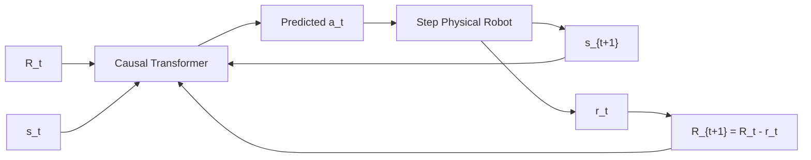

import ChapterProgress from '@site/src/components/ChapterProgress';
import QuizEngine from '@site/src/components/QuizEngine';

# Offline Reinforcement Learning & Sequence Modeling

Deploying exploratory online reinforcement learning algorithms directly on physical robots presents immense operational hazards. An agent performing random exploration to learn a manipulation skill can drive end-effectors into tables, overheat high-torque joints, or destroy mechanical linkages. Conversely, robotics laboratories possess massive archives of historical data: human teleoperation demonstrations collected via bilateral leader-follower arms or VR headsets, scripted automation runs, and failed trial logs.

**Offline Reinforcement Learning** (also termed batch RL) addresses the challenge of learning optimal policies entirely from static, pre-collected datasets $\mathcal{D} = \{(s_t, a_t, r_t, s_{t+1})\}_{t=1}^N$ without engaging in further environmental interaction. Unlike simple imitation learning, which merely copies demonstrated actions, offline RL can stitch together disparate sub-optimal trajectories to discover strategies that exceed the performance of the best trajectory in the dataset.

```mermaid
flowchart LR
    subgraph DataCollection["Static Robotics Archive D"]
        Teleop["Human Teleoperation (VR/SpaceMouse)"]
        Scripted["Scripted Heuristic Trajectories"]
        PreviousRL["Sub-Optimal Prior Policies"]
        Teleop --> Dataset["Offline Replay Buffer D"]
        Scripted --> Dataset
        PreviousRL --> Dataset
    end

    subgraph OfflineParadigms["Algorithmic Paradigms"]
        Dataset -->|Supervised Token Stream| DT["Decision Transformer (Autoregressive Returns-to-Go)"]
        Dataset -->|Penalize OOD Actions| CQL["Conservative Q-Learning (CQL: Lower-Bound Value)"]
        Dataset -->|Expectile Regression (No OOD)| IQL["Implicit Q-Learning (IQL: In-Sample Updates)"]
    end

    subgraph Deployment["Physical Execution"]
        DT --> RobotHardware["Physical Humanoid / Arm Controller"]
        CQL --> RobotHardware
        IQL --> RobotHardware
    end
```

---

## 1. Behavioral Cloning & Compounding Covariate Shift

The simplest approach to leveraging demonstration data is **Behavioral Cloning (BC)**, which treats policy learning as supervised regression from states to actions:

$$
\pi_{\text{BC}} = \arg\min_\theta \mathbb{E}_{(s, a) \sim \mathcal{D}} \left[ \|\pi_\theta(s) - a\|^2 \right]
$$

### The Compounding Error Theorem (Ross & Bagnell, 2011)
While BC achieves low training error under the dataset distribution $p_{\mathcal{D}}(s)$, it suffers catastrophically when deployed in closed loop. If the policy makes an $\epsilon$-small error at timestep $t$, the robot transitions into a novel state $s_{t+1}$ not present in $\mathcal{D}$. In this unfamiliar territory, the error compounds:

$$
\mathbb{E}\left[ \sum_{t=1}^T \mathbb{I}(\pi(s_t) \neq \pi^*(s_t)) \right] \le \epsilon T^2
$$

The expected cumulative error grows **quadratically** with task horizon $T$, in contrast to standard supervised learning where errors scale linearly $\mathcal{O}(\epsilon T)$. While **DAgger** (Dataset Aggregation) resolves this by querying a human expert at every step of rollout, requiring interactive human supervision at 50 Hz on physical robots is impractical.

---

## 2. The Distribution Shift Dilemma in Offline RL

Standard off-policy algorithms (like DQN, SAC, or TD3) fail when applied to static offline datasets. The root cause is **distributional shift** coupled with the Bellman optimality operator:

$$
y = r(s, a) + \gamma \max_{a' \in \mathcal{A}} Q(s', a')
$$

When evaluating $\max_{a'} Q(s', a')$, the neural network queries actions $a'$ that lie outside the support of the training data (Out-of-Distribution, or OOD actions). Because function approximators cannot generalize reliably outside their training distribution, the critic assigns spuriously high Q-values to these OOD actions:

$$
Q_{\theta}(s', a'_{\text{OOD}}) \gg Q^*(s', a'_{\text{OOD}})
$$

The actor policy then exploits this illusion, steering the physical robot toward dangerous, ungrounded actions that cause immediate task failure.

---

## 3. Conservative Q-Learning (CQL)

Kumar et al. (2020) resolved overestimation by designing an objective that provably learns a **pointwise lower bound** on the true value function $V^\pi(s)$.

### The CQL Objective
CQL augments the standard temporal difference loss with a conservative regularizer that pushes down Q-values for all state-action pairs while pulling up Q-values for actions observed in the dataset:

$$
\min_Q \alpha \left( \mathbb{E}_{s \sim \mathcal{D}, a \sim \mu(a \mid s)}\left[ \exp\left(Q(s, a)\right) \right] - \mathbb{E}_{(s, a) \sim \mathcal{D}}\left[ Q(s, a) \right] \right) + \frac{1}{2} \mathbb{E}_{(s, a, r, s') \sim \mathcal{D}}\left[ \left( Q(s, a) - \mathcal{B}^{\pi} \hat{Q}(s, a) \right)^2 \right]
$$

where $\mu(a \mid s)$ is a wide sampling distribution (typically uniform or current policy $\pi$).

### Theoretical Lower-Bound Property
For an appropriate regularization coefficient $\alpha$, the expected value under the learned policy satisfies:

$$
\hat{V}^{\pi}(s) \le V^{\pi}(s), \quad \forall s \in \mathcal{S}
$$

Because value estimates are guaranteed to be conservative, the policy avoids unseen OOD actions and remains securely anchored to behaviors verified within the offline dataset.

---

## 4. Implicit Q-Learning (IQL)

While CQL is theoretically grounded, computing the log-sum-exp over continuous action spaces requires computationally intensive importance sampling. **Implicit Q-Learning (IQL)** (Kostrikov et al., 2021) completely circumvents the evaluation of unobserved actions by never querying the critic with actions outside the dataset $\mathcal{D}$.

### Step 1: Expectile Regression for Value Estimation
Instead of computing an explicit $\max_{a} Q(s, a)$, IQL estimates the upper expectile of the dataset Q-values using asymmetric $L_2$ loss:

$$
L_V(\psi) = \mathbb{E}_{(s, a) \sim \mathcal{D}} \left[ L_2^\tau\left( \min(Q_{\theta_1}, Q_{\theta_2})(s, a) - V_\psi(s) \right) \right]
$$

where the expectile loss is formulated as:

$$
L_2^\tau(u) = |\tau - \mathbf{1}(u &lt; 0)| \cdot u^2, \quad \tau \in (0.5, 1.0)
$$

For $\tau \approx 0.7\text{--}0.9$, $V_\psi(s)$ smoothly approximates the value of the best actions in $\mathcal{D}$ without sampling fictitious actions.

### Step 2: In-Sample Critic Update
The twin Q-critics are updated strictly using the learned state-value function $V_\psi$:

$$
L_Q(\theta_i) = \mathbb{E}_{(s, a, r, s') \sim \mathcal{D}} \left[ \left( r + \gamma V_\psi(s') - Q_{\theta_i}(s, a) \right)^2 \right]
$$

### Step 3: Advantage-Weighted Behavioral Extraction
Finally, the policy is extracted using Advantage-Weighted Regression (AWR):

$$
L_\pi(\phi) = \mathbb{E}_{(s, a) \sim \mathcal{D}} \left[ \exp\left(\beta \left( \min(Q_1, Q_2)(s, a) - V_\psi(s) \right)\right) \log \pi_\phi(a \mid s) \right]
$$

where $\beta$ is an inverse temperature parameter. Every update step operates strictly in-sample.

---

## 5. Sequence Modeling: The Decision Transformer

Chen et al. (2021) reframed reinforcement learning as an autoregressive sequence generation problem. Rather than computing Bellman backups, a **Decision Transformer (DT)** models trajectories using a causal, GPT-style transformer architecture.

### Trajectory Tokenization
A robotic trajectory of length $K$ is serialized into tokens of **Return-to-Go (RTG)**, **State**, and **Action**:

$$
\tau = \left( \hat{R}_1, s_1, a_1, \, \hat{R}_2, s_2, a_2, \, \dots, \, \hat{R}_K, s_K, a_K \right)
$$

where Return-to-Go is the remaining reward to be collected:

$$
\hat{R}_t = \sum_{t'=t}^T r_{t'}
$$



### Inference & Conditioning on Expert Return
During physical execution, the engineer conditions the model on a desired expert target return (e.g., $\hat{R}_1 = 1000.0$). The transformer predicts $a_1$ conditioned on $[\hat{R}_1, s_1]$. Upon executing $a_1$ and receiving reward $r_1$, the RTG token is decremented $\hat{R}_2 = \hat{R}_1 - r_1$, and the process repeats autoregressively.

---

## 6. Algorithmic Trade-off Analysis

| Metric | Behavioral Cloning (BC) | Conservative Q-Learning (CQL) | Implicit Q-Learning (IQL) | Decision Transformer (DT) |
| :--- | :--- | :--- | :--- | :--- |
| **Formulation** | Supervised Regression | Value-Based (Lower bound) | Value-Based (Expectiles) | Autoregressive Sequence Model |
| **Trajectory Stitching** | Impossible (Averages modes) | Strong | Strong | Moderate (Limited by context window) |
| **OOD Action Vulnerability** | N/A (Compounding shift) | Robust (Explicit penalty) | Extremely Robust (In-sample only) | Robust (Supervised tokens) |
| **Training Stability** | High (Convex loss) | Moderate (LogSumExp tuning) | Very High (Standard MSE / SGD) | High (Causal cross-entropy/MSE) |
| **Computational Footprint** | Low (Small MLP) | High (MCMC/Importance sampling) | Low (Fast PyTorch MLPs) | High (Transformer self-attention) |

---

## 7. Production Implementation: Implicit Q-Learning (IQL)

The following script provides a complete PyTorch implementation of IQL for continuous robotic state-action spaces, featuring expectile loss, twin critics, and advantage-weighted policy extraction:

```python
"""
iql_robotics.py
Production PyTorch implementation of Implicit Q-Learning (IQL) for offline robot learning.
"""

from typing import Tuple
import torch
import torch.nn as nn
import torch.nn.functional as F


def expectile_loss(diff: torch.Tensor, expectile: float = 0.7) -> torch.Tensor:
    """Computes asymmetric L2 expectile loss."""
    weight = torch.where(diff > 0, expectile, (1.0 - expectile))
    return (weight * (diff ** 2)).mean()


class ValueNetwork(nn.Module):
    """Estimates state-value V(s) via expectile regression."""
    def __init__(self, state_dim: int, hidden_dim: int = 256):
        super().__init__()
        self.net = nn.Sequential(
            nn.Linear(state_dim, hidden_dim),
            nn.LayerNorm(hidden_dim),
            nn.Mish(),
            nn.Linear(hidden_dim, hidden_dim),
            nn.LayerNorm(hidden_dim),
            nn.Mish(),
            nn.Linear(hidden_dim, 1)
        )

    def forward(self, state: torch.Tensor) -> torch.Tensor:
        return self.net(state)


class TwinQNetwork(nn.Module):
    """Dual Q-critics Q(s, a)."""
    def __init__(self, state_dim: int, action_dim: int, hidden_dim: int = 256):
        super().__init__()
        self.q1 = nn.Sequential(
            nn.Linear(state_dim + action_dim, hidden_dim),
            nn.Mish(),
            nn.Linear(hidden_dim, hidden_dim),
            nn.Mish(),
            nn.Linear(hidden_dim, 1)
        )
        self.q2 = nn.Sequential(
            nn.Linear(state_dim + action_dim, hidden_dim),
            nn.Mish(),
            nn.Linear(hidden_dim, hidden_dim),
            nn.Mish(),
            nn.Linear(hidden_dim, 1)
        )

    def forward(self, state: torch.Tensor, action: torch.Tensor) -> Tuple[torch.Tensor, torch.Tensor]:
        sa = torch.cat([state, action], dim=-1)
        return self.q1(sa), self.q2(sa)


class GaussianPolicy(nn.Module):
    """Continuous Gaussian policy network."""
    def __init__(self, state_dim: int, action_dim: int, hidden_dim: int = 256):
        super().__init__()
        self.net = nn.Sequential(
            nn.Linear(state_dim, hidden_dim),
            nn.Mish(),
            nn.Linear(hidden_dim, hidden_dim),
            nn.Mish(),
            nn.Linear(hidden_dim, action_dim)
        )
        self.log_std = nn.Parameter(torch.zeros(action_dim, dtype=torch.float32))

    def forward(self, state: torch.Tensor) -> Tuple[torch.Tensor, torch.Tensor]:
        mean = torch.tanh(self.net(state))
        std = torch.exp(torch.clamp(self.log_std, -20.0, 2.0))
        return mean, std


class IQLAgent:
    """Complete Implicit Q-Learning (IQL) trainer."""
    def __init__(
        self,
        state_dim: int,
        action_dim: int,
        expectile: float = 0.7,
        temperature: float = 3.0,
        gamma: float = 0.99,
        tau: float = 0.005,
        lr: float = 3e-4,
        device: str = "cpu"
    ):
        self.device = torch.device(device)
        self.expectile = expectile
        self.temperature = temperature
        self.gamma = gamma
        self.tau = tau

        self.v_net = ValueNetwork(state_dim).to(self.device)
        self.q_net = TwinQNetwork(state_dim, action_dim).to(self.device)
        self.q_target = TwinQNetwork(state_dim, action_dim).to(self.device)
        self.q_target.load_state_dict(self.q_net.state_dict())
        self.actor = GaussianPolicy(state_dim, action_dim).to(self.device)

        self.v_optimizer = torch.optim.Adam(self.v_net.parameters(), lr=lr)
        self.q_optimizer = torch.optim.Adam(self.q_net.parameters(), lr=lr)
        self.actor_optimizer = torch.optim.Adam(self.actor.parameters(), lr=lr)

    def train_step(self, states: torch.Tensor, actions: torch.Tensor, rewards: torch.Tensor, next_states: torch.Tensor, dones: torch.Tensor):
        # 1. Update Value Function via Expectile Regression
        with torch.no_grad():
            q1_target, q2_target = self.q_target(states, actions)
            min_q = torch.min(q1_target, q2_target)
        
        v = self.v_net(states)
        v_loss = expectile_loss(min_q - v, self.expectile)

        self.v_optimizer.zero_grad()
        v_loss.backward()
        self.v_optimizer.step()

        # 2. Update Twin Q-Functions with In-Sample Bellman Target
        with torch.no_grad():
            next_v = self.v_net(next_states)
            q_target = rewards + (1.0 - dones) * self.gamma * next_v

        q1, q2 = self.q_net(states, actions)
        q_loss = F.mse_loss(q1, q_target) + F.mse_loss(q2, q_target)

        self.q_optimizer.zero_grad()
        q_loss.backward()
        self.q_optimizer.step()

        # 3. Advantage-Weighted Behavioral Extraction (AWR)
        with torch.no_grad():
            v_eval = self.v_net(states)
            q_eval = torch.min(*self.q_net(states, actions))
            adv = q_eval - v_eval
            exp_weights = torch.clamp(torch.exp(adv / self.temperature), max=100.0)

        mean, std = self.actor(states)
        dist = torch.distributions.Normal(mean, std)
        log_prob = dist.log_prob(actions).sum(dim=-1, keepdim=True)
        actor_loss = -(exp_weights * log_prob).mean()

        self.actor_optimizer.zero_grad()
        actor_loss.backward()
        self.actor_optimizer.step()

        # 4. Soft Target Update
        for param, target_param in zip(self.q_net.parameters(), self.q_target.parameters()):
            target_param.data.copy_(self.tau * param.data + (1.0 - self.tau) * target_param.data)


if __name__ == "__main__":
    torch.manual_seed(42)
    agent = IQLAgent(state_dim=12, action_dim=6)
    
    # Generate dummy batch
    batch_size = 128
    s = torch.randn(batch_size, 12)
    a = torch.empty(batch_size, 6).uniform_(-1, 1)
    r = torch.randn(batch_size, 1)
    ns = torch.randn(batch_size, 12)
    d = torch.zeros(batch_size, 1)
    
    agent.train_step(s, a, r, ns, d)
    print("IQL batch update executed successfully. Actor and Value networks optimized in-sample.")
```

---

## 8. Hands-On Lab Project: Trajectory Stitching on Sub-Optimal Robotic Datasets

### Project Objective
Demonstrate that IQL successfully stitches disconnected segments of sub-optimal demonstration data to discover an optimal reaching trajectory, while Behavioral Cloning simply reproduces sub-optimal averages.

### Tasks
1. Load a synthetic robotic arm dataset containing two distinct failure modes:
   - Trajectory Type A: Smoothly navigates from Initial Posture $S_0$ to Obstacle Bypass $S_{\text{mid}}$, but falters before Reaching Goal $S_{\text{goal}}$.
   - Trajectory Type B: Starts randomly near $S_{\text{mid}}$ and successfully executes precision insertion into $S_{\text{goal}}$.
2. Train a Behavioral Cloning model and an IQL agent for 50,000 gradient steps.
3. Test both models starting from $S_0$.
4. Track task success rate ($\%$) and trajectory smoothness.

### Verification & Success Criteria
- Behavioral Cloning achieves $&lt; 15\%$ success rate (averaging the two distinct modes into collision paths).
- IQL achieves $&gt; 85\%$ success rate by recognizing the high value of $S_{\text{mid}}$ from Trajectory B and stitching it seamlessly onto Trajectory A.

---

## 9. Research Foundations & Seminal Literature

1. **Ross, S., & Bagnell, D. (2010).** *Efficient reductions for imitation learning*. International Conference on Artificial Intelligence and Statistics (AISTATS), pp. 661-668. [Formulated compounding covariate shift in behavioral cloning].
2. **Kumar, A., Zhou, A., Tucker, G., & Levine, S. (2020).** *Conservative Q-learning for offline reinforcement learning*. Advances in Neural Information Processing Systems (NeurIPS), 33, 1179-1191. [Established theoretical lower-bound Q-learning via out-of-distribution penalization].
3. **Kostrikov, I., Nair, A., & Levine, S. (2021).** *Offline reinforcement learning with implicit Q-learning*. arXiv:2110.06169. [Eliminated OOD evaluation through expectile regression].
4. **Chen, L., Lu, K., Rajeswaran, A., et al. (2021).** *Decision Transformer: Reinforcement learning via sequence modeling*. Advances in Neural Information Processing Systems (NeurIPS), 34, 15084-15097. [Cast RL trajectory optimization as causal autoregressive language modeling].
5. **Fujimoto, S., & Gu, S. S. (2021).** *A minimalist approach to offline reinforcement learning*. Advances in Neural Information Processing Systems (NeurIPS), 34, 20132-20145. [Introduced TD3+BC with normalized Q-filter scaling].

---

<ChapterProgress chapterId="8-6-offline-rl-and-imitation" moduleId="module8" totalChapters={10} />

## Chapter Mastery Check

<QuizEngine
  quizId="quiz-8-6"
  title="Module 8.6 Mastery Check: Offline RL & Sequence Modeling"
  moduleId="module8"
  passThreshold={70}
  questions={[
    {
      id: "q1",
      question: "Why do standard off-policy algorithms like standard DDPG or SAC fail when trained strictly on fixed offline datasets without online interaction?",
      options: [
        "Because GPU memory cannot hold offline replay buffers",
        "Because the Bellman target queries max_{a'} Q(s', a') over unseen out-of-distribution actions, leading function approximators to spuriously overestimate values and output ungrounded actions",
        "Because offline datasets do not contain reward labels",
        "Because neural network weights decay to zero without real-time physical sensor inputs"
      ],
      correctIndex: 1,
      explanation: "Without online exploration to correct erroneous optimistic beliefs, querying the critic on out-of-distribution actions a' yields massive overestimation errors that compound, driving the policy toward catastrophic failure."
    },
    {
      id: "q2",
      question: "How does Implicit Q-Learning (IQL) completely avoid the problem of out-of-distribution action overestimation?",
      options: [
        "It replaces neural networks with linear interpolation tables",
        "It estimates state-values V(s) using asymmetric expectile regression strictly over actions in the dataset, updating Q-critics and actor policies without ever querying unseen actions",
        "It queries a human operator over teleoperation whenever an OOD action is sampled",
        "It adds Gaussian noise with variance sigma = 100 to all actions"
      ],
      correctIndex: 1,
      explanation: "IQL relies on expectile regression to compute state values V(s) solely using state-action pairs present in the dataset. Because the target r + gamma V(s') requires no maximization over actions, IQL never evaluates out-of-distribution actions."
    },
    {
      id: "q3",
      question: "In the Decision Transformer architecture, what mechanism enables the model to generate high-performing actions during physical robot inference?",
      options: [
        "Gradient ascent on the actor loss at every control step",
        "Conditioning the causal autoregressive transformer on a high target Return-to-Go token (hat{R}_1), steering attention toward sequences that historically produced high cumulative return",
        "Running Value Iteration inside the transformer attention layer",
        "Using Monte Carlo Tree Search to evaluate future branches"
      ],
      correctIndex: 1,
      explanation: "The Decision Transformer autoregressively conditions generation on the prompt token sequence [hat{R}_t, s_t]. By initializing hat{R}_1 with an expert target return, the model generates actions that match high-reward training trajectories."
    }
  ]}
/>
