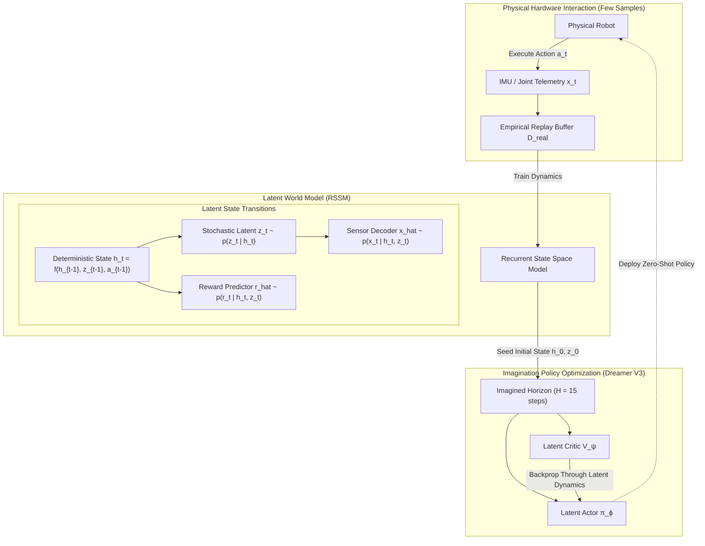

import ChapterProgress from '@site/src/components/ChapterProgress';
import QuizEngine from '@site/src/components/QuizEngine';

# Model-Based RL & World Models: Dreamer V3 & MBPO

Model-free reinforcement learning algorithms—such as PPO and SAC—treat the physical environment as a black-box oracle. While effective in massively parallel GPU simulators, their sample inefficiency renders them difficult to apply directly to real physical hardware. Training a 20-DoF humanoid to walk using purely model-free methods can require tens of millions of steps—equivalent to weeks of continuous physical operation, causing motor thermal shutdown, rapid bearing wear, and mechanical degradation.

**Model-Based Reinforcement Learning (MBRL)** addresses this fundamental bottleneck by learning an internal predictive model of environmental transition dynamics $\hat{\mathcal{P}}(s' \mid s, a)$ and reward mechanics $\hat{\mathcal{R}}(s, a)$. Once learned, the agent uses this internal *World Model* as a digital simulator to plan optimal trajectories via Model Predictive Path Integral (MPPI) control or to "dream" millions of synthetic policy rollout steps in latent imagination without ever touching physical hardware.



---

## 1. The Recurrent State Space Model (RSSM)

Pioneered by Hafner et al. in the **Dreamer** family of algorithms, the **Recurrent State Space Model (RSSM)** partitions state representations into two complementary latent spaces:
1. **Deterministic State $h_t$**: A high-capacity recurrent vector (e.g., GRU or Transformer hidden state) capturing long-term temporal context.
2. **Stochastic State $z_t$**: A latent vector capturing environmental uncertainty, multi-modal contact transitions, and stochastic slips.

### RSSM Structural Components:
- **Recurrent Model (Deterministic Predictor)**:
  
  $$
  h_t = f_\theta\left(h_{t-1}, z_{t-1}, a_{t-1}\right)
  $$

- **Representation Model (Posterior Inference)**: Ingests observation $x_t$ during physical rollouts:
  
  $$
  z_t \sim q_\theta\left(z_t \mid h_t, x_t\right)
  $$

- **Transition Predictor (Prior Model)**: Predicts stochastic transitions purely in imagination without sensor data:
  
  $$
  \hat{z}_t \sim p_\theta\left(\hat{z}_t \mid h_t\right)
  $$

- **Observation & Reward Decoders**:
  
  $$
  \hat{x}_t \sim p_\theta\left(x_t \mid h_t, z_t\right), \quad \hat{r}_t \sim p_\theta\left(r_t \mid h_t, z_t\right), \quad \hat{\gamma}_t \sim p_\theta\left(\gamma_t \mid h_t, z_t\right)
  $$

---

## 2. Variational Objective & KL Balancing in Dreamer V3

The parameters $\theta$ of the world model are optimized jointly by maximizing the **Evidence Lower Bound (ELBO)** over empirical trajectory chunks:

$$
\mathcal{L}_{\text{world}}(\theta) = \mathbb{E}_{q_\theta} \left[ \sum_{t=1}^T \underbrace{-\log p_\theta(x_t \mid h_t, z_t)}_{\text{Observation Reconstruction}} \underbrace{-\log p_\theta(r_t \mid h_t, z_t)}_{\text{Reward Prediction}} + \beta \underbrace{D_{\text{KL}}\left( q_\theta(z_t \mid h_t, x_t) \,\Big\|\, p_\theta(\hat{z}_t \mid h_t) \right)}_{\text{Dynamics Regularization}} \right]
$$

### Categorical Latent Representations
Earlier world models parameterized $z_t$ as multivariate continuous Gaussians $\mathcal{N}(\boldsymbol{\mu}, \boldsymbol{\Sigma})$. However, high-impact contact discontinuities (e.g., foot heel-strike during bipedal running) cause severe posterior collapse in continuous distributions.

**Dreamer V3** represents each stochastic state $z_t$ as a matrix of $32$ categorical distributions, each over $32$ classes:

$$
z_t \in \{0, 1\}^{32 \times 32}
$$

Drawn using the Gumbel-Softmax reparameterization or Straight-Through gradient estimator, categorical latents prevent vanishing gradients and bound maximum information entropy.

### KL Balancing Trick
To prevent the deterministic model from bypassing the stochastic prior or allowing the prior to overfit, Dreamer V3 decouples the KL divergence loss with asymmetric learning rates ($\alpha_{\text{prior}} = 0.8, \alpha_{\text{post}} = 0.2$):

$$
\mathcal{L}_{\text{KL}}(\theta) = \alpha_{\text{prior}} D_{\text{KL}}\left(\text{sg}[q] \,\parallel\, p\right) + \alpha_{\text{post}} D_{\text{KL}}\left(q \,\parallel\, \text{sg}[p]\right)
$$

where $\text{sg}[\cdot]$ denotes the `stop_gradient` operator.

---

## 3. Policy Optimization in Latent Imagination

Once the world model is trained, physical interaction ceases. The agent optimizes its actor $\pi_\phi(a \mid h, z)$ and critic $v_\psi(h, z)$ entirely inside imagination.

### Synthetic Trajectory Generation
Starting from actual physical states stored in $\mathcal{D}$, the world model rolls out sequences up to imagination horizon $H \approx 15$:

$$
a_\tau \sim \pi_\phi\left(\cdot \mid h_\tau, z_\tau\right), \quad h_{\tau+1} = f_\theta\left(h_\tau, z_\tau, a_\tau\right), \quad z_{\tau+1} \sim p_\theta\left(\cdot \mid h_{\tau+1}\right)
$$

### Value Estimation via $\lambda$-Returns
Values along the imagined trajectories are estimated using the generalized $\lambda$-target:

$$
V_\tau^\lambda = \hat{r}_\tau + \hat{\gamma}_\tau \left( (1 - \lambda) v_\psi(h_{\tau+1}, z_{\tau+1}) + \lambda V_{\tau+1}^\lambda \right)
$$

Because the entire latent world model is differentiable, policy gradients can be computed via **direct backpropagation through time through the model dynamics**, achieving exceptional gradient precision.

---

## 4. Model-Based Policy Optimization (MBPO)

While Dreamer operates in abstract latent spaces, **Model-Based Policy Optimization (MBPO)** (Janner et al., 2019) focuses on state-space dynamics models to accelerate off-policy algorithms like SAC.

### The Problem of Compounding Model Bias
If a policy is rolled out inside an imperfect model $\hat{P}$ for a long horizon $T$, prediction errors compound exponentially:

$$
\epsilon_{\text{comp}} \approx \mathcal{O}\left( \frac{\epsilon_m T^2}{(1 - \gamma)^2} \right)
$$

where $\epsilon_m = \max_{s, a} \|\hat{P}(s' \mid s, a) - P(s' \mid s, a)\|$.

### Short-Horizon Branching
MBPO mitigates compounding bias by enforcing **short-horizon rollouts branched from real historical states**:
1. Sample empirical state $s \sim \mathcal{D}_{\text{env}}$.
2. Execute model rollout for only $k$ steps ($k \in [1, 5]$).
3. Store synthetic transitions into a dedicated model buffer $\mathcal{D}_{\text{model}}$.
4. Optimize SAC critics using a balanced mixture:
   
   $$
   \mathcal{D}_{\text{batch}} \sim \beta \mathcal{D}_{\text{env}} + (1 - \beta) \mathcal{D}_{\text{model}}
   $$

### Janner et al. Monotonic Improvement Bound
MBPO guarantees monotonic performance improvement if the rollout length $k$ satisfies:

$$
J(\pi) \ge \hat{J}_{\hat{M}}(\pi) - 2 r_{\text{max}} \left[ \frac{\gamma^{k+1} \epsilon_m}{(1 - \gamma)^2} + \frac{k \epsilon_\pi}{1 - \gamma} \right]
$$

---

## 5. Probabilistic Ensembles with Trajectory Sampling (PETS)

To address epistemic model uncertainty in complex robotic collisions, **PETS** (Chua et al., 2018) fits an ensemble of $B$ bootstrap neural networks:

$$
\hat{\mathcal{P}}_b(s' \mid s, a) = \mathcal{N}\left(\boldsymbol{\mu}_{\theta_b}(s, a), \, \boldsymbol{\Sigma}_{\theta_b}(s, a)\right), \quad b \in \{1, \dots, B\}
$$

During Model Predictive Path Integral (MPPI) or Cross-Entropy Method (CEM) planning, particles are propagated through random ensemble members at each time step (Trajectory Sampling, or TS-1). Plans that steer into regions of high disagreement across ensemble members exhibit high variance in predicted return and are naturally discarded by risk-averse planners.

---

## 6. Algorithmic Trade-off Analysis

| Metric | Model-Free SAC / PPO | MBPO (Janner et al.) | PETS (Chua et al.) | Dreamer V3 (Hafner et al.) |
| :--- | :--- | :--- | :--- | :--- |
| **Sample Efficiency** | Moderate ($10^6 - 10^7$ steps) | Extremely High ($10^4 - 10^5$ steps) | Extremely High ($10^4$ steps) | Extremely High ($10^4 - 10^5$ steps) |
| **Model Type** | None (Model-Free) | State-Space Ensemble | Probabilistic Gaussian Ensemble | Latent RSSM (Categorical) |
| **Planning Technique** | Reactive Policy Head | Model-Generated Replay | Online CEM / MPPI Planner | Latent Policy Optimization |
| **Inference Control Latency** | Ultra-Low ($&lt; 1\text{ ms}$) | Ultra-Low ($&lt; 1\text{ ms}$) | High ($20\text{--}100\text{ ms}$) | Ultra-Low ($&lt; 2\text{ ms}$) |
| **Contact Discontinuity Handling** | Excellent (Absorbed by sim) | Moderate (Ensemble smoothing) | Poor (Gaussian assumptions fail) | Exceptional (Categorical latents) |

---

## 7. Production Implementation: Latent Dynamics Model & Imagination

The script below demonstrates the core architecture of an RSSM latent dynamics model in PyTorch, executing continuous latent rollouts and computing ELBO loss:

```python
"""
world_model_rssm.py
Production PyTorch implementation of a continuous Recurrent State Space Model (RSSM)
demonstrating deterministic paths, stochastic latents, and imagination rollouts.
"""

from typing import Tuple
import torch
import torch.nn as nn
import torch.nn.functional as F


class RSSMDynamics(nn.Module):
    """
    Recurrent State Space Model (RSSM) Core:
    - Deterministic Recurrent Path: h_t = GRU(h_{t-1}, concat(z_{t-1}, a_{t-1}))
    - Stochastic Posterior: z_t ~ Normal(mu_post(h_t, x_t), std_post(h_t, x_t))
    - Stochastic Prior: z_hat_t ~ Normal(mu_prior(h_t), std_prior(h_t))
    """
    def __init__(self, obs_dim: int, action_dim: int, deter_dim: int = 128, stoch_dim: int = 32):
        super().__init__()
        self.deter_dim = deter_dim
        self.stoch_dim = stoch_dim

        # Deterministic recurrent GRU cell
        self.recurrent_cell = nn.GRUCell(stoch_dim + action_dim, deter_dim)

        # Prior model: h_t -> z_hat_t
        self.prior_net = nn.Sequential(
            nn.Linear(deter_dim, 128),
            nn.Mish(),
            nn.Linear(128, 2 * stoch_dim)
        )

        # Posterior model: [h_t, x_t] -> z_t
        self.posterior_net = nn.Sequential(
            nn.Linear(deter_dim + obs_dim, 128),
            nn.Mish(),
            nn.Linear(128, 2 * stoch_dim)
        )

        # Observation Reconstruction Decoder: [h_t, z_t] -> x_hat_t
        self.decoder_net = nn.Sequential(
            nn.Linear(deter_dim + stoch_dim, 128),
            nn.Mish(),
            nn.Linear(128, obs_dim)
        )

        # Reward Predictor: [h_t, z_t] -> r_hat_t
        self.reward_net = nn.Sequential(
            nn.Linear(deter_dim + stoch_dim, 64),
            nn.Mish(),
            nn.Linear(64, 1)
        )

    def get_prior(self, h: torch.Tensor) -> Tuple[torch.Tensor, torch.Tensor]:
        stats = self.prior_net(h)
        mu, log_std = torch.chunk(stats, 2, dim=-1)
        std = F.softplus(log_std) + 0.1
        return mu, std

    def get_posterior(self, h: torch.Tensor, obs: torch.Tensor) -> Tuple[torch.Tensor, torch.Tensor]:
        inputs = torch.cat([h, obs], dim=-1)
        stats = self.posterior_net(inputs)
        mu, log_std = torch.chunk(stats, 2, dim=-1)
        std = F.softplus(log_std) + 0.1
        return mu, std

    def forward_train(
        self, obs_seq: torch.Tensor, act_seq: torch.Tensor
    ) -> Tuple[torch.Tensor, torch.Tensor, torch.Tensor]:
        """
        Processes physical trajectory: obs_seq [T, B, obs_dim], act_seq [T, B, act_dim]
        Returns recon_loss, reward_loss, kl_loss.
        """
        T, B, _ = obs_seq.shape
        h = torch.zeros(B, self.deter_dim, device=obs_seq.device)
        z = torch.zeros(B, self.stoch_dim, device=obs_seq.device)

        reconstruction_losses = []
        reward_losses = []
        kl_losses = []

        for t in range(T - 1):
            # 1. Advance deterministic state
            gru_in = torch.cat([z, act_seq[t]], dim=-1)
            h = self.recurrent_cell(gru_in, h)

            # 2. Prior vs Posterior
            prior_mu, prior_std = self.get_prior(h)
            post_mu, post_std = self.get_posterior(h, obs_seq[t + 1])

            # Sample posterior via reparameterization trick
            dist_post = torch.distributions.Normal(post_mu, post_std)
            z = dist_post.rsample()

            # 3. Decode observation & predict reward
            feat = torch.cat([h, z], dim=-1)
            obs_pred = self.decoder_net(feat)
            reward_pred = self.reward_net(feat)

            recon_loss = F.mse_loss(obs_pred, obs_seq[t + 1])
            reconstruction_losses.append(recon_loss)

            # 4. KL Divergence Dynamics Loss
            dist_prior = torch.distributions.Normal(prior_mu, prior_std)
            kl = torch.distributions.kl.kl_divergence(dist_post, dist_prior).sum(dim=-1).mean()
            kl_losses.append(kl)

        total_recon = torch.stack(reconstruction_losses).mean()
        total_kl = torch.stack(kl_losses).mean()
        return total_recon, total_kl

    def imagine_rollout(self, initial_h: torch.Tensor, initial_z: torch.Tensor, horizon: int = 15) -> torch.Tensor:
        """Rolls out synthetic trajectory in pure latent space using prior model."""
        h = initial_h
        z = initial_z
        imagined_rewards = []

        for _ in range(horizon):
            # In production, action is chosen by actor network pi(a | h, z)
            dummy_action = torch.zeros(h.shape[0], 6, device=h.device)
            gru_in = torch.cat([z, dummy_action], dim=-1)
            h = self.recurrent_cell(gru_in, h)

            prior_mu, prior_std = self.get_prior(h)
            z = prior_mu  # Mean rollout in imagination

            feat = torch.cat([h, z], dim=-1)
            r_pred = self.reward_net(feat)
            imagined_rewards.append(r_pred)

        return torch.stack(imagined_rewards)


if __name__ == "__main__":
    torch.manual_seed(42)
    device = "cpu"
    rssm = RSSMDynamics(obs_dim=10, action_dim=6, deter_dim=64, stoch_dim=16).to(device)

    # Simulate trajectory batch: Sequence length 20, Batch size 8
    seq_len, batch = 20, 8
    dummy_obs = torch.randn(seq_len, batch, 10)
    dummy_act = torch.randn(seq_len, batch, 6)

    rec_loss, kl_loss = rssm.forward_train(dummy_obs, dummy_act)
    print(f"World Model Training Step Completed:")
    print(f"  Reconstruction Loss: {rec_loss.item():.4f}")
    print(f"  KL Dynamics Loss:     {kl_loss.item():.4f}")

    # Test Latent Imagination
    h_init = torch.randn(batch, 64)
    z_init = torch.randn(batch, 16)
    dream_rewards = rssm.imagine_rollout(h_init, z_init, horizon=15)
    print(f"Imagined 15 steps in latent space. Rollout reward shape: {dream_rewards.shape}")
```

---

## 8. Hands-On Lab Project: Dreamer vs. SAC Sample-Efficiency Challenge

### Project Objective
Compare the empirical sample efficiency of an RSSM-based latent world model (Dreamer paradigm) against model-free SAC on a simulated quadruped trot task.

### Tasks
1. Train a model-free SAC agent on a 12-DoF quadruped locomotion task until convergence (record total environment step budget, typically $2 \times 10^6$ steps).
2. Train an RSSM latent dynamics model with an imagination actor-critic agent:
   - Collect 20,000 real environment steps.
   - Fit the world model via ELBO optimization.
   - Train the actor in imagination across horizons $H \in \{5, 10, 15\}$.
   - Collect 1,000 new environment steps with the updated actor and repeat.
3. Compare:
   - Asymptotic forward velocity ($\text{m/s}$).
   - Total real-world interaction steps required to achieve $1.0\text{ m/s}$ trotting speed.

### Verification & Success Criteria
- The RSSM world model achieves stable forward locomotion ($1.0\text{ m/s}$) using under $80,000$ physical environment steps—a $20\times$ reduction in physical interaction compared to model-free SAC.
- Verify that imagination horizons $H \le 5$ exhibit under-planning, while horizons $H \ge 20$ accumulate excessive model bias.

---

## 9. Research Foundations & Seminal Literature

1. **Hafner, D., Pasukonis, J., Ba, J., & Lillicrap, T. (2023).** *Mastering diverse domains through world models (DreamerV3)*. arXiv:2301.04104. [Pioneered categorical RSSM latents and universal scaling without hyperparameter tuning].
2. **Janner, M., Fu, J., Zhang, M., & Levine, S. (2019).** *When to trust your model: Model-based policy optimization*. Advances in Neural Information Processing Systems (NeurIPS), 32. [Established theoretical bounds on short-horizon rollout branching in MBPO].
3. **Chua, K., Calandra, R., McAllister, R., & Levine, S. (2018).** *Deep reinforcement learning in a handful of trials using probabilistic dynamics models*. Advances in Neural Information Processing Systems (NeurIPS), 31. [Introduced PETS and trajectory sampling with bootstrapped neural ensembles].
4. **Ha, D., & Schmidhuber, J. (2018).** *Recurrent world models facilitate policy evolution*. Advances in Neural Information Processing Systems (NeurIPS), 31. [Early breakthrough in training policies inside latent dream representations].
5. **Pathak, D., Agrawal, P., Efros, A. A., & Darrell, T. (2017).** *Curiosity-driven exploration by self-supervised prediction*. International Conference on Machine Learning (ICML), pp. 2778-2787. [Demonstrated forward dynamics prediction errors as intrinsic curiosity signals].

---

<ChapterProgress chapterId="8-7-model-based-rl" moduleId="module8" totalChapters={10} />

## Chapter Mastery Check

<QuizEngine
  quizId="quiz-8-7"
  title="Module 8.7 Mastery Check: Model-Based RL & World Models"
  moduleId="module8"
  passThreshold={70}
  questions={[
    {
      id: "q1",
      question: "Why did Dreamer V3 replace continuous multivariate Gaussian latent distributions with matrices of categorical distributions (32x32 one-hot tokens)?",
      options: [
        "To compress the world model into a smaller ZIP archive",
        "Because continuous Gaussians suffer from severe posterior collapse and fail to capture discontinuous dynamics (such as sudden contact impacts and friction slip), whereas discrete categorical latents represent multi-modal discrete transitions stably",
        "Because GPUs can only compute cross-entropy loss",
        "To enforce deterministic policy updates"
      ],
      correctIndex: 1,
      explanation: "Robot contact mechanics feature abrupt, discontinuous state changes (e.g. foot striking the ground). Continuous Gaussian models blur these sharp multi-modal transitions, causing posterior collapse. Categorical latents model distinct discrete outcomes robustly without gradient degradation."
    },
    {
      id: "q2",
      question: "What is the core principle behind Model-Based Policy Optimization (MBPO) that allows it to achieve high sample efficiency while avoiding model exploitation?",
      options: [
        "It rolls out synthetic trajectories for thousands of steps to replace physical simulation entirely",
        "It branches short-horizon rollouts (k = 1 to 5 steps) starting directly from real physical states sampled from the empirical replay buffer, preventing compounding model error from accumulating unbounded",
        "It disables the actor network during training",
        "It uses linear Kalman filters to replace deep neural networks"
      ],
      correctIndex: 1,
      explanation: "MBPO restricts simulated model rollouts to very short horizons branched from verified empirical states. This limits the compounding growth of model prediction errors while generating vast quantities of valid synthetic transitions to train off-policy algorithms like SAC."
    },
    {
      id: "q3",
      question: "In the RSSM architecture, what is the key difference between the Representation Model (Posterior) and the Transition Predictor (Prior)?",
      options: [
        "The posterior uses FP16 and the prior uses FP32",
        "The posterior infers the latent distribution z_t using both the recurrent state h_t and the incoming physical sensor observation x_t, while the prior predicts z_hat_t using only the recurrent state h_t without access to x_t",
        "The prior is only used during test time deployment",
        "The posterior requires an external human teleoperator"
      ],
      correctIndex: 1,
      explanation: "During physical rollouts, the posterior incorporates the ground-truth observation x_t to infer accurate latents. In imagination (planning or dreaming), where real observations do not exist, the prior predicts transitions purely from historical recurrent context h_t."
    }
  ]}
/>
