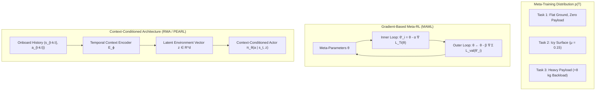
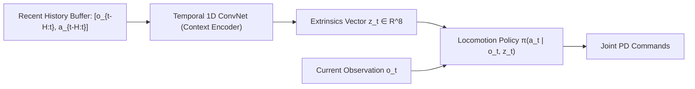

import ChapterProgress from '@site/src/components/ChapterProgress';
import QuizEngine from '@site/src/components/QuizEngine';

# Multi-Task & Meta-Reinforcement Learning: MAML to Context Policies

Standard reinforcement learning trains a policy to solve a single, narrowly defined task in a fixed environment. An autonomous humanoid trained exclusively to walk on dry linoleum floors with an empty backpack will stumble when placed on ice or when suddenly handed a 10-kilogram payload. Requiring thousands of fresh gradient updates whenever environmental parameters shift is unacceptable for real-world autonomy.

**Multi-Task and Meta-Reinforcement Learning** establish general-purpose robotic agents. Multi-Task RL trains a single shared neural architecture to master dozens of distinct manipulation and locomotion skills simultaneously. Meta-Reinforcement Learning ("learning to learn") optimizes policies to rapidly adapt to unseen tasks, variable payloads, and changing friction regimes within a handful of interaction steps—or entirely in-context through recurrent memory activations.



---

## 1. Multi-Task Reinforcement Learning (MTRL)

In Multi-Task RL, an embodied agent is exposed to a family of tasks drawn from a distribution:

$$
\mathcal{T}_i = \left(\mathcal{S}, \mathcal{A}, \mathcal{P}_i, \mathcal{R}_i, \gamma\right) \sim p(\mathcal{T})
$$

The overall multi-task objective maximizes expected return across all tasks:

$$
J_{\text{multi}}(\theta) = \sum_{i=1}^M \mathbb{E}_{\tau \sim \pi_\theta(\cdot \mid \cdot, \mathbf{c}_i)} \left[ R_{\mathcal{T}_i}(\tau) \right]
$$

where $\mathbf{c}_i$ is a task conditioning signal (e.g., a one-hot task identifier, natural language instruction embedding, or goal configuration).

### Negative Transfer & Gradient Interference
When training a single neural network across diverse tasks, gradients from different tasks often conflict:

$$
\mathbf{g}_i = \nabla_\theta \mathcal{L}_{\mathcal{T}_i}(\theta), \quad \mathbf{g}_j = \nabla_\theta \mathcal{L}_{\mathcal{T}_j}(\theta)
$$

If the inner product is negative ($\mathbf{g}_i \cdot \mathbf{g}_j &lt; 0$), updating along $\mathbf{g}_i$ actively degrades performance on task $\mathcal{T}_j$.

### Projecting Conflicting Gradients (PCGrad)
Yu et al. (2020) resolved gradient interference with **PCGrad**. If two task gradients conflict, $\mathbf{g}_i$ is projected onto the normal plane of $\mathbf{g}_j$:

$$
\mathbf{g}_i \leftarrow \mathbf{g}_i - \frac{\mathbf{g}_i \cdot \mathbf{g}_j}{\|\mathbf{g}_j\|^2} \mathbf{g}_j \quad \text{if } \mathbf{g}_i \cdot \mathbf{g}_j &lt; 0
$$

This prevents destructive cross-task interference, enabling shared representation backbones to acquire multi-task dexterous skills stably.

---

## 2. Gradient-Based Meta-Learning: MAML

Introduced by Finn et al. (2017), **Model-Agnostic Meta-Learning (MAML)** optimizes policy parameters $\boldsymbol{\theta}$ such that one or a few gradient steps on a new task produce maximal performance improvement.

### Bi-Level Optimization Formulation
MAML operates across two nested optimization loops:
1. **Inner Loop (Task-Specific Adaptation)**: For each task $\mathcal{T}_i \sim p(\mathcal{T})$, the agent collects support trajectories $\mathcal{D}_i^{\text{train}}$ and takes a gradient step:
   
   $$
   \boldsymbol{\theta}_i' = \boldsymbol{\theta} - \alpha \nabla_{\boldsymbol{\theta}} \mathcal{L}_{\mathcal{T}_i}^{\text{train}}(\boldsymbol{\theta})
   $$

2. **Outer Loop (Meta-Parameter Optimization)**: Evaluates the adapted parameters $\boldsymbol{\theta}_i'$ on independent query trajectories $\mathcal{D}_i^{\text{val}}$, updating the base meta-parameters $\boldsymbol{\theta}$:
   
   $$
   \boldsymbol{\theta} \leftarrow \boldsymbol{\theta} - \beta \nabla_{\boldsymbol{\theta}} \sum_{\mathcal{T}_i \sim p(\mathcal{T})} \mathcal{L}_{\mathcal{T}_i}^{\text{val}}\left(\boldsymbol{\theta}_i'\right)
   $$

### Meta-Gradient Derivation with Hessian-Vector Products
By applying the chain rule to the outer objective:

$$
\nabla_{\boldsymbol{\theta}} \mathcal{L}_{\mathcal{T}_i}^{\text{val}}(\boldsymbol{\theta}_i') = \left( \mathbf{I} - \alpha \nabla_{\boldsymbol{\theta}}^2 \mathcal{L}_{\mathcal{T}_i}^{\text{train}}(\boldsymbol{\theta}) \right) \nabla_{\boldsymbol{\theta}_i'} \mathcal{L}_{\mathcal{T}_i}^{\text{val}}(\boldsymbol{\theta}_i')
$$

The term $\nabla_{\boldsymbol{\theta}}^2 \mathcal{L}_{\mathcal{T}_i}^{\text{train}}(\boldsymbol{\theta})$ represents the second-order Hessian matrix. While First-Order MAML (FOMAML) sets the Hessian to zero for computational speed, exact MAML evaluates this term via Pearlmutter's vector-Hessian product algorithm without materializing full $D \times D$ matrices.

---

## 3. Recurrent Meta-RL: $\text{RL}^2$

Gradient-based adaptation requires backward propagation at test time on physical robots—a computationally expensive process prone to numeric instability. **$\text{RL}^2$** (Duan et al., 2016; Wang et al., 2016) casts meta-learning as a purely recurrent sequence modeling problem.

### Emergent In-Context Learning
The policy is structured as an RNN (LSTM or GRU). Crucially, the input vector at time $t$ concatenates the current observation, previous action, previous reward, and episode termination flag:

$$
\mathbf{x}_t = \left[ s_t, \, a_{t-1}, \, r_{t-1}, \, d_{t-1} \right]
$$

$$
\mathbf{h}_t = \text{RNN}\left(\mathbf{h}_{t-1}, \, \mathbf{x}_t\right), \quad a_t \sim \pi\left(\cdot \mid \mathbf{h}_t\right)
$$

### Preservation of Hidden State Across Episodes
Unlike standard episodic RL, which resets the hidden state $\mathbf{h}_0 = \mathbf{0}$ at the end of each episode, $\text{RL}^2$ preserves the recurrent state $\mathbf{h}$ across multiple consecutive episodes (a *meta-episode*). The internal activations of the recurrent network dynamically update an implicit estimate of the task dynamics. **No test-time gradient steps are performed**; adaptation occurs purely in forward-pass activation space.

---

## 4. Context-Conditioned Policies: RMA & PEARL

For real-world bipedal and quadrupedal robots, **Rapid Motor Adaptation (RMA)** (Kumar et al., 2021) and **PEARL** (Rakelly et al., 2019) formulate task adaptation via latent context conditioning.



### Two-Phase Training Paradigm:
1. **Phase 1: Privileged Training**:
   - The policy actor $\pi(a_t \mid \mathbf{o}_t, \mathbf{z}_t)$ receives privileged simulation variables $\mathbf{e}_t$ (payload mass, surface friction, center of mass offset) encoded into an extrinsics latent vector:
     
     $$
     \mathbf{z}_t = E_{\text{priv}}(\mathbf{e}_t)
     $$

2. **Phase 2: Online Context Adaptation (Student-Teacher Distillation)**:
   - A temporal 1D convolutional network $E_{\text{adapt}}$ is trained to predict the latent vector $\mathbf{z}_t$ purely from recent historical sequences of onboard sensor measurements:
     
     $$
     \hat{\mathbf{z}}_t = E_{\text{adapt}}\left( \mathbf{o}_{t-H:t}, \, \mathbf{a}_{t-H:t} \right)
     $$
     
     via supervised reconstruction:
     
     $$
     \mathcal{L}_{\text{adapt}} = \mathbb{E}\left[ \|\mathbf{z}_t - \hat{\mathbf{z}}_t\|^2 \right]
     $$

During deployment on the physical robot, the adaptation module estimates $\hat{\mathbf{z}}_t$ at 50 Hz, continuously informing the actor of changing environmental physical parameters without explicit system identification.

---

## 5. Comparative Paradigm Analysis

| Characteristic | Single-Task Baseline | Multi-Task RL (Shared Head) | Gradient Meta-RL (MAML) | Recurrent Meta-RL ($\text{RL}^2$) | Context Policies (RMA / PEARL) |
| :--- | :--- | :--- | :--- | :--- | :--- |
| **Adaptation Speed** | None (Static) | None (Static) | 1 to 5 Gradient Steps | Immediate (Forward Pass) | Immediate (10 to 50 ms window) |
| **Test-Time Compute** | Minimal ($\mathcal{O}(1)$) | Minimal ($\mathcal{O}(1)$) | Very High (Backprop) | Minimal (RNN hidden state) | Ultra-Low (1D ConvNet) |
| **Training Complexity** | Low | High (Gradient conflicts) | Massive (Second-order Hessians) | High (BPTT across meta-episodes) | Moderate (Two-phase distillation) |
| **Generalization** | Narrow | Interpolation only | Broad (Fast adaptation) | Moderate to High | Superb (Proven on physical humanoids) |
| **Sim-to-Real Viability**| Low | Moderate | Impractical on hardware | Moderate | Gold Standard in modern locomotion |

---

## 6. Complete Implementation: Context-Conditioned Policy Architecture

The following production script implements a complete Context-Conditioned Motor Adaptation module in PyTorch, featuring a temporal 1D convolutional history encoder, extrinsics latent projection, and an adaptive continuous locomotion policy:

```python
"""
context_meta_rl.py
Complete PyTorch implementation of a Context-Conditioned Adaptive Locomotion Policy (RMA paradigm).
"""

from typing import Tuple
import torch
import torch.nn as nn
import torch.nn.functional as F


class TemporalContextEncoder(nn.Module):
    """
    Ingests recent historical observation-action buffers [Batch, History_Len, Feature_Dim]
    and outputs a low-dimensional latent environmental extrinsics vector z in R^latent_dim.
    """
    def __init__(self, feature_dim: int, history_len: int = 20, latent_dim: int = 8):
        super().__init__()
        self.conv1 = nn.Conv1d(in_channels=feature_dim, out_channels=32, kernel_size=5, stride=2)
        self.conv2 = nn.Conv1d(in_channels=32, out_channels=32, kernel_size=3, stride=2)
        
        # Calculate flattened dimension
        dummy_in = torch.zeros(1, feature_dim, history_len)
        with torch.no_grad():
            dummy_out = self.conv2(self.conv1(dummy_in))
            flattened_size = dummy_out.shape[1] * dummy_out.shape[2]

        self.fc = nn.Sequential(
            nn.Linear(flattened_size, 64),
            nn.ReLU(),
            nn.Linear(64, latent_dim)
        )

    def forward(self, history: torch.Tensor) -> torch.Tensor:
        # Expected input shape: [Batch, History_Len, Feature_Dim]
        # Transpose for 1D convolution: [Batch, Feature_Dim, History_Len]
        x = history.transpose(1, 2)
        x = F.relu(self.conv1(x))
        x = F.relu(self.conv2(x))
        x = torch.flatten(x, start_dim=1)
        z = self.fc(x)
        return z


class AdaptiveActorPolicy(nn.Module):
    """
    Context-Conditioned Continuous Actor:
    Ingests current onboard observation o_t AND latent environmental context z_t.
    """
    def __init__(self, obs_dim: int, action_dim: int, latent_dim: int = 8, hidden_dim: int = 128):
        super().__init__()
        self.net = nn.Sequential(
            nn.Linear(obs_dim + latent_dim, hidden_dim),
            nn.ELU(),
            nn.Linear(hidden_dim, hidden_dim),
            nn.ELU(),
            nn.Linear(hidden_dim, action_dim)
        )

    def forward(self, obs: torch.Tensor, latent_z: torch.Tensor) -> torch.Tensor:
        combined = torch.cat([obs, latent_z], dim=-1)
        action_mean = torch.tanh(self.net(combined))
        return action_mean


class MetaAdaptiveLocomotionSystem:
    """End-to-end evaluation harness for online motor adaptation."""
    def __init__(self, obs_dim: int = 12, action_dim: int = 6, history_len: int = 20, latent_dim: int = 8):
        self.obs_dim = obs_dim
        self.action_dim = action_dim
        self.history_len = history_len
        self.total_feature_dim = obs_dim + action_dim

        self.encoder = TemporalContextEncoder(feature_dim=self.total_feature_dim, history_len=history_len, latent_dim=latent_dim)
        self.actor = AdaptiveActorPolicy(obs_dim=obs_dim, action_dim=action_dim, latent_dim=latent_dim)

    def act_online(self, current_obs: torch.Tensor, history_buffer: torch.Tensor) -> torch.Tensor:
        """
        Executes online adaptation in real-time.
        current_obs: [Batch, obs_dim]
        history_buffer: [Batch, history_len, obs_dim + action_dim]
        """
        with torch.no_grad():
            latent_z = self.encoder(history_buffer)
            action = self.actor(current_obs, latent_z)
        return action


if __name__ == "__main__":
    torch.manual_seed(42)
    system = MetaAdaptiveLocomotionSystem(obs_dim=14, action_dim=6, history_len=25, latent_dim=8)

    # Simulate batch of 4 robots operating under unknown friction/payloads
    batch_size = 4
    current_sensors = torch.randn(batch_size, 14)
    simulated_history = torch.randn(batch_size, 25, 14 + 6)

    motor_commands = system.act_online(current_sensors, simulated_history)
    print("Online Adaptation Pass Executed Successfully.")
    print("Motor Commands Shape:", motor_commands.shape)
    print("Sample Command Tensor:\n", motor_commands[0])
```

---

## 7. Hands-On Lab Project: Real-Time Payload Adaptation Challenge

### Project Objective
Train a context-conditioned adaptive policy (RMA paradigm) on a simulated biped robot and evaluate its zero-shot recovery when sudden unexpected payloads ($0.0\text{ to }6.0\text{ kg}$) are mounted on the torso during walking.

### Tasks
1. Train an asymmetric teacher policy with privileged access to exact payload mass $m_{\text{load}}$ and friction $\mu$.
2. Train a Temporal Context Encoder to predict the latent extrinsics vector $\mathbf{z}$ using a 20-step window of joint errors and IMU accelerations.
3. Deploy the policy on a test evaluation run:
   - At $t = 5.0\text{ s}$, drop an unexpected $5.0\text{ kg}$ mass onto the robot's torso.
   - At $t = 10.0\text{ s}$, transition the surface friction from $\mu = 1.0$ (concrete) to $\mu = 0.2$ (wet ice).
4. Compare torso height tracking error ($z_{\text{error}}$) against a standard, non-adaptive baseline PPO policy.

### Verification & Success Criteria
- The non-adaptive baseline suffers knee collapse and tips over within 1.5 seconds of payload impact ($z_{\text{base}} &lt; 0.4\text{ m}$).
- The context-adaptive policy infers the disturbance within $150\text{ ms}$, increases knee extension effort, and maintains upright walking without falling.

---

## 8. Research Foundations & Seminal Literature

1. **Finn, C., Abbeel, P., & Levine, S. (2017).** *Model-agnostic meta-learning for fast adaptation of deep networks*. International Conference on Machine Learning (ICML), pp. 1126-1135. [Seminal foundation of bi-level gradient meta-learning].
2. **Duan, Y., Schulman, J., Chen, X., et al. (2016).** *RL$^2$: Fast reinforcement learning via slow reinforcement learning*. arXiv:1611.02779. [Pioneered memory-based meta-reinforcement learning in recurrent activation spaces].
3. **Kumar, N., Malik, J., & Levine, S. (2021).** *RMA: Rapid Motor Adaptation for bipedal and quadrupedal robots*. Robotics: Science and Systems (RSS). [Demonstrated real-world zero-shot locomotion adaptation via temporal context distillation].
4. **Rakelly, K., Zhou, A., Quillen, D., Finn, C., & Levine, S. (2019).** *Efficient off-policy meta-reinforcement learning via probabilistic context variables (PEARL)*. International Conference on Machine Learning (ICML), pp. 5331-5340. [Context latent conditioning with variational inference].
5. **Yu, T., Kumar, S., Gupta, A., Levine, S., Hausman, K., & Finn, C. (2020).** *Gradient surgery for multi-task learning (PCGrad)*. Advances in Neural Information Processing Systems (NeurIPS), 33, 5824-5836. [Solved negative gradient interference in multi-task learning].

---

<ChapterProgress chapterId="8-8-multi-task-and-meta-learning" moduleId="module8" totalChapters={10} />

## Chapter Mastery Check

<QuizEngine
  quizId="quiz-8-8"
  title="Module 8.8 Mastery Check: Multi-Task & Meta-Learning"
  moduleId="module8"
  passThreshold={70}
  questions={[
    {
      id: "q1",
      question: "How does the PCGrad (Projecting Conflicting Gradients) algorithm eliminate negative transfer during multi-task neural network optimization?",
      options: [
        "By setting the learning rate to zero for the harder task",
        "Whenever the dot product of two task gradients is negative (g_i . g_j < 0), it projects g_i onto the orthogonal normal plane of g_j, removing conflicting directional components before updating parameters",
        "By training distinct neural networks on separate physical servers",
        "By converting floating point weights to binary values"
      ],
      correctIndex: 1,
      explanation: "When task gradients conflict (g_i . g_j < 0), taking a step along g_i impairs performance on task j. PCGrad projects g_i onto the hyperplane orthogonal to g_j, ensuring that gradient updates never degrade other concurrent tasks."
    },
    {
      id: "q2",
      question: "In the Rapid Motor Adaptation (RMA) framework, why does the physical robot adapt online without performing backpropagation or gradient updates on hardware?",
      options: [
        "Because backpropagation is mathematically prohibited by IEEE standards",
        "Because a temporal 1D convolutional network predicts the environmental latent vector z directly from a sliding window of past onboard observations and actions in a single forward pass",
        "Because the physical robot is hardwired to a mainframe via fiber optic cable",
        "Because the robot only operates on pre-mapped indoor environments"
      ],
      correctIndex: 1,
      explanation: "RMA avoids test-time backpropagation entirely. A temporal context encoder processes recent joint states and IMU readings to infer environmental properties (friction, payload) directly in its forward pass, passing the latent vector to the policy actor at 50 Hz."
    },
    {
      id: "q3",
      question: "What is the key structural requirement that allows RL^2 to learn an implicit meta-reinforcement learning algorithm inside its recurrent memory?",
      options: [
        "It must use a discrete action space",
        "The recurrent hidden state h must be preserved across consecutive task episodes within a meta-episode, while input vectors explicitly include the previous action a_{t-1}, previous reward r_{t-1}, and termination flag d_{t-1}",
        "It must reset all network weights to zero after each step",
        "It requires a physical teleoperator to demonstrate every trajectory"
      ],
      correctIndex: 1,
      explanation: "RL^2 feeds previous actions, rewards, and done flags into an RNN whose hidden state persists across episode boundaries during a trial. This allows the recurrent dynamics to update internal state representations, effectively executing a learning algorithm entirely within activation memory."
    }
  ]}
/>
