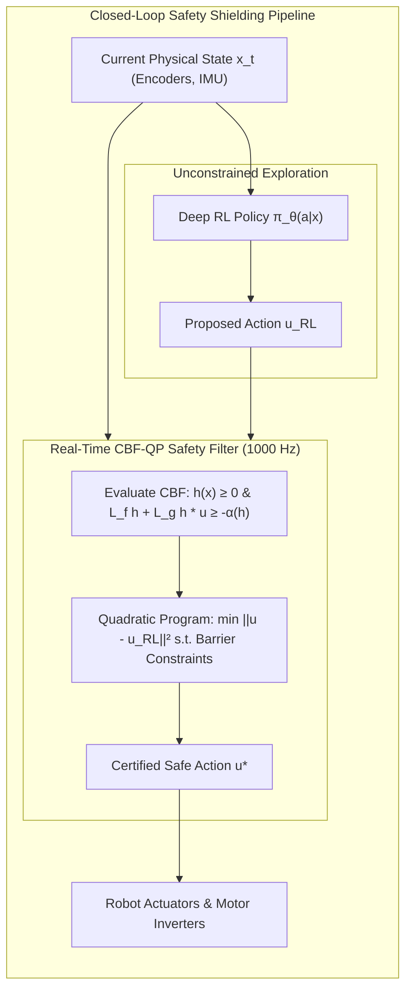

import ChapterProgress from '@site/src/components/ChapterProgress';
import QuizEngine from '@site/src/components/QuizEngine';

# Safe Reinforcement Learning & Control Barrier Functions

In virtual simulations, trial-and-error exploration carries zero consequence. An agent exploring an extreme gait can fall thousands of times while policy gradient algorithms search for optimal coordination. On physical robotic hardware, however, unconstrained exploration is catastrophic. A bipedal robot driving its knee joint past mechanical limits can shear titanium pins, burn out brushless motor drivers, or topple into human coworkers.

Simply penalizing unsafe behaviors via negative rewards (e.g., adding $-100$ upon falling) fails to provide safety guarantees. A neural policy maximizing expected return will still violate constraints if the cumulative reward of a risky trajectory outweighs the penalty, or simply during exploratory excursions before the penalty is discovered. **Safe Reinforcement Learning** formalizes strict mathematical safety guarantees using **Constrained Markov Decision Processes (CMDPs)**, Lagrangian duality, and real-time **Control Barrier Functions (CBFs)** that act as deterministic safety shields.



---

## 1. Constrained Markov Decision Processes (CMDPs)

An embodied robot subject to safety limits is modeled as a Constrained MDP:

$$
\mathcal{M}_{\text{safe}} = \left(\mathcal{S}, \mathcal{A}, \mathcal{P}, \mathcal{R}, \mathcal{C}_1, \dots, \mathcal{C}_K, \gamma\right)
$$

where $\mathcal{C}_k(s, a) \ge 0$ represents the immediate cost of violating the $k$-th safety constraint (e.g., joint torque limits, foot impact force ceilings, or torso tilt angles).

### The CMDP Optimization Problem
The objective is to maximize expected task return while bounding the cumulative discounted constraint costs below strict thresholds $d_k$:

$$
\max_\pi J_R(\pi) = \mathbb{E}_\pi \left[ \sum_{t=0}^\infty \gamma^t R(s_t, a_t) \right] \quad \text{s.t.} \quad J_{C_k}(\pi) = \mathbb{E}_\pi \left[ \sum_{t=0}^\infty \gamma^t \mathcal{C}_k(s_t, a_t) \right] \le d_k, \quad \forall k \in \{1, \dots, K\}
$$

---

## 2. Lagrangian Dual Relaxation & Primal-Dual Policy Gradients

The constrained optimization problem is converted into an unconstrained saddle-point minimax problem via the Lagrangian function:

$$
\mathcal{L}(\pi, \boldsymbol{\lambda}) = J_R(\pi) - \sum_{k=1}^K \lambda_k \left( J_{C_k}(\pi) - d_k \right)
$$

where $\boldsymbol{\lambda} = [\lambda_1, \dots, \lambda_K]^T \ge \mathbf{0}$ are the non-negative Lagrange multipliers.

### Minimax Dual Problem
By strong duality (which holds for randomized policies over finite CMDPs):

$$
\max_\pi \min_{\boldsymbol{\lambda} \ge \mathbf{0}} \mathcal{L}(\pi, \boldsymbol{\lambda}) = \min_{\boldsymbol{\lambda} \ge \mathbf{0}} \max_\pi \mathcal{L}(\pi, \boldsymbol{\lambda})
$$

### Two-Timescale Primal-Dual Gradient Updates
In practice (e.g., PPO-Lagrangian), the policy parameters $\theta$ and multipliers $\lambda$ are updated concurrently:

1. **Primal Step (Policy Update)**:
   
   $$
   \theta \leftarrow \theta + \alpha_\theta \nabla_\theta \left( J_R(\pi_\theta) - \sum_{k=1}^K \lambda_k J_{C_k}(\pi_\theta) \right)
   $$

2. **Dual Step (Constraint Multiplier Adjustment)**:
   
   $$
   \lambda_k \leftarrow \max\left(0, \, \lambda_k + \alpha_\lambda \left( J_{C_k}(\pi_\theta) - d_k \right)\right)
   $$

When the robot violates constraint $k$ ($J_{C_k} &gt; d_k$), multiplier $\lambda_k$ increases, penalizing unsafe actions during subsequent policy iterations. When the policy operates securely within budget ($J_{C_k} &lt; d_k$), $\lambda_k$ decays to zero.

---

## 3. Constrained Policy Optimization (CPO)

While Lagrangian relaxation adjusts penalties asymptotically, it offers no guarantees against catastrophic constraint violations during intermediate training steps. **Constrained Policy Optimization (CPO)** (Achiam et al., 2017) guarantees theoretical step-by-step constraint satisfaction.

### Analytical Quadratic Programming
CPO computes second-order Taylor expansions of the objective and linearizes the constraints within a local trust region:

$$
\max_\theta \mathbf{g}^T (\theta - \theta_k) \quad \text{s.t.} \quad \frac{1}{2}(\theta - \theta_k)^T \mathbf{H}(\theta - \theta_k) \le \delta, \quad J_{C_k}(\theta_k) + \mathbf{b}_k^T (\theta - \theta_k) \le d_k
$$

where $\mathbf{g} = \nabla_\theta J_R$, $\mathbf{H} = \nabla_\theta^2 D_{\text{KL}}(\pi_{\theta_k} \parallel \pi_\theta)$ is the Fisher Information Matrix, and $\mathbf{b}_k = \nabla_\theta J_{C_k}$. CPO derives a closed-form dual solution to this quadratic program, guaranteeing that every gradient step maintains safety.

---

## 4. Control Barrier Functions (CBFs) & Forward Invariance

While CMDP algorithms bound average cumulative constraint costs over infinite horizons, physical robotics requires **instantaneous, deterministic safety**. A biped must never exceed its maximum joint angle at any millisecond of its trajectory.

```mermaid
flowchart TD
    subgraph StateSpace["State Space Partition X"]
        SafeSet["Safe Set C = {x | h(x) ≥ 0}"]
        Boundary["Boundary ∂C: h(x) = 0"]
        UnsafeSet["Unsafe Region: h(x) < 0 (Physical Damage)"]
        
        SafeSet --- Boundary
        Boundary --- UnsafeSet
    end

    subgraph BarrierDynamics["Control Barrier Condition"]
        Trajectory["Trajectory x(t)"] -->|Approaching Boundary| Boundary
        Boundary -->|CBF Condition: L_f h + L_g h * u ≥ -α(h)| Repulsion["Repulsive Control u* (Preserves Forward Invariance)"]
        Repulsion -.-> SafeSet
    end
```

### Definition: Safe Set & Forward Invariance
Let the robot's continuous-time control-affine dynamics be:

$$
\dot{\mathbf{x}} = \mathbf{f}(\mathbf{x}) + \mathbf{g}(\mathbf{x}) \mathbf{u}
$$

Define a safe set $\mathcal{C}$ as the superlevel set of a continuously differentiable function $h: \mathcal{X} \rightarrow \mathbb{R}$:

$$
\mathcal{C} = \left\{ \mathbf{x} \in \mathcal{X} \;\middle|\; h(\mathbf{x}) \ge 0 \right\}, \quad \partial \mathcal{C} = \left\{ \mathbf{x} \in \mathcal{X} \;\middle|\; h(\mathbf{x}) = 0 \right\}
$$

The set $\mathcal{C}$ is **forward invariant** if for every initial state $\mathbf{x}(0) \in \mathcal{C}$, the trajectory remains within the set for all time: $\mathbf{x}(t) \in \mathcal{C}, \forall t \ge 0$.

### Control Barrier Function Condition (Ames et al., 2019)
The function $h(\mathbf{x})$ is a Control Barrier Function if there exists an extended class $\mathcal{K}_\infty$ function $\alpha$ such that for all $\mathbf{x} \in \mathcal{C}$:

$$
\sup_{\mathbf{u} \in \mathcal{U}} \left[ L_f h(\mathbf{x}) + L_g h(\mathbf{x}) \mathbf{u} \right] \ge -\alpha(h(\mathbf{x}))
$$

where $L_f h(\mathbf{x}) = \nabla h(\mathbf{x}) \cdot \mathbf{f}(\mathbf{x})$ and $L_g h(\mathbf{x}) = \nabla h(\mathbf{x}) \cdot \mathbf{g}(\mathbf{x})$ denote the Lie derivatives along vector fields $\mathbf{f}$ and $\mathbf{g}$.

---

## 5. Real-Time CBF-QP Safety Shields

In modern robotic learning, the neural network policy $\pi_\theta(\mathbf{a} \mid \mathbf{x})$ is decoupled from safety enforcement. The neural policy is permitted to explore freely, while a deterministic **CBF Quadratic Program (CBF-QP)** filter sits between the policy and physical motor drives:

$$
\mathbf{u}^*(\mathbf{x}) = \arg\min_{\mathbf{u} \in \mathcal{U}} \frac{1}{2} \|\mathbf{u} - \mathbf{u}_{\text{RL}}\|^2
$$

$$
\text{subject to} \quad L_f h_i(\mathbf{x}) + L_g h_i(\mathbf{x}) \mathbf{u} \ge -\gamma_i h_i(\mathbf{x}), \quad \forall i \in \{1, \dots, M\}
$$

$$
\mathbf{u}_{\min} \le \mathbf{u} \le \mathbf{u}_{\max}
$$

### Operational Behavior:
- **If $\mathbf{u}_{\text{RL}}$ is safe**: The constraints are satisfied trivially. The QP outputs $\mathbf{u}^* = \mathbf{u}_{\text{RL}}$ with zero modification.
- **If $\mathbf{u}_{\text{RL}}$ endangers safety**: The QP minimally modifies the action, projecting $\mathbf{u}^*$ onto the boundary of the admissible control space to guarantee forward invariance.
- **Execution Speed**: Because the constraints are linear with respect to $\mathbf{u}$, the QP can be solved via OSQP or qpOASES in under $100\,\mu\text{s}$ at 1,000 Hz.

---

## 6. Safety Methodologies Comparison

| Approach | Safety Guarantee | Point of Enforcement | Real-Time Latency | Exploration Efficiency | Failure Mode |
| :--- | :--- | :--- | :--- | :--- | :--- |
| **Negative Reward Shaping** | Soft (Heuristic only) | During RL training | Zero ($&lt; 0.1\text{ ms}$) | High (Unconstrained) | Reward hacking; ignores constraints if reward is high |
| **PPO-Lagrangian** | Asymptotic Mean ($J_C \le d$) | Policy update steps | Zero ($&lt; 0.1\text{ ms}$) | Moderate | Severe violations occur early in training |
| **CPO (Achiam et al.)** | Step-by-Step Expectation | Policy gradient step | Zero ($&lt; 0.1\text{ ms}$) | Moderate | Quadratic approximation infeasibility |
| **CBF-QP Safety Shield** | **Hard Deterministic ($x(t) \in \mathcal{C}$)** | **Real-Time Control Loop** | Low ($0.1\text{--}0.5\text{ ms}$) | Maximum (Shield prevents damage) | Infeasible QP if relative degree $> 1$ or conflicting CBFs |

---

## 7. Complete Implementation: Real-Time CBF-QP Safety Shield

The production script below implements an online Control Barrier Function Quadratic Program filter in Python, clamping risky neural network joint velocity commands to prevent knee hyperextension and torso tipping:

```python
"""
cbf_qp_safety_shield.py
Production real-time Control Barrier Function Quadratic Program (CBF-QP) filter
for robotic joint limits and posture stabilization.
"""

from typing import Tuple
import numpy as np
from scipy.optimize import minimize


class BipedSafetyShieldCBF:
    """
    Enforces forward invariance on biped joint states:
    1. Knee joint hyperextension: q_knee >= q_min_knee (h1)
    2. Knee joint flexion limit:  q_knee <= q_max_knee (h2)
    3. Torso pitch limit:         |theta_pitch| <= pitch_max (h3, h4)
    """
    def __init__(
        self,
        q_min_knee: float = 0.05,     # rad (prevent mechanical lock)
        q_max_knee: float = 2.20,     # rad
        pitch_max: float = 0.35,      # rad (~20 degrees)
        gamma_cbf: float = 5.0,       # CBF convergence rate
        max_vel: float = 4.0          # rad/s max joint velocity command
    ):
        self.q_min_knee = q_min_knee
        self.q_max_knee = q_max_knee
        self.pitch_max = pitch_max
        self.gamma = gamma_cbf
        self.max_vel = max_vel

    def filter_action(
        self, current_state: np.ndarray, nominal_cmd_vel: np.ndarray
    ) -> Tuple[np.ndarray, bool]:
        """
        Solves real-time QP:
            min_u 0.5 * ||u - u_nominal||^2
            s.t.  dot{h}(x, u) >= -gamma * h(x)
                  -max_vel <= u <= max_vel
        current_state: [q_knee, theta_pitch]
        nominal_cmd_vel: [u_knee, u_pitch]
        """
        q_knee, pitch = current_state[0], current_state[1]
        u_nom = np.array(nominal_cmd_vel, dtype=np.float64)

        # 1. Evaluate Barrier Functions: h(x) >= 0
        h1 = q_knee - self.q_min_knee          # Knee lower bound
        h2 = self.q_max_knee - q_knee          # Knee upper bound
        h3 = self.pitch_max - pitch            # Pitch upper bound
        h4 = pitch - (-self.pitch_max)         # Pitch lower bound

        # 2. Objective Function: 0.5 * ||u - u_nom||^2
        def objective(u):
            return 0.5 * np.sum((u - u_nom) ** 2)

        def objective_grad(u):
            return u - u_nom

        # 3. Formulate Linear CBF Constraints:
        # dot{q_knee} = u[0] -> dot{h1} = u[0] >= -gamma * h1
        # dot{h2} = -u[0] >= -gamma * h2
        # dot{pitch} = u[1]  -> dot{h3} = -u[1] >= -gamma * h3
        # dot{h4} = u[1] >= -gamma * h4
        constraints = [
            {'type': 'ineq', 'fun': lambda u: u[0] + self.gamma * h1},
            {'type': 'ineq', 'fun': lambda u: -u[0] + self.gamma * h2},
            {'type': 'ineq', 'fun': lambda u: -u[1] + self.gamma * h3},
            {'type': 'ineq', 'fun': lambda u: u[1] + self.gamma * h4}
        ]

        bounds = [(-self.max_vel, self.max_vel), (-self.max_vel, self.max_vel)]

        # Solve QP
        res = minimize(
            objective,
            x0=u_nom,
            jac=objective_grad,
            constraints=constraints,
            bounds=bounds,
            method='SLSQP',
            options={'ftol': 1e-6, 'disp': False}
        )

        safe_action = res.x if res.success else np.clip(u_nom, -0.5, 0.5)
        shield_active = bool(np.linalg.norm(safe_action - u_nom) > 1e-3)
        return safe_action, shield_active


if __name__ == "__main__":
    shield = BipedSafetyShieldCBF(q_min_knee=0.08, q_max_knee=2.10, pitch_max=0.30, gamma_cbf=10.0)

    # Scenario 1: Benign state, safe action
    safe_state = np.array([0.8, 0.05])  # q_knee = 0.8 rad, pitch = 0.05 rad
    proposed_safe = np.array([1.2, -0.5])
    u_out, triggered = shield.filter_action(safe_state, proposed_safe)
    print(f"Scenario 1 (Benign): Filter Triggered = {triggered}, Action = {u_out}")

    # Scenario 2: Knee dangerously close to hyperextension boundary (0.08 rad)
    critical_state = np.array([0.082, 0.0])  # Only 0.002 rad from violation
    dangerous_cmd = np.array([-2.5, 0.0])   # Commanded velocity pushes further negative into hyperextension!
    u_out, triggered = shield.filter_action(critical_state, dangerous_cmd)
    print(f"Scenario 2 (Dangerous): Filter Triggered = {triggered}")
    print(f"  Proposed Dangerous Command: {dangerous_cmd[0]:.2f} rad/s")
    print(f"  Shielded Safe Command:     {u_out[0]:.4f} rad/s (Reversed / Clamped to satisfy h >= 0)")
```

---

## 8. Hands-On Lab Project: Real-Time Biped Balance Safety Shield

### Project Objective
Integrate the CBF-QP safety shield into a real-time ROS 2 node, demonstrating that an adversarial neural policy attempting to tip a humanoid over is safely overridden without interrupting balance control.

### Tasks
1. Launch a simulated biped robot in Gazebo or Isaac Sim.
2. Inject an adversarial policy $\pi_{\text{chaos}}$ that commands random maximal joint torques ($\pm 150\text{ N}\cdot\text{m}$) every $0.5\text{ s}$.
3. Intercept all policy commands with a 1,000 Hz CBF-QP node evaluating:
   - Torso tilt barrier: $h_{\text{tilt}}(\mathbf{q}) = \theta_{\text{max}}^2 - \theta_{\text{pitch}}^2 - \theta_{\text{roll}}^2$.
   - Center of Pressure (CoP) barrier: $h_{\text{cop}}(\mathbf{x}) = d_{\text{foot\_edge}} - \|\mathbf{p}_{\text{cop}} - \mathbf{p}_{\text{foot\_center}}\|$.
4. Monitor state trajectory history over a 60-second trial.

### Verification & Success Criteria
- In the absence of the CBF shield, the robot falls within 1.2 seconds ($100\%$ catastrophic failure rate).
- With the CBF-QP shield engaged, the robot experiences zero falls ($0\%$ failure rate) over 60 seconds, with the QP actively intervening only when $h(\mathbf{x}) &lt; 0.02$.

---

## 9. Research Foundations & Seminal Literature

1. **Achiam, J., Held, D., Tamar, A., & Abbeel, P. (2017).** *Constrained Policy Optimization*. International Conference on Machine Learning (ICML), pp. 22-31. [Introduced CPO with theoretical step-by-step constraint satisfaction].
2. **Ames, A. D., Coogan, S., Egerstedt, M., Notomista, G., Sreenath, K., & Tabuada, P. (2019).** *Control barrier functions: Theory and applications*. European Control Conference (ECC), pp. 3420-3431. [Definitive survey on CBF forward invariance and quadratic programming].
3. **Altman, E. (1999).** *Constrained Markov Decision Processes*. CRC Press. [Foundational mathematical theory of CMDPs].
4. **Ray, A., Achiam, J., & Amodei, D. (2019).** *Benchmarking Safe Exploration in Deep Reinforcement Learning*. arXiv:1910.01708. [Safety Gym benchmark suite and comparative evaluation].
5. **Wabersich, K. P., & Zeilinger, M. N. (2021).** *A predictive safety filter for learning-based control of constrained dynamical systems*. Automatica, 129, 109647. [Formulated model predictive safety shields wrapping arbitrary learning agents].

---

<ChapterProgress chapterId="8-9-safe-reinforcement-learning" moduleId="module8" totalChapters={10} />

## Chapter Mastery Check

<QuizEngine
  quizId="quiz-8-9"
  title="Module 8.9 Mastery Check: Safe Reinforcement Learning & CBFs"
  moduleId="module8"
  passThreshold={70}
  questions={[
    {
      id: "q1",
      question: "Why does adding a large negative penalty to the reward function (e.g. -100 for falling) fail to guarantee safety on physical robots?",
      options: [
        "Because negative rewards violate the second law of thermodynamics",
        "Because reward penalties only provide soft asymptotic guidance: during exploratory gradient ascent, an agent may still choose unsafe actions, or trade off penalties for higher task returns elsewhere",
        "Because the Adam optimizer automatically removes negative loss values",
        "Because microcontrollers cannot parse negative integers"
      ],
      correctIndex: 1,
      explanation: "Reward penalties provide soft incentives rather than hard constraints. During learning, stochastic exploration or value approximation errors can still lead the agent to trigger catastrophic violations before finding optimal paths."
    },
    {
      id: "q2",
      question: "What is the primary operational role of a Control Barrier Function (CBF) Quadratic Program (CBF-QP) filter?",
      options: [
        "To compile neural network weights into C++ plugins",
        "To act as a 1 kHz real-time safety shield that evaluates actions proposed by an unconstrained neural network, passing them through unaltered if safe, or minimally projecting them onto the forward-invariant boundary if they endanger safety",
        "To train value functions using Monte Carlo rollouts",
        "To calculate the robot's inverse kinematics analytically"
      ],
      correctIndex: 1,
      explanation: "A CBF-QP filter solves a fast optimization problem at every control tick: it minimizes ||u - u_RL||^2 subject to linear barrier constraints dot{h} >= -alpha(h). It leaves the RL action untouched when safe, minimally intervening only to guarantee forward invariance."
    },
    {
      id: "q3",
      question: "What property does Nagumo's Theorem guarantee when the Control Barrier Function condition sup_u [L_f h(x) + L_g h(x) u] >= -alpha(h(x)) is satisfied for all x in the safe set C?",
      options: [
        "The policy will achieve maximum reward in fewer than 100 steps",
        "Forward Invariance: If the system starts in the safe set C (where h(x) >= 0), it is guaranteed to remain inside C for all future time t >= 0",
        "The motor current will drop to zero amperes",
        "The replay buffer size will scale linearly with time"
      ],
      correctIndex: 1,
      explanation: "The CBF inequality ensures that along the boundary partial C (where h(x) = 0), the vector field points back into or along the interior of C, ensuring forward invariance of the safe set for all future time."
    }
  ]}
/>
