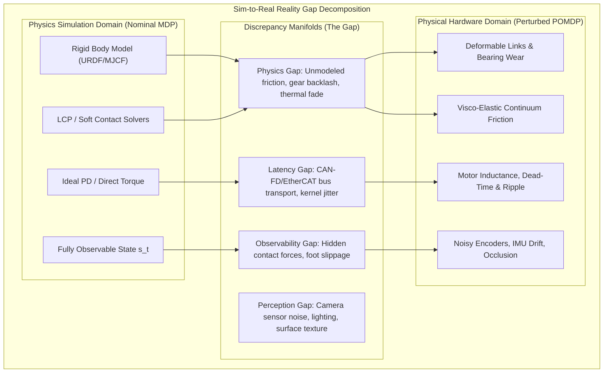

import ChapterProgress from '@site/src/components/ChapterProgress';
import QuizEngine from '@site/src/components/QuizEngine';

# Anatomy of the Reality Gap: Physics, Perception & Latency

A control policy trained inside a modern physics simulator can execute millions of bipedal steps or dexterous manipulation maneuvers without a single failure. The policy masters balancing on complex terrains, dynamically leaping over obstacles, or manipulating delicate objects with millimeter precision. Yet, when transferred directly to a physical humanoid robot such as the Unitree G1 or Boston Dynamics Atlas, this very same policy frequently stumbles, violently vibrates around joint equilibria, or experiences catastrophic balance collapse within fractions of a second.

This failure mode is the **Reality Gap** (or Sim-to-Real Gap). The reality gap is not a singular mathematical error; it is an accumulation of discrepancies across rigid-body dynamics approximations, unmodeled transmission compliance, non-linear Coulomb and Stribeck friction, communication bus latency, sensor noise, and partial state observability. To bridge this divide, roboticists must move beyond treating simulation as a black box and instead mathematically dissect, quantify, and bound each physical discrepancy.



---

## 1. The Discrepancy Taxonomy: Physics, Perception & Latency

The divergence between the simulated transition probability density $\mathcal{P}_{\text{sim}}(\mathbf{s}_{t+1} \mid \mathbf{s}_t, \mathbf{a}_t)$ and the physical world dynamics $\mathcal{P}_{\text{real}}(\mathbf{s}_{t+1} \mid \mathbf{s}_t, \mathbf{a}_t)$ can be classified into four primary dimensions:

### 1.1 The Physics Fidelity Gap
Modern physics engines (MuJoCo, PhysX 5, DART, Bullet) solve forward multi-body dynamics under rigid-body assumptions. They model joints as ideal kinematic constraints without elasticity and contacts using linearized friction pyramids or Linear Complementarity Problems (LCP). Physical hardware violates these assumptions:
- **Motor Backlash & Transmission Compliance**: Harmonic drives and cycloidal reducers exhibit non-zero angular play ($0.5 \text{ to } 2.0\text{ mrad}$) and non-linear torsional spring compliance.
- **Thermal Demagnetization & Resistance Rise**: Under sustained bipedal trotting, motor winding temperatures climb from $25^\circ\text{C}$ to $85^\circ\text{C}$, elevating coil resistance ($R_T = R_0(1 + \alpha \Delta T)$) and dropping back-EMF and torque constant $K_t$ by up to $15\%$.
- **Complex Friction Regimes**: Real bearings and gear teeth experience Stribeck friction, micro-slip pre-sliding displacement, and hysteresis that standard viscous-Coulomb models fail to capture.

### 1.2 The Actuator & Latency Gap
In simulation, control commands $\mathbf{a}_t$ are often instantaneously transformed into joint torques or position targets. On physical hardware, commanded efforts traverse multiple layers of processing, communication, and electromagnetic conversion:
1. **Operating System Scheduling Jitter**: Non-real-time Linux kernels introduce 1–10 ms of scheduling variance. Even with `PREEMPT_RT`, context switching and interrupt handling yield 10–50 $\mu\text{s}$ of jitter.
2. **Fieldbus Communication Latency**: Transmitting setpoints over CAN-FD (at 5–8 Mbps) or EtherCAT (at 100 Mbps) introduces transport delays $\Delta t_{\text{bus}} \in [0.25, 2.0]\text{ ms}$.
3. **Current Loop / Inverter Dead-Time**: Pulse-Width Modulation (PWM) gate drivers require blanking dead-times ($0.5 \text{ to } 2.0\ \mu\text{s}$) to prevent shoot-through currents in H-bridges, creating non-linear output voltage distortions at zero current crossings.
4. **Motor Inductive Delay**: Winding inductance $L$ acts as a low-pass filter on current rise time ($\tau_{\text{elec}} = L/R$), delaying instantaneous torque generation.

The composite actuation delay is modeled as:

$$
\tau_{\text{delay}} = \Delta t_{\text{sense}} + \Delta t_{\text{inference}} + \Delta t_{\text{bus}} + \Delta t_{\text{inverter}} + \tau_{\text{elec}}
$$

For a typical humanoid robot operating at 500 Hz (a 2 ms nominal loop time), total phase delay $\tau_{\text{delay}}$ often reaches 4–8 ms—equivalent to 2 to 4 complete control steps of lag. When high-gain feedback policies encounter unmodeled phase lag, they enter oscillatory limit cycles and become unstable.

### 1.3 The Contact & Foot Compliance Gap
Standard simulation pipelines model ground contacts through point contacts or planar convex polygons with Coulomb dry friction ($F_t \le \mu F_n$). In physical reality:
- Foot soles consist of compliant rubber elastomers (e.g., Shore A 60–70 neoprene) exhibiting visco-elastic compression governed by Hunt-Crossley or Kelvin-Voigt models.
- Surface friction is anisotropic, non-uniform, and dependent on normal load, velocity, and temperature.
- Real-world terrain yields under dynamic load, producing sinkage and soil mechanics effects absent in rigid collision meshes.

### 1.4 The State Observability Gap
In simulation, policies frequently query privileged state variables: base linear velocity $\mathbf{v}_{\text{base}}$, ground height directly underneath the feet $z_{\text{ground}}$, contact force vectors $\mathbf{f}_c$, and external disturbance forces $\mathbf{F}_{\text{ext}}$. In the real world:
- Linear velocity must be estimated via noisy Extended Kalman Filters (EKF) or invariant filters fusing high-rate IMU accelerations with intermittent foot kinematic contact estimates.
- Ground topography is partially occluded by the robot's own limbs and shadows.
- Foot contact force sensing via strain gauges or torque-sensing actuators suffers from thermal zero-drift and calibration offsets.

---

## 2. Mathematical Formalization of the Gap

| Discrepancy Dimension | Physical Mechanism | Typical Order of Magnitude | Simulation Failure Mode | Primary Mitigation |
| :--- | :--- | :--- | :--- | :--- |
| **Actuator Latency** | CAN-FD bus transit, motor inductance $L/R$ | 2–8 ms (1–4 control cycles) | High-frequency joint chatter, limit cycles | Delay buffer randomization, explicit actuator net |
| **Joint Friction** | Stribeck effect, micro-slip, temperature drift | 5%–20% of rated torque | Static positioning error, stick-slip limit cycles | LuGre friction sysID, torque-feedforward |
| **Gear Backlash** | Mechanical tooth clearance in reducers | 0.5–3.0 mrad | Non-linear phase lag during zero-torque crossing | Backlash deadband modeling, pre-loaded gears |
| **Contact Compliance** | Visco-elastic foot sole deformation | 2–5 mm penetration, damping ratio $\zeta \approx 0.3$ | Premature stance phase transitions, foot bouncing | Hunt-Crossley contact models, compliance tuning |
| **Perception Noise** | CMOS sensor noise, specular glare, depth dropout | 10–50 mm depth error, 15% pixel dropout | Hallucinated obstacles, localization drift | Domain randomization, visual depth distillation |
| **Payload Uncertainty** | Center of mass shift, variable battery/tool mass | $\pm 5\%\text{ to } \pm 15\%$ total mass | Tilting CoM, foot roll drift, under-actuation | Adaptive Domain Randomization, online sysID |

---

## 3. Distribution Distance Metrics: Quantifying the Reality Gap

To scientifically evaluate sim-to-real transfer, we must quantify the divergence between the state-action trajectory distribution generated in simulation $\mathbb{P}_{\text{sim}}$ and that observed on the physical robot $\mathbb{P}_{\text{real}}$.

### 3.1 The Failure of Kullback-Leibler (KL) Divergence
A common statistical metric is the Kullback-Leibler (KL) divergence:

$$
D_{\text{KL}}(\mathbb{P}_{\text{real}} \parallel \mathbb{P}_{\text{sim}}) = \int_{\mathcal{S}} p_{\text{real}}(\mathbf{x}) \log \left( \frac{p_{\text{real}}(\mathbf{x})}{p_{\text{sim}}(\mathbf{x})} \right) d\mathbf{x}
$$

However, trajectory distributions $\mathbb{P}_{\text{sim}}$ and $\mathbb{P}_{\text{real}}$ in robotics inhabit low-dimensional sub-manifolds embedded within high-dimensional state spaces $\mathcal{S} \subset \mathbb{R}^D$ (e.g., $D = 60$ for a humanoid with 20 joints, joint velocities, base pose, and twist). Whenever the support of $\mathbb{P}_{\text{real}}$ does not strictly overlap with $\mathbb{P}_{\text{sim}}$, the ratio $p_{\text{real}}(\mathbf{x}) / p_{\text{sim}}(\mathbf{x}) \to \infty$, causing $D_{\text{KL}}$ to diverge to infinity and offering no useful gradient or comparison metric.

### 3.2 The Wasserstein-1 Distance (Earth Mover's Distance)
The **Wasserstein-1 distance** ($\mathcal{W}_1$) resolves the support mismatch problem by measuring the minimal cost of transporting the probability mass of $\mathbb{P}_{\text{sim}}$ to match $\mathbb{P}_{\text{real}}$ under a continuous ground metric $c(\mathbf{x}, \mathbf{y}) = \|\mathbf{x} - \mathbf{y}\|$:

$$
\mathcal{W}_1(\mathbb{P}_{\text{sim}}, \mathbb{P}_{\text{real}}) = \inf_{\gamma \in \Pi(\mathbb{P}_{\text{sim}}, \mathbb{P}_{\text{real}})} \mathbb{E}_{(\mathbf{x}, \mathbf{y}) \sim \gamma} \left[ \|\mathbf{x} - \mathbf{y}\| \right]
$$

where $\Pi(\mathbb{P}_{\text{sim}}, \mathbb{P}_{\text{real}})$ represents the set of all joint distributions whose marginals correspond to $\mathbb{P}_{\text{sim}}$ and $\mathbb{P}_{\text{real}}$.

By the **Kantorovich-Rubinstein duality theorem**, this can be written as:

$$
\mathcal{W}_1(\mathbb{P}_{\text{sim}}, \mathbb{P}_{\text{real}}) = \sup_{\|\phi\|_L \le 1} \left( \mathbb{E}_{\mathbf{x} \sim \mathbb{P}_{\text{sim}}}[\phi(\mathbf{x})] - \mathbb{E}_{\mathbf{y} \sim \mathbb{P}_{\text{real}}}[\phi(\mathbf{y})] \right)
$$

where $\|\phi\|_L \le 1$ denotes the class of all 1-Lipschitz continuous functions $\phi: \mathcal{S} \to \mathbb{R}$. The Wasserstein metric provides a well-behaved, smooth metric even when the trajectory supports are completely disjoint.

### 3.3 Maximum Mean Discrepancy (MMD)
In practice, computing the exact continuous Wasserstein distance across large trajectory logs requires solving a linear program with $O(N^3)$ complexity. An efficient alternative metric is the **Maximum Mean Discrepancy (MMD)** evaluated in a Reproducing Kernel Hilbert Space (RKHS) $\mathcal{H}$ with a characteristic kernel $k(\mathbf{x}, \mathbf{x}') = \exp(-\frac{\|\mathbf{x} - \mathbf{x}'\|^2}{2\sigma^2})$:

$$
\text{MMD}^2(\mathbb{P}_{\text{sim}}, \mathbb{P}_{\text{real}}) = \mathbb{E}_{\mathbf{x}, \mathbf{x}' \sim \mathbb{P}_{\text{sim}}}[k(\mathbf{x}, \mathbf{x}')] - 2\mathbb{E}_{\mathbf{x} \sim \mathbb{P}_{\text{sim}}, \mathbf{y} \sim \mathbb{P}_{\text{real}}}[k(\mathbf{x}, \mathbf{y})] + \mathbb{E}_{\mathbf{y}, \mathbf{y}' \sim \mathbb{P}_{\text{real}}}[k(\mathbf{y}, \mathbf{y}')]
$$

An empirical estimate across $M$ simulated trajectories and $N$ real-world trajectories evaluates in $O(M^2 + N^2 + MN)$ time.

---

## 4. Production Python Script: Reality Gap Distance Evaluator

The script below demonstrates a complete, production-grade telemetry analysis tool. It ingests simulated and physical humanoid joint kinematics and IMU trajectories, computes the empirical Wasserstein-1 metric (via 1D projections and optimal transport), and calculates the Maximum Mean Discrepancy (MMD) with an RBF kernel:

```python
#!/usr/bin/env python3
"""
reality_gap_metrics.py
Production-grade reality gap quantifier computing Wasserstein-1 distance
and Maximum Mean Discrepancy (MMD) between simulated and real robot trajectories.
"""

import numpy as np
from scipy.stats import wasserstein_distance
from typing import Dict, Tuple, List


class RealityGapQuantifier:
    """
    Computes statistical distribution metrics between simulated and physical
    robot state-action telemetry trajectories.
    """

    def __init__(self, kernel_gamma: float = 0.1):
        """
        Args:
            kernel_gamma: RBF kernel bandwidth gamma = 1 / (2 * sigma^2).
        """
        self.gamma = kernel_gamma

    def compute_channel_wasserstein(
        self, sim_data: np.ndarray, real_data: np.ndarray
    ) -> Dict[str, float]:
        """
        Computes 1D Wasserstein-1 (Earth Mover's) distance for each state dimension.

        Args:
            sim_data: Simulated trajectory array of shape (N_samples, D_features).
            real_data: Physical trajectory array of shape (M_samples, D_features).

        Returns:
            Dictionary mapping feature index to Wasserstein-1 distance.
        """
        assert sim_data.shape[1] == real_data.shape[1], (
            f"Feature dimensions must match: sim {sim_data.shape[1]} vs real {real_data.shape[1]}"
        )
        d_features = sim_data.shape[1]
        distances = {}

        for i in range(d_features):
            w1 = wasserstein_distance(sim_data[:, i], real_data[:, i])
            distances[f"channel_{i}"] = float(w1)

        distances["mean_wasserstein"] = float(np.mean(list(distances.values())))
        return distances

    def compute_mmd(self, sim_data: np.ndarray, real_data: np.ndarray) -> float:
        """
        Computes the Maximum Mean Discrepancy (MMD^2) with an RBF kernel.

        MMD^2 = E[k(x, x')] - 2*E[k(x, y)] + E[k(y, y')]
        """
        # Subsample if data exceeds 2000 points to bound quadratic complexity
        n_sim = min(len(sim_data), 1000)
        n_real = min(len(real_data), 1000)

        idx_sim = np.random.choice(len(sim_data), n_sim, replace=False)
        idx_real = np.random.choice(len(real_data), n_real, replace=False)

        x = sim_data[idx_sim]
        y = real_data[idx_real]

        # Compute Gram matrices
        k_xx = self._rbf_kernel_matrix(x, x)
        k_yy = self._rbf_kernel_matrix(y, y)
        k_xy = self._rbf_kernel_matrix(x, y)

        # Unbiased estimator: zero out diagonal elements in self-comparisons
        np.fill_diagonal(k_xx, 0.0)
        np.fill_diagonal(k_yy, 0.0)

        e_xx = np.sum(k_xx) / (n_sim * (n_sim - 1))
        e_yy = np.sum(k_yy) / (n_real * (n_real - 1))
        e_xy = np.sum(k_xy) / (n_sim * n_real)

        mmd_sq = max(0.0, e_xx - 2.0 * e_xy + e_yy)
        return float(np.sqrt(mmd_sq))

    def _rbf_kernel_matrix(self, a: np.ndarray, b: np.ndarray) -> np.ndarray:
        """
        Vectorized computation of RBF kernel matrix K(a, b) = exp(-gamma * ||a - b||^2).
        """
        # ||a - b||^2 = ||a||^2 + ||b||^2 - 2 * a . b^T
        a_sq = np.sum(a ** 2, axis=1)[:, np.newaxis]
        b_sq = np.sum(b ** 2, axis=1)[np.newaxis, :]
        dist_sq = a_sq + b_sq - 2.0 * np.dot(a, b.T)
        dist_sq = np.maximum(0.0, dist_sq)
        return np.exp(-self.gamma * dist_sq)


if __name__ == "__main__":
    np.random.seed(42)

    # Synthetic trajectory simulation: 12-DoF humanoid leg joints (position + velocity)
    timesteps = 2000
    n_joints = 12

    # Simulated data: nominal cyclic walking gait with small Gaussian noise
    t = np.linspace(0, 10, timesteps)
    sim_base = np.sin(2.0 * np.pi * 1.5 * t[:, np.newaxis] + np.linspace(0, np.pi, n_joints))
    sim_telemetry = sim_base + np.random.normal(0, 0.02, size=(timesteps, n_joints))

    # Real data: simulated gait with 4 ms phase lag, 8% motor friction dampening, and sensor noise
    lag_samples = 8  # 4 ms lag at 2000 Hz
    real_base = np.roll(sim_base * 0.92, shift=lag_samples, axis=0)
    real_telemetry = real_base + np.random.normal(0, 0.06, size=(timesteps, n_joints))

    quantifier = RealityGapQuantifier(kernel_gamma=0.2)

    # 1. Evaluate Channel-wise Wasserstein Distance
    w1_metrics = quantifier.compute_channel_wasserstein(sim_telemetry, real_telemetry)
    print("=== Wasserstein-1 Telemetry Gap Evaluation ===")
    for k, v in list(w1_metrics.items())[:4]:
        print(f"  {k}: {v:.4f} rad")
    print(f"  Overall Mean Wasserstein-1 Distance: {w1_metrics['mean_wasserstein']:.4f} rad")

    # 2. Evaluate Maximum Mean Discrepancy (MMD)
    mmd_score = quantifier.compute_mmd(sim_telemetry, real_telemetry)
    print(f"\n=== Trajectory Maximum Mean Discrepancy (MMD) ===")
    print(f"  Empirical MMD (RBF gamma=0.2): {mmd_score:.4f}")
    if mmd_score > 0.15:
        print("  [ALERT] Reality gap exceeds transfer stability threshold (0.15).")
        print("  Recommendation: Inject actuator latency buffer and identify joint friction.")
```

---

## 5. Research Foundations & Seminal Literature

1. **Tobin, J., Fong, R., Ray, A., Schneider, J., Welinder, P., & Zaremba, W. (2017).** *Domain randomization for transferring deep neural networks from simulation to the real world*. In IEEE/RSJ International Conference on Intelligent Robots and Systems (IROS) (pp. 23-30). [Pioneering paper defining zero-shot domain randomization across rendering and physics].
2. **Kadian, A., Truong, J., Gokaslan, A., Clegg, A., Erik, M., Wijmans, E., Liu, C. K., & Savva, M. (2020).** *Sim2Real Predictivity: Does Evaluation in Simulation Predict Real-World Performance?*. IEEE Robotics and Automation Letters, 5(4), 6670-6677. [Introduces rigorous correlation metrics between sim and real benchmark benchmarks].
3. **Tan, J., Zhang, T., Coumans, E., Iscen, A., Bai, Y., Hafner, D., Bohez, S., & Vanhoucke, V. (2018).** *Sim-to-Real: Learning Agile Locomotion for Quadruped Robots*. In Robotics: Science and Systems (RSS). [Exposes actuator delay and motor electrical dynamics as the primary failure points in dynamic locomotion transfer].
4. **Hwangbo, J., Sa, I., Siegwart, R., & Hutter, M. (2019).** *Learning agile and dynamic motor skills for legged robots*. Science Robotics, 4(26), eaau5872. [Introduces data-driven neural network actuator dynamics models to replace idealized simulation motors].

---

## 6. Hands-On Lab Project: Quantifying the Reality Gap on Unitree G1 Telemetry

### Project Objective
In this hands-on lab, you will process paired sets of simulated and real robot kinematic telemetry logs recorded during a 500 Hz walking trot. You will compute the Wasserstein-1 discrepancy and identify whether the primary source of divergence is phase lag (actuator delay) or magnitude attenuation (friction and torque saturation).

### Implementation Steps
1. Download or synthesize paired joint position and velocity trajectories for the Unitree G1 hip, knee, and ankle pitch joints over a 10-second trot trial.
2. Formulate cross-correlation functions $R_{xy}(\tau) = \sum_t x(t) y(t + \tau)$ to isolate the discrete phase lag $\Delta \tau^*$ between simulated and physical joint commands.
3. Apply the `RealityGapQuantifier` from Section 4 to evaluate channel-wise Wasserstein-1 distances before and after compensating for the isolated phase lag.
4. If the post-compensation Wasserstein distance drops by more than 60%, confirm actuator latency as the dominant reality gap source; if the distance remains high, flag non-linear friction and compliance.

### Lab Success Criteria
- [ ] Successfully parse paired CSV/HDF5 telemetry streams containing timestamped joint positions, velocities, and commanded efforts.
- [ ] Accurately calculate the empirical discrete delay $\tau_{\text{delay}}$ within $\pm 0.5\text{ ms}$ accuracy using cross-correlation.
- [ ] Compute both channel-wise $\mathcal{W}_1$ distances and the aggregate MMD metric across all joints.
- [ ] Produce a comparative diagnostic plot demonstrating the distribution shift before and after delay alignment.

---

<ChapterProgress chapterId="9-1-the-reality-gap" moduleId="module9" totalChapters={8} />

## Chapter Mastery Check

<QuizEngine
  quizId="quiz-9-1"
  title="Module 9.1 Mastery Check: The Reality Gap"
  moduleId="module9"
  passThreshold={70}
  questions={[
    {
      id: "q1",
      question: "Why is Kullback-Leibler (KL) divergence frequently unsuitable for measuring the sim-to-real gap between trajectory distributions?",
      options: [
        "KL divergence can only be evaluated for discrete random variables, not continuous robot states",
        "Because trajectory distributions exist on low-dimensional manifolds, any non-overlapping support causes the probability density ratio to approach infinity, making KL divergence diverge",
        "KL divergence is non-differentiable and cannot be computed via numerical integration",
        "Physics engines automatically enforce zero KL divergence during execution"
      ],
      correctIndex: 1,
      explanation: "Robot trajectory distributions typically inhabit thin low-dimensional manifolds within high-dimensional state spaces. If the real robot encounters any state configuration outside the support of the simulation data, p_real(x) / p_sim(x) divides by zero, causing KL divergence to explode to infinity."
    },
    {
      id: "q2",
      question: "On a physical humanoid robot operating with a 500 Hz control loop (2 ms period), what is the typical impact of an unmodeled 6 ms composite actuator and communication latency?",
      options: [
        "It improves stability by providing natural low-pass filtering on torque spikes",
        "It has zero impact because modern motors have infinite bandwidth",
        "It introduces a 3-cycle phase lag that destabilizes high-gain feedback controllers, inducing high-frequency oscillatory chatter or fall collapse",
        "It causes the CAN-FD bus to shut down due to buffer overflow"
      ],
      correctIndex: 2,
      explanation: "A 6 ms delay represents 3 complete control iterations of unmodeled lag. In high-bandwidth feedback control, phase lag erodes the phase margin, causing the closed-loop system to become unstable and oscillate aggressively around joint setpoints."
    },
    {
      id: "q3",
      question: "How does the Kantorovich-Rubinstein duality theorem enable practical evaluation of the Wasserstein-1 distance?",
      options: [
        "By replacing the infinite-dimensional probability densities with a supremum over 1-Lipschitz continuous witness functions",
        "By converting the dynamics into a linear ODE that can be integrated analytically",
        "By proving that all friction regimes can be linearized into Coulomb friction",
        "By eliminating the need to record real robot telemetry data"
      ],
      correctIndex: 0,
      explanation: "The Kantorovich-Rubinstein duality reformulation expresses the intractable infimum over all coupling distributions as a supremum over 1-Lipschitz witness functions: W_1(P, Q) = sup_{||phi||_L <= 1} (E_P[phi(x)] - E_Q[phi(y)]), allowing efficient sample-based empirical estimation."
    }
  ]}
/>
