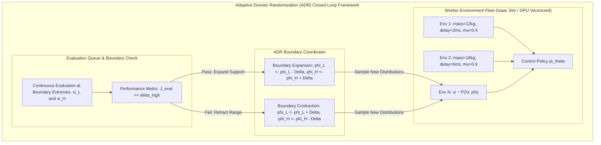
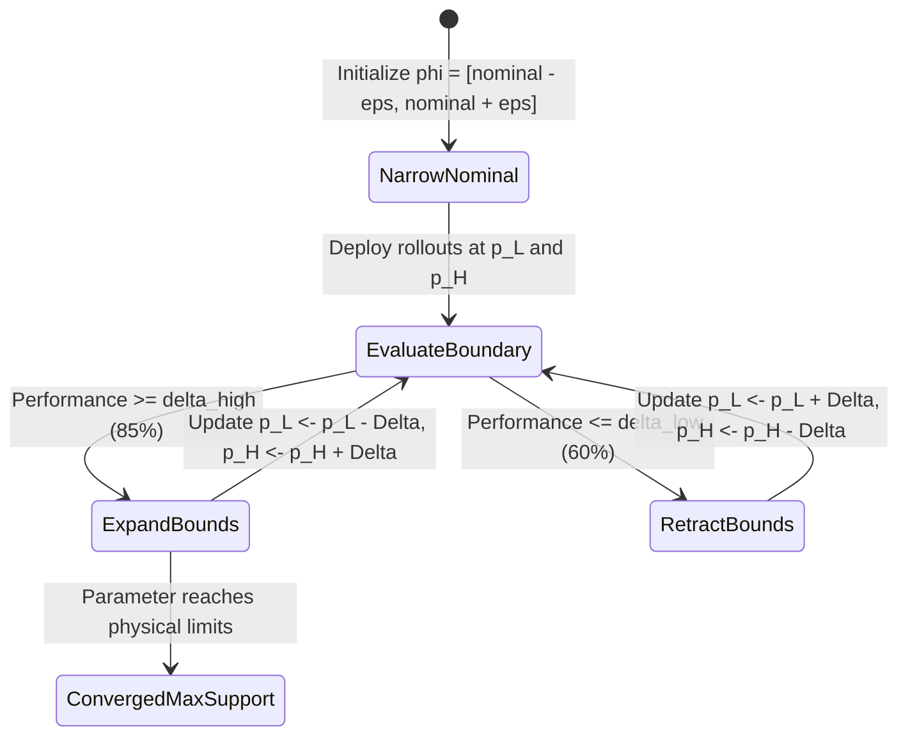

import ChapterProgress from '@site/src/components/ChapterProgress';
import QuizEngine from '@site/src/components/QuizEngine';

# Domain Randomization & Adaptive Domain Randomization (ADR)

If a neural network controller is trained in a single, high-fidelity simulator, it inevitably overfits to the idiosyncratic artifacts of that simulator. The policy learns to exploit subtle solver approximations—such as rigid contact penetration dynamics, perfectly instantaneous motor response, or infinitely stiff joint constraints—that do not exist in reality. When transferred to physical hardware, even slight parameter mismatches cause the policy to fail catastrophically.

**Domain Randomization (DR)** fundamentally re-frames sim-to-real transfer: rather than attempting to construct an impossibly perfect, hand-tuned digital twin, we train the policy across an entire distribution of randomized simulated worlds. If the variance of the simulation distribution is sufficiently broad, the real world will appear to the neural network as merely another random sample drawn from the distribution it has already mastered.



---

## 1. Mathematical Formulation: The Robust Markov Decision Process

Standard reinforcement learning optimizes policy parameters $\boldsymbol{\theta}$ within a nominal Markov Decision Process $\mathcal{M} = \langle \mathcal{S}, \mathcal{A}, \mathcal{P}, \mathcal{R}, \gamma \rangle$. In Domain Randomization, we generalize to a **Robust Markov Decision Process** (Robust MDP), parameterized by a vector of physical environment parameters $\boldsymbol{\xi} \in \boldsymbol{\Xi} \subset \mathbb{R}^K$:

$$
\mathcal{M}(\boldsymbol{\xi}) = \langle \mathcal{S}, \mathcal{A}, \mathcal{P}_{\boldsymbol{\xi}}, \mathcal{R}_{\boldsymbol{\xi}}, \gamma \rangle
$$

where $\boldsymbol{\xi}$ encapsulates physical attributes such as link masses, centers of mass, link lengths, joint damping coefficients, motor torque constants, surface friction coefficients, and communication latencies.

### 1.1 The Expected Return Objective
The environment parameters $\boldsymbol{\xi}$ are governed by a probability density distribution $P(\boldsymbol{\xi}; \boldsymbol{\phi})$ parameterized by hyperparameters $\boldsymbol{\phi}$ (such as support bounds $[\mathbf{a}, \mathbf{b}]$ or mean and covariance $(\boldsymbol{\mu}, \boldsymbol{\Sigma})$). The goal of Domain Randomization is finding a single robust policy $\pi_{\boldsymbol{\theta}}$ maximizing expected return across the parameter distribution:

$$
J(\pi_{\boldsymbol{\theta}}) = \mathbb{E}_{\boldsymbol{\xi} \sim P(\boldsymbol{\Xi}; \boldsymbol{\phi})} \left[ \mathbb{E}_{\tau \sim \pi_{\boldsymbol{\theta}}, \mathcal{P}_{\boldsymbol{\xi}}} \left[ \sum_{t=0}^T \gamma^t \mathcal{R}(s_t, a_t; \boldsymbol{\xi}) \right] \right]
$$

where trajectory $\tau = (s_0, a_0, s_1, a_1, \dots, s_T)$ unfolds under the dynamics transition operator $\mathbf{s}_{t+1} \sim \mathcal{P}_{\boldsymbol{\xi}}(\cdot \mid \mathbf{s}_t, \mathbf{a}_t)$.

---

## 2. Parameter Sampling Distributions

Choosing the appropriate probability distribution for each physical parameter is essential for stable gradient descent and preventing policy conservatism.

### 2.1 Uniform Distribution
For parameters with symmetric, well-bounded linear tolerances (e.g., center of mass offset or link length manufacturing variations):

$$
\xi_i \sim \mathcal{U}(a_i, b_i), \quad p(\xi_i) = \frac{1}{b_i - a_i}
$$

### 2.2 Log-Uniform Distribution
Parameters spanning several orders of magnitude—such as joint proportional gains ($K_p \in [10^1, 10^3]$), ground contact stiffness ($k_c \in [10^3, 10^6]\text{ N/m}$), or viscous damping coefficients—must be sampled **log-uniformly**. Sampling linearly across $[10, 1000]$ causes $90\%$ of samples to concentrate above 100, severely undersampling low-stiffness regimes:

$$
\log \xi_i \sim \mathcal{U}(\log a_i, \log b_i) \implies \xi_i = \exp \left( \mathcal{U}(\log a_i, \log b_i) \right)
$$

with probability density function:

$$
p(\xi_i) = \frac{1}{\xi_i (\log b_i - \log a_i)}, \quad \xi_i \in [a_i, b_i]
$$

### 2.3 Truncated Gaussian Distribution
For physical properties centered around nominal CAD specifications but subject to Gaussian manufacturing dispersion, values must be bounded to preclude non-physical negative numbers (such as negative mass or negative friction):

$$
\xi_i \sim \mathcal{TN}(\mu_i, \sigma_i^2, a_i, b_i), \quad \text{where } 0 < a_i < \mu_i < b_i
$$

---

## 3. The OpenAI Dactyl Milestone: 128-Parameter Scaling

In 2019, OpenAI published the **Dactyl** breakthrough, demonstrating a physical 24-DoF Shadow Dexterous Hand solving a Rubik's cube entirely from vision and touch without any real-world training samples. The core enabler was massive domain randomization scaling across **128 physical parameters simultaneously**:

| Parameter Category | Randomized Variables | Nominal Value | Randomization Range | Distribution Type |
| :--- | :--- | :--- | :--- | :--- |
| **Link Masses** | Palm, phalanges, wrist body | 0.05–0.40 kg | $\pm 30\%$ nominal | Uniform |
| **Center of Mass** | 3-axis offset per link | $(0, 0, 0)$ mm | $[-5.0, +5.0]$ mm | Truncated Gaussian |
| **Surface Friction** | Fingertip rubber, cube plastic | $\mu = 0.80$ | $[0.10, 2.00]$ | Uniform |
| **Joint Damping** | Rotational damping per joint | $0.05\text{ Nms/rad}$ | $[0.005, 0.50]$ | Log-Uniform |
| **Actuator Latency** | CAN packet buffer queue | 0 steps (0 ms) | $[0, 4]$ steps ($0\text{ to }80\text{ ms}$) | Discrete Uniform |
| **Motor Gains** | Tendon driver $K_p$ and $K_d$ | $K_p=120$ | $[60, 240]$ | Log-Uniform |
| **Sensor Noise** | Joint encoders, IMU angular rate | $\sigma=0$ | $\sigma_{\text{enc}} \in [0.01, 0.05]\text{ rad}$ | Gaussian |
| **Visual Render** | Lighting direction, FOV, texture hue | Fixed HDRI | RGB color jitter, random mesh textures | Procedural noise |

---

## 4. Adaptive Domain Randomization (ADR)

While manual domain randomization is powerful, choosing static bounds $[a_i, b_i]$ presents a severe dilemma:
- If bounds are set **too narrow**, the real world falls outside the distribution support, causing sim-to-real failure.
- If bounds are set **too wide from scratch**, the environment becomes excessively difficult or physically impossible, causing policy optimization to collapse into degenerate, passive behaviors.

**Adaptive Domain Randomization (ADR)** eliminates manual parameter tuning by automating boundary expansion through a closed-loop curriculum.

### 4.1 The ADR Curriculum Algorithm
Each randomized parameter $i \in \{1, \dots, K\}$ is governed by dynamic boundary thresholds $\boldsymbol{\phi}_i = (p_L^i, p_H^i)$. During parallel policy training:
1. With probability $1 - \rho$, environments sample parameters from the current uniform interior $\xi_i \sim \mathcal{U}(p_L^i, p_H^i)$.
2. With probability $\rho$, environments are assigned as **boundary evaluators**, fixing $\xi_i = p_L^i$ (lower boundary evaluation) or $\xi_i = p_H^i$ (upper boundary evaluation).
3. The ADR coordinator maintains an exponential moving average or sliding window of policy performance $S_L^i$ and $S_H^i$ recorded at the boundaries.
4. If boundary performance exceeds a mastery threshold $\delta_{\text{high}}$ (e.g., $85\%$ task success rate), the boundary expands by step $\Delta$:

$$
p_L^i \leftarrow p_L^i - \Delta_i, \quad p_H^i \leftarrow p_H^i + \Delta_i
$$

5. Conversely, if boundary performance drops below a regression threshold $\delta_{\text{low}}$ (e.g., $60\%$), the boundary contracts to keep the task within the policy's learning frontier:

$$
p_L^i \leftarrow p_L^i + \Delta_i, \quad p_H^i \leftarrow p_H^i - \Delta_i
$$



---

## 5. Production Python Implementation: Vectorized ADR Engine

Below is a complete, production-grade Adaptive Domain Randomization coordinator designed for vectorized robotics simulation frameworks (such as Isaac Lab or PyTorch-based environments):

```python
#!/usr/bin/env python3
"""
adaptive_domain_randomization.py
Production-grade Adaptive Domain Randomization (ADR) coordinator for
vectorized reinforcement learning in robotics.
"""

import numpy as np
import torch
from typing import Dict, List, Tuple


class ADRParameter:
    """Represents a single physical property managed by the ADR curriculum."""

    def __init__(
        self,
        name: str,
        nominal: float,
        init_range: Tuple[float, float],
        min_limit: float,
        max_limit: float,
        step_size: float,
        is_log: bool = False,
    ):
        self.name = name
        self.nominal = nominal
        self.p_low = init_range[0]
        self.p_high = init_range[1]
        self.min_limit = min_limit
        self.max_limit = max_limit
        self.step_size = step_size
        self.is_log = is_log

        # Performance evaluation buffers at boundaries
        self.eval_low_scores: List[float] = []
        self.eval_high_scores: List[float] = []

    def sample(self, num_envs: int, device: torch.device) -> torch.Tensor:
        """Samples parameter values across num_envs."""
        if self.is_log:
            log_low = np.log(max(1e-6, self.p_low))
            log_high = np.log(self.p_high)
            rand_log = torch.empty(num_envs, device=device).uniform_(log_low, log_high)
            return torch.exp(rand_log)
        else:
            return torch.empty(num_envs, device=device).uniform_(self.p_low, self.p_high)

    def record_eval(self, boundary: str, score: float):
        """Appends evaluation score to lower or upper boundary buffer."""
        buffer = self.eval_low_scores if boundary == "low" else self.eval_high_scores
        buffer.append(score)
        if len(buffer) > 100:
            buffer.pop(0)

    def update_bounds(self, delta_high: float = 0.80, delta_low: float = 0.50):
        """Expands or contracts boundaries based on recorded boundary performance."""
        # Update lower boundary
        if len(self.eval_low_scores) >= 30:
            avg_low = np.mean(self.eval_low_scores)
            if avg_low >= delta_high:
                self.p_low = max(self.min_limit, self.p_low - self.step_size)
                self.eval_low_scores.clear()
            elif avg_low <= delta_low:
                self.p_low = min(self.nominal, self.p_low + self.step_size)
                self.eval_low_scores.clear()

        # Update upper boundary
        if len(self.eval_high_scores) >= 30:
            avg_high = np.mean(self.eval_high_scores)
            if avg_high >= delta_high:
                self.p_high = min(self.max_limit, self.p_high + self.step_size)
                self.eval_high_scores.clear()
            elif avg_high <= delta_low:
                self.p_high = max(self.nominal, self.p_high - self.step_size)
                self.eval_high_scores.clear()


class ADRCoordinator:
    """Manages multi-parameter ADR curriculum across parallel simulation workers."""

    def __init__(self, eval_prob: float = 0.15, device: str = "cpu"):
        self.device = torch.device(device)
        self.eval_prob = eval_prob
        self.params: Dict[str, ADRParameter] = {}

    def register_parameter(
        self,
        name: str,
        nominal: float,
        init_range: Tuple[float, float],
        min_limit: float,
        max_limit: float,
        step_size: float,
        is_log: bool = False,
    ):
        self.params[name] = ADRParameter(
            name, nominal, init_range, min_limit, max_limit, step_size, is_log
        )

    def sample_batch(self, num_envs: int) -> Tuple[Dict[str, torch.Tensor], Dict[str, str]]:
        """
        Samples a parameter dictionary for num_envs.
        Assigns boundary evaluation flags to a subset of environments.
        """
        batch_params = {}
        env_metadata = {}

        for name, param in self.params.items():
            vals = param.sample(num_envs, self.device)

            # Assign boundary evaluations
            is_eval = torch.rand(num_envs) < self.eval_prob
            low_or_high = torch.rand(num_envs) < 0.5

            for env_idx in range(num_envs):
                if is_eval[env_idx]:
                    if low_or_high[env_idx]:
                        vals[env_idx] = param.p_low
                        env_metadata[f"{name}_env_{env_idx}"] = "low"
                    else:
                        vals[env_idx] = param.p_high
                        env_metadata[f"{name}_env_{env_idx}"] = "high"

            batch_params[name] = vals

        return batch_params, env_metadata

    def step(self, delta_high: float = 0.80, delta_low: float = 0.50):
        """Runs ADR boundary step across all registered physical parameters."""
        for param in self.params.values():
            param.update_bounds(delta_high, delta_low)

    def print_status(self):
        """Displays current parameter support intervals."""
        print(f"\n{'Parameter':<20} | {'Lower Bound':<12} | {'Nominal':<10} | {'Upper Bound':<12}")
        print("-" * 62)
        for name, p in self.params.items():
            print(f"{name:<20} | {p.p_low:<12.4f} | {p.nominal:<10.4f} | {p.p_high:<12.4f}")


if __name__ == "__main__":
    # Example ADR configuration for a humanoid robot locomotion environment
    adr = ADRCoordinator(eval_prob=0.20, device="cpu")

    # 1. Base torso payload mass (nominal 15.0 kg, limits 10.0 kg to 30.0 kg)
    adr.register_parameter(
        name="torso_mass",
        nominal=15.0,
        init_range=(14.5, 15.5),
        min_limit=10.0,
        max_limit=30.0,
        step_size=0.5,
    )

    # 2. Ground surface friction coefficient (nominal 0.8, limits 0.2 to 2.0)
    adr.register_parameter(
        name="ground_friction",
        nominal=0.80,
        init_range=(0.75, 0.85),
        min_limit=0.20,
        max_limit=2.00,
        step_size=0.05,
    )

    # 3. Actuator joint stiffness (log-uniform: nominal 150 N*m/rad, limits 30 to 450)
    adr.register_parameter(
        name="joint_stiffness",
        nominal=150.0,
        init_range=(140.0, 160.0),
        min_limit=30.0,
        max_limit=450.0,
        step_size=10.0,
        is_log=True,
    )

    print("Initial ADR Parameter State:")
    adr.print_status()

    # Simulate 5 curriculum progression cycles with successful policy performance
    num_envs = 64
    for cycle in range(1, 6):
        batch, metadata = adr.sample_batch(num_envs=num_envs)

        # Simulate evaluation feedback: policy passes evaluations with 90% success
        for name, param in adr.params.items():
            for _ in range(35):
                param.record_eval("low", 0.90)
                param.record_eval("high", 0.88)

        adr.step(delta_high=0.80, delta_low=0.50)

    print("\nADR Parameter State After 5 Automated Expansion Cycles:")
    adr.print_status()
```

---

## 6. Research Foundations & Seminal Literature

1. **Akkaya, I., Andrychowicz, M., Chociej, M., Litwin, M., McGrew, B., Petron, A., Paino, A., Plappert, M., Powell, G., Ribas, A., et al. (2019).** *Solving Rubik's Cube with a Robot Hand*. arXiv:1910.07113. [Seminal publication defining the Adaptive Domain Randomization (ADR) curriculum on a 24-DoF dexterous hand].
2. **Peng, X. B., Andrychowicz, M., Zaremba, W., & Abbeel, P. (2018).** *Sim-to-Real Transfer of Robotic Control with Dynamics Randomization*. In IEEE International Conference on Robotics and Automation (ICRA) (pp. 1-8). [Demonstrates dynamics randomization for agile manipulation and locomotion].
3. **Tobin, J., Biewald, L., Duan, R., Andrychowicz, M., Handa, A., Kumar, V., McGrew, B., Ray, A., Schneider, J., Welinder, P., et al. (2018).** *Domain Randomization and Generative Adversarial Networks for Visual Transfer*. In IEEE/RSJ International Conference on Intelligent Robots and Systems (IROS). [Combines visual randomization with GANs to match physical lighting distributions].
4. **Sadeghi, F., & Levine, S. (2017).** *CAD2RL: Real single-image flight without a single real image*. In Robotics: Science and Systems (RSS). [Shows that highly randomized 3D rendering allows a drone to navigate real physical hallways with zero real training data].
5. **Muratore, F., Treede, F., Gienger, M., & Peters, J. (2021).** *Domain Randomization for Simulation-Based Policy Optimization with Transferability Assessment*. Machine Learning, 110(9), 2419-2447. [Theoretical grounding on optimal sample bounds and bounding value loss under Robust MDPs].

---

## 7. Hands-On Lab Project: Parameterize DR in Isaac Lab for Bipedal Locomotion

### Project Objective
In this lab, you will configure a full-spectrum domain randomization pipeline within NVIDIA Isaac Lab for a Unitree G1 humanoid robot. You will implement uniform mass randomization, log-uniform joint damping, and discrete step-delay latency queues to verify that the randomized policy avoids joint oscillation.

### Implementation Steps
1. Create an Isaac Lab `EventCfg` class registering randomized setup events for robot link masses ($\pm 15\%$), base payload ($[-3, +5]\text{ kg}$), and foot friction ($\mu \in [0.3, 1.2]$).
2. Implement an actuation delay circular buffer holding action commands for a randomized duration of $\Delta \in \{0, 1, 2, 3\}$ control cycles (0 to 15 ms).
3. Train a baseline PPO locomotion policy without domain randomization, and train a second policy with full domain randomization enabled.
4. Deploy both policies into an evaluation environment configured with an unmodeled $10\text{ ms}$ latency and $0.4$ surface friction coefficient. Measure fall rates and tracking RMSE.

### Lab Success Criteria
- [ ] Implement and verify log-uniform sampling for joint damping parameters across $[0.05, 0.50]\text{ Nms/rad}$.
- [ ] Demonstrate zero simulation memory leaks across 4096 parallel Isaac Lab vectorized environments during episode resets.
- [ ] Verify that the policy trained with Domain Randomization maintains stability (fall rate $< 5\%$) on perturbed evaluation testbeds where the non-randomized policy fails ($> 80\%$ fall rate).

---

<ChapterProgress chapterId="9-2-domain-randomization" moduleId="module9" totalChapters={8} />

## Chapter Mastery Check

<QuizEngine
  quizId="quiz-9-2"
  title="Module 9.2 Mastery Check: Domain Randomization & ADR"
  moduleId="module9"
  passThreshold={70}
  questions={[
    {
      id: "q1",
      question: "Why should positive-definite physical parameters spanning multiple orders of magnitude (such as joint stiffness or ground compliance) be sampled log-uniformly rather than uniformly?",
      options: [
        "Uniform distributions require more GPU memory to compute",
        "Uniform sampling concentrates the vast majority of samples in the highest order of magnitude, severely undersampling low-stiffness regimes where dynamics are most compliant",
        "Log-uniform distributions eliminate all need for reinforcement learning",
        "Isaac Sim only supports log-uniform distributions"
      ],
      correctIndex: 1,
      explanation: "If a parameter spans [10, 1000], a uniform distribution places 90% of all samples between 100 and 1000, and only 1% between 10 and 20. Log-uniform sampling allocates equal probability mass to each decade (10-100 and 100-1000), guaranteeing adequate training exposure to soft, compliant regimes."
    },
    {
      id: "q2",
      question: "In Adaptive Domain Randomization (ADR), how does the curriculum coordinator determine when to expand parameter support boundaries?",
      options: [
        "It expands boundaries automatically after a fixed number of wall-clock hours",
        "It evaluates policy performance specifically at the boundary extremes (p_low and p_high), expanding the bounds only when success rates exceed a high threshold (e.g., >= 80%)",
        "It measures the temperature of the physical robot's motors",
        "It computes the Hessian of the value network"
      ],
      correctIndex: 1,
      explanation: "ADR continually routes a subset of simulation environments to evaluate performance at the boundary frontiers (p_low and p_high). When the policy masters these extreme edge cases with high success, the bounds expand outward, growing the curriculum difficulty in tandem with policy competence."
    },
    {
      id: "q3",
      question: "What is the primary risk of setting static Domain Randomization ranges excessively wide at the beginning of policy training?",
      options: [
        "It causes the PyTorch compiler to crash",
        "The policy experiences optimization collapse or converges to overly conservative, passive behaviors because the task is physically impossible under extreme randomized combinations",
        "The robot hardware runs backward",
        "It increases communication latency on EtherCAT"
      ],
      correctIndex: 1,
      explanation: "If parameters are randomized too aggressively from initialization, many environments become physically unsolvable (e.g., near-zero friction combined with maximum payload and high latency). The policy often fails to find any learning signal and collapses into stationary or passive collapse modes."
    }
  ]}
/>
