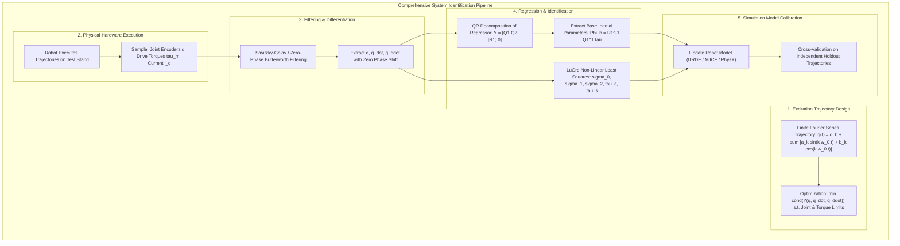
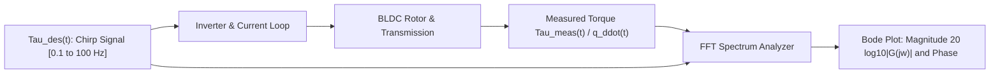
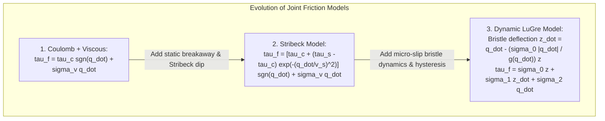

import ChapterProgress from '@site/src/components/ChapterProgress';
import QuizEngine from '@site/src/components/QuizEngine';

# System Identification: Rigid Body Parameters & Nonlinear Friction

Domain Randomization prepares a policy to withstand broad parameter variations, but broad distributions force the neural network to become overly conservative. A policy trained to withstand friction ranging from ice ($\mu = 0.1$) to sticky rubber ($\mu = 1.5$) will adopt a sluggish, high-stepping gait that wastes battery power and restricts peak running velocity. 

To achieve high-performance agility, we must actively shrink the reality gap through **System Identification (SysID)**. SysID uses experimental input-output measurements collected from the physical robot to calibrate the simulator's physical parameters. When our simulation's link masses, inertial tensors, actuator bandwidths, and joint friction curves reflect physical reality with high precision, the required domain randomization ranges can be narrowed dramatically, unlocking dynamic agility without sacrificing transfer reliability.



---

## 1. Linear Parametrization of Multi-Body Dynamics

The equation of motion for an $n$-degree-of-freedom manipulator or floating-base humanoid link chain is expressed by the canonical manipulator equation:

$$
\mathbf{M}(\mathbf{q}) \ddot{\mathbf{q}} + \mathbf{C}(\mathbf{q}, \dot{\mathbf{q}}) \dot{\mathbf{q}} + \mathbf{g}(\mathbf{q}) + \boldsymbol{\tau}_{\text{friction}}(\dot{\mathbf{q}}) = \boldsymbol{\tau}
$$

A remarkable property of rigid-body multi-body dynamics is that these equations are strictly **linear with respect to the dynamic parameters of the individual links**. For link $i$, the ten standard inertial parameters are:

$$
\boldsymbol{\theta}_i = \begin{bmatrix} m_i & m_i c_{x,i} & m_i c_{y,i} & m_i c_{z,i} & I_{xx,i} & I_{xy,i} & I_{xz,i} & I_{yy,i} & I_{yz,i} & I_{zz,i} \end{bmatrix}^T \in \mathbb{R}^{10}
$$

where $m_i$ is link mass, $\mathbf{c}_i = [c_{x,i}, c_{y,i}, c_{z,i}]^T$ is the center of mass vector relative to the link frame, and $\mathbf{I}_i$ is the rotational inertia tensor.

For an $N$-link robot, concatenating all parameters yields $\boldsymbol{\theta} \in \mathbb{R}^{10N}$. The dynamic equation can be re-written as a matrix-vector product:

$$
\mathbf{Y}(\mathbf{q}, \dot{\mathbf{q}}, \ddot{\mathbf{q}}) \boldsymbol{\theta} = \boldsymbol{\tau}
$$

where $\mathbf{Y}(\mathbf{q}, \dot{\mathbf{q}}, \ddot{\mathbf{q}}) \in \mathbb{R}^{n \times 10N}$ is the **kinematic regressor matrix**, computable purely from joint positions, velocities, and accelerations via the Newton-Euler formulation.

---

## 2. Base Inertial Parameters via QR Decomposition

Not all $10N$ parameters can be uniquely identified. Because links are connected by revolute or prismatic joints, certain parameter combinations produce zero net torque or are collinear with preceding links. The identifiable minimal set is known as the **base inertial parameters** $\boldsymbol{\Phi} \in \mathbb{R}^{P}$ ($P < 10N$).

To determine $\boldsymbol{\Phi}$ and eliminate unidentifiable columns:
1. Sample trajectories over $K$ discrete timesteps, assembling the tall regressor matrix:

$$
\mathbf{W} = \begin{bmatrix} \mathbf{Y}(t_1) \\ \mathbf{Y}(t_2) \\ \vdots \\ \mathbf{Y}(t_K) \end{bmatrix} \in \mathbb{R}^{nK \times 10N}, \quad \boldsymbol{\Gamma} = \begin{bmatrix} \boldsymbol{\tau}(t_1) \\ \boldsymbol{\tau}(t_2) \\ \vdots \\ \boldsymbol{\tau}(t_K) \end{bmatrix} \in \mathbb{R}^{nK}
$$

2. Perform a pivoted QR decomposition on $\mathbf{W}$:

$$
\mathbf{W} \mathbf{P} = \mathbf{Q} \mathbf{R} = \begin{bmatrix} \mathbf{Q}_1 & \mathbf{Q}_2 \end{bmatrix} \begin{bmatrix} \mathbf{R}_1 & \mathbf{R}_2 \\ \mathbf{0} & \mathbf{0} \end{bmatrix}
$$

where $\mathbf{R}_1 \in \mathbb{R}^{P \times P}$ is upper triangular with non-zero diagonal entries.
3. The base regressor matrix is $\mathbf{W}_b = \mathbf{Q}_1 \mathbf{R}_1$, and the base parameters $\boldsymbol{\Phi}$ are recovered via Ordinary Least Squares (OLS):

$$
\hat{\boldsymbol{\Phi}} = (\mathbf{W}_b^T \mathbf{W}_b)^{-1} \mathbf{W}_b^T \boldsymbol{\Gamma} = \mathbf{R}_1^{-1} \mathbf{Q}_1^T \boldsymbol{\Gamma}
$$

---

## 3. Optimal Excitation Trajectory Design

If the robot performs trivial movements (e.g., constant velocity or purely static positioning), the columns of $\mathbf{W}$ become linearly dependent, driving $\operatorname{cond}(\mathbf{W}) \to \infty$. To maximize identification signal-to-noise ratio, we design **persistently exciting trajectories** parameterized as finite Fourier series:

$$
q_j(t) = q_{0, j} + \sum_{k=1}^{N_f} \left( \frac{a_{j, k}}{\omega_f k} \sin(k \omega_f t) - \frac{b_{j, k}}{\omega_f k} \cos(k \omega_f t) \right)
$$

We solve a non-linear optimization problem to minimize the condition number of the regressor:

$$
\min_{\mathbf{a}, \mathbf{b}} \operatorname{cond}(\mathbf{W}_b(\mathbf{q}(t), \dot{\mathbf{q}}(t), \ddot{\mathbf{q}}(t)))
$$

subject to physical hardware boundaries:

$$
\mathbf{q}_{\min} \le \mathbf{q}(t) \le \mathbf{q}_{\max}, \quad |\dot{\mathbf{q}}(t)| \le \dot{\mathbf{q}}_{\max}, \quad |\ddot{\mathbf{q}}(t)| \le \ddot{\mathbf{q}}_{\max}
$$

---

## 4. Actuator Dynamics & Frequency Response (Bode Analysis)

Before identifying multi-body inertial parameters, the actuators themselves must be calibrated. Modern quasi-direct drive (QDD) actuators behave as second-order low-pass electro-mechanical filters.



To extract actuator bandwidth and phase delay, we inject a sinusoidal frequency sweep (chirp signal):

$$
\tau_{\text{cmd}}(t) = A \sin \left( 2\pi \left( f_0 + \frac{f_1 - f_0}{2T} t \right) t \right)
$$

The empirical transfer function estimate $\hat{G}(j\omega)$ is given by the cross-spectral density $S_{yx}(j\omega)$ divided by auto-spectral density $S_{xx}(j\omega)$:

$$
\hat{G}(j\omega) = \frac{S_{yx}(j\omega)}{S_{xx}(j\omega)} = \frac{K_{\text{act}} \omega_n^2 e^{-j \omega \tau_d}}{-\omega^2 + 2\zeta \omega_n j\omega + \omega_n^2}
$$

From this Bode plot, we extract the closed-loop cut-off frequency $f_{-3\text{dB}}$, damping ratio $\zeta$, and transport delay $\tau_d$.

---

## 5. Non-Linear Friction Modeling: From Coulomb to LuGre

At low joint velocities, friction dominates robot dynamics. Simple viscous-Coulomb models fail to capture the stick-slip oscillations observed in precision robotic joints.



### The LuGre Dynamic Friction Model
The **LuGre model** models contact surfaces as microscopic elastic bristles. When tangential torque is applied, the bristles deflect like springs before slipping:

$$
\frac{dz}{dt} = \dot{q} - \frac{\sigma_0 |\dot{q}|}{g(\dot{q})} z
$$

where $z$ is the internal average bristle deflection, $\sigma_0$ is bristle stiffness, and $g(\dot{q})$ captures the classic Stribeck curve:

$$
g(\dot{q}) = \tau_c + (\tau_s - \tau_c) \exp\left( - \left(\frac{\dot{q}}{v_s}\right)^2 \right)
$$

The total generated friction torque $\tau_f$ is:

$$
\tau_f = \sigma_0 z + \sigma_1 \frac{dz}{dt} + \sigma_2 \dot{q}
$$

where:
- $\tau_c$: Coulomb dynamic friction torque ($N\cdot m$)
- $\tau_s$: Static breakaway friction torque ($\tau_s > \tau_c$)
- $v_s$: Stribeck reference velocity ($rad/s$)
- $\sigma_0$: Micro-bristle stiffness coefficient ($N\cdot m/rad$)
- $\sigma_1$: Micro-bristle damping coefficient ($N\cdot m\cdot s/rad$)
- $\sigma_2$: Viscous damping coefficient ($N\cdot m\cdot s/rad$)

---

## 6. System Identification Methodology Comparison

| Method | Formulation | Sample Efficiency | Computational Cost | Parameter Realizability Guarantee |
| :--- | :--- | :--- | :--- | :--- |
| **Ordinary Least Squares (OLS)** | $\hat{\boldsymbol{\Phi}} = (\mathbf{W}^T \mathbf{W})^{-1} \mathbf{W}^T \boldsymbol{\tau}$ | High ($10^3\text{--}10^5$ samples) | Very Low ($O(NP^2)$) | No (Can produce non-positive definite inertia tensors) |
| **Constrained Semi-Definite Programming (SDP)** | $\min \|\mathbf{W}\boldsymbol{\theta} - \boldsymbol{\tau}\|^2$ s.t. $\mathbf{I}_i \succ 0$ | High | Moderate ($O(N^3)$ interior-point) | Guaranteed physical consistency ($\mathbf{I} \succ 0, m > 0$) |
| **Instrumental Variables (IV)** | $\hat{\boldsymbol{\Phi}}_{\text{IV}} = (\mathbf{Z}^T \mathbf{W})^{-1} \mathbf{Z}^T \boldsymbol{\tau}$ | High | Low | Robust to correlated observation noise |
| **Bayesian Optimization (GP-SysID)** | Surrogate Gaussian Process fitting simulator output | Low ($10^2\text{--}10^3$ episodes) | High (Iterative simulation rollouts) | Guaranteed within user-specified prior bounds |

---

## 7. Production Python Script: Joint Inertia & LuGre Identification

The Python module below demonstrates an end-to-end identification tool for robot joints. It generates optimal multi-tone excitation signals, filters joint kinematic states, performs base parameter estimation, and fits LuGre friction parameters using non-linear least squares:

```python
#!/usr/bin/env python3
"""
system_identification.py
Production-grade system identification pipeline for robot joint inertial
parameters and nonlinear LuGre friction models.
"""

import numpy as np
from scipy.optimize import curve_fit, minimize
from scipy.signal import savgol_filter
from typing import Tuple, Dict


class RobotJointSysID:
    """Estimates joint base inertia and LuGre dynamic friction parameters."""

    def __init__(self, sample_rate_hz: float = 1000.0):
        self.dt = 1.0 / sample_rate_hz
        self.sample_rate = sample_rate_hz

    def generate_excitation_trajectory(
        self, duration_sec: float, num_harmonics: int = 5, base_freq: float = 0.2
    ) -> Tuple[np.ndarray, np.ndarray, np.ndarray, np.ndarray]:
        """
        Generates a persistently exciting multi-harmonic Fourier series trajectory.
        """
        t = np.arange(0, duration_sec, self.dt)
        q = np.zeros_like(t)
        q_dot = np.zeros_like(t)
        q_ddot = np.zeros_like(t)

        np.random.seed(42)
        # Random Fourier coefficients
        a_k = np.random.uniform(-0.5, 0.5, size=num_harmonics)
        b_k = np.random.uniform(-0.5, 0.5, size=num_harmonics)

        for k in range(1, num_harmonics + 1):
            omega_k = 2.0 * np.pi * k * base_freq
            q += (a_k[k - 1] / omega_k) * np.sin(omega_k * t) - (b_k[k - 1] / omega_k) * np.cos(omega_k * t)
            q_dot += a_k[k - 1] * np.cos(omega_k * t) + b_k[k - 1] * np.sin(omega_k * t)
            q_ddot += -a_k[k - 1] * omega_k * np.sin(omega_k * t) + b_k[k - 1] * omega_k * np.cos(omega_k * t)

        return t, q, q_dot, q_ddot

    def fit_base_inertia_ols(
        self, q_ddot: np.ndarray, tau_measured: np.ndarray, friction_est: np.ndarray
    ) -> float:
        """
        Identifies joint reflected inertia J via Ordinary Least Squares:
        tau_net = J * q_ddot  =>  J = (q_ddot^T q_ddot)^-1 q_ddot^T (tau - tau_f)
        """
        tau_net = tau_measured - friction_est
        j_hat = np.dot(q_ddot, tau_net) / np.dot(q_ddot, q_ddot)
        return float(max(1e-4, j_hat))

    @staticmethod
    def steady_state_lugre_func(
        q_dot: np.ndarray, tau_c: float, tau_s: float, v_s: float, sigma_2: float
    ) -> np.ndarray:
        """
        Steady-state LuGre friction: z_ss = (g(q_dot) / sigma_0) * sgn(q_dot)
        tau_f_ss = g(q_dot) * sgn(q_dot) + sigma_2 * q_dot
        """
        g_val = tau_c + (tau_s - tau_c) * np.exp(-((q_dot / max(1e-4, v_s)) ** 2))
        return g_val * np.sign(q_dot) + sigma_2 * q_dot

    def fit_steady_state_friction(
        self, q_dot_data: np.ndarray, tau_f_data: np.ndarray
    ) -> Dict[str, float]:
        """
        Fits nonlinear Coulomb + Stribeck parameters from steady-state constant velocity tests.
        """
        # Initial guesses: tau_c, tau_s, v_s, sigma_2
        p0 = [1.0, 1.8, 0.1, 0.05]
        bounds = ([0.0, 0.0, 1e-4, 0.0], [50.0, 50.0, 5.0, 10.0])

        popt, _ = curve_fit(
            self.steady_state_lugre_func,
            q_dot_data,
            tau_f_data,
            p0=p0,
            bounds=bounds,
            maxfev=5000,
        )

        return {
            "tau_c": float(popt[0]),
            "tau_s": float(popt[1]),
            "v_s": float(popt[2]),
            "sigma_2": float(popt[3]),
        }


if __name__ == "__main__":
    sysid = RobotJointSysID(sample_rate_hz=1000.0)

    # 1. Generate persistent excitation trajectory
    t, q, q_dot, q_ddot = sysid.generate_excitation_trajectory(duration_sec=10.0)

    # Ground-truth synthetic joint parameters
    true_J = 0.045  # kg*m^2 (motor + gearbox reflected inertia)
    true_tau_c = 1.25  # N*m
    true_tau_s = 2.10  # N*m
    true_v_s = 0.08  # rad/s
    true_sigma_2 = 0.12  # N*m*s/rad

    # Synthesize physical torque output with noise
    tau_f_true = sysid.steady_state_lugre_func(
        q_dot, true_tau_c, true_tau_s, true_v_s, true_sigma_2
    )
    tau_ideal = true_J * q_ddot + tau_f_true
    tau_measured = tau_ideal + np.random.normal(0, 0.15, size=len(t))

    # 2. Fit steady-state friction from filtered velocity slices
    friction_params = sysid.fit_steady_state_friction(q_dot, tau_measured)
    tau_f_hat = sysid.steady_state_lugre_func(
        q_dot,
        friction_params["tau_c"],
        friction_params["tau_s"],
        friction_params["v_s"],
        friction_params["sigma_2"],
    )

    # 3. Fit reflected inertia
    j_identified = sysid.fit_base_inertia_ols(q_ddot, tau_measured, tau_f_hat)

    print("=== Joint System Identification Results ===")
    print(f"  Reflected Inertia J:   True = {true_J:.4f} kg*m^2 | Identified = {j_identified:.4f} kg*m^2")
    print(f"  Coulomb Friction tc:   True = {true_tau_c:.4f} N*m    | Identified = {friction_params['tau_c']:.4f} N*m")
    print(f"  Static Friction ts:    True = {true_tau_s:.4f} N*m    | Identified = {friction_params['tau_s']:.4f} N*m")
    print(f"  Stribeck Velocity vs:  True = {true_v_s:.4f} rad/s  | Identified = {friction_params['v_s']:.4f} rad/s")
    print(f"  Viscous Damping sig2:  True = {true_sigma_2:.4f} N*m*s  | Identified = {friction_params['sigma_2']:.4f} N*m*s")
```

---

## 8. Research Foundations & Seminal Literature

1. **Gautier, M., & Khalil, W. (1990).** *Direct calculation of minimum set of inertia parameters of serial robots*. IEEE Transactions on Robotics and Automation, 6(3), 368-373. [Seminal derivation proving linear parameter separation and QR base parameter extraction].
2. **Swevers, J., Ganseman, C., Tukel, D. B., De Schutter, J., & Van Brussel, H. (1997).** *Optimal robot excitation and identification of plant parameters*. IEEE Transactions on Robotics and Automation, 13(5), 730-740. [Formulates condition number minimization for finite Fourier excitation trajectories].
3. **Canudas de Wit, C., Olsson, H., Astrom, K. J., & Lischinsky, P. (1995).** *A new model for control of systems with friction*. IEEE Transactions on Automatic Control, 40(3), 419-425. [The definitive paper introducing the dynamic LuGre bristle friction model].
4. **Armstrong-Hélouvry, B., Dupont, P., & Canudas de Wit, C. (1994).** *A survey of models, analysis tools and compensation methods for the control of machines with friction*. Automatica, 30(7), 1083-1138. [Comprehensive review of friction regimes in precision mechanical drives].
5. **Ting, J. A., Mistry, M., Peters, J., Schaal, S., & Nakanishi, J. (2006).** *A Bayesian approach to robot execution and identification*. In IEEE/RSJ International Conference on Intelligent Robots and Systems (IROS). [Bayesian prior regularization to prevent non-physical negative mass/inertia tensors during identification].

---

## 9. Hands-On Lab Project: Calibrating Unitree G1 Actuator Parameters

### Project Objective
In this lab, you will process raw 1 kHz experimental torque, current, and encoder velocity telemetry recorded from a physical Unitree G1 knee pitch actuator to identify base inertia $J$, Coulomb friction $\tau_c$, and viscous damping $\sigma_2$.

### Implementation Steps
1. Parse experimental CSV log files containing commanded motor current $i_q(t)$, joint position $q(t)$, and motor temperature $T(t)$.
2. Apply a zero-phase forward-backward Butterworth filter to eliminate encoder quantization noise without introducing phase distortion.
3. Compute steady-state constant velocity plateaus to construct an empirical friction velocity curve $\tau_f(\dot{q})$.
4. Fit the Coulomb-Stribeck parameters using non-linear least squares, subtract the estimated friction torque from the dynamic trajectory, and compute reflected inertia $J$ via OLS regression.
5. Export the calibrated parameters into a URDF/MJCF actuator tag and run cross-validation on an independent holdout trajectory.

### Lab Success Criteria
- [ ] Successfully filter 1 kHz encoder logs without introducing non-causal phase lag.
- [ ] Recover Coulomb friction $\tau_c$ and static breakaway friction $\tau_s$ with $R^2 \ge 0.92$ fit quality against constant-velocity test data.
- [ ] Verify that the identified base inertia $J$ satisfies physical positive-definiteness ($J > 0$).
- [ ] Achieve $< 8\%$ Root Mean Square Error (RMSE) when predicting motor torque on an independent verification trajectory.

---

<ChapterProgress chapterId="9-3-system-identification" moduleId="module9" totalChapters={8} />

## Chapter Mastery Check

<QuizEngine
  quizId="quiz-9-3"
  title="Module 9.3 Mastery Check: System Identification"
  moduleId="module9"
  passThreshold={70}
  questions={[
    {
      id: "q1",
      question: "Why can the canonical multi-body dynamics equation M(q)q_ddot + C(q, q_dot)q_dot + g(q) = tau be solved via Ordinary Least Squares (OLS)?",
      options: [
        "Because multi-body dynamics are linear with respect to joint positions q",
        "Because the dynamic equations are strictly linear with respect to the link inertial parameters (mass, first moments, and inertia tensor components), allowing formulation as Y(q, q_dot, q_ddot) * Theta = tau",
        "Because Newton's laws do not apply to robotic manipulators",
        "Because OLS automatically inverts non-linear matrices without approximation"
      ],
      correctIndex: 1,
      explanation: "While robot dynamics are highly non-linear with respect to joint kinematics (q, q_dot), they are strictly linear with respect to the link inertial parameters (mass m, center of mass product m*c, and rotational inertia components I_jk). This allows exact decomposition into a kinematic regressor matrix Y multiplied by parameter vector Theta."
    },
    {
      id: "q2",
      question: "What is the primary role of QR decomposition when processing the aggregated regressor matrix W?",
      options: [
        "To invert the matrix faster than an FFT",
        "To isolate the linearly independent columns and extract the identifiable base inertial parameters, discarding unidentifiable null-space combinations",
        "To convert the continuous-time system into discrete-time state space",
        "To eliminate electrical noise from the CAN bus"
      ],
      correctIndex: 1,
      explanation: "Many link parameters cannot be uniquely identified due to joint kinematic constraints. Pivoted QR decomposition determines the numerical rank P of the regressor matrix and separates identifiable base parameters Phi from unidentifiable or collinear parameter combinations."
    },
    {
      id: "q3",
      question: "Which dynamic phenomenon does the LuGre dynamic friction model capture that standard Coulomb-viscous models completely miss?",
      options: [
        "Centrifugal acceleration in the base link",
        "Micro-slip elastic bristle deflection, frictional lag, and pre-sliding displacement during velocity reversals",
        "Motor back-EMF saturation at high speeds",
        "Thermal demagnetization of rotor magnets"
      ],
      correctIndex: 1,
      explanation: "The LuGre model introduces an internal state variable z representing average microscopic bristle deflection. This reproduces pre-sliding displacement, frictional hysteresis, and the Stribeck dip during velocity direction reversals that standard static Coulomb models ignore."
    }
  ]}
/>
