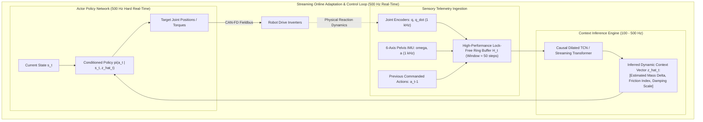
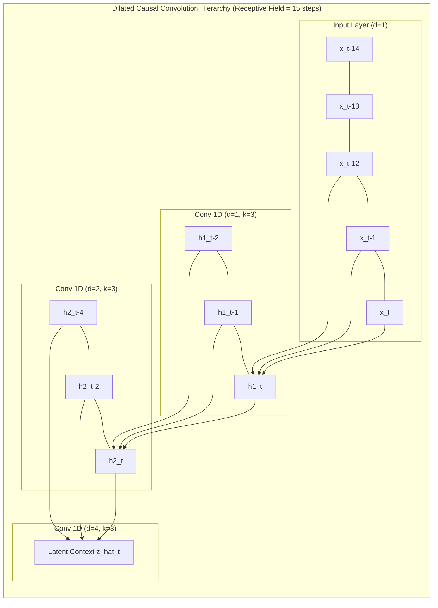

import ChapterProgress from '@site/src/components/ChapterProgress';
import QuizEngine from '@site/src/components/QuizEngine';

# Online Adaptation Modules: Temporal Convolutions to Transformers

When a humanoid robot transitions from hard dry concrete onto wet grass, steps into loose sand, or picks up a heavy 8 kg package in its hands, the underlying multi-body dynamics undergo instantaneous, unmodeled shifts. A static policy trained under nominal assumptions lacks the flexibility to adapt: its motor commands will under-compensate for added mass or over-torque on slick surfaces, inducing foot slip and catastrophic tip-over.

To navigate non-stationary real-world environments, modern control pipelines integrate **Online Adaptation Modules**. These architectures operate concurrently with the high-frequency control loop, ingesting a sliding temporal window of proprioceptive measurements to infer dynamic environment shifts in real time. From classical Recursive Least Squares (RLS) to causal dilated Temporal Convolutional Networks (TCN) and streaming Transformers, adaptation modules bridge the reality gap during physical deployment.



---

## 1. Classical Online System Identification: Recursive Least Squares (RLS)

Before deep neural context encoders, adaptive control relied on online parametric estimators. Consider the linear observation model where scalar observation $y_t$ relates to an unknown, slowly-varying parameter vector $\boldsymbol{\theta}_t \in \mathbb{R}^d$ through a regressor $\boldsymbol{\phi}_t \in \mathbb{R}^d$:

$$
y_t = \boldsymbol{\phi}_t^T \boldsymbol{\theta}_t + \epsilon_t, \quad \epsilon_t \sim \mathcal{N}(0, \sigma^2)
$$

In robot mass estimation, $y_t$ represents the vertical ground reaction force or joint torque $\tau$, $\boldsymbol{\phi}_t$ is the kinematic acceleration regressor, and $\boldsymbol{\theta}_t$ is the unknown payload mass $m_{\text{load}}$.

### 1.1 The RLS Algorithm with Exponential Forgetting
To track time-varying parameters (e.g., dropping or picking up an object), classical least squares is augmented with an **exponential forgetting factor** $\lambda \in (0, 1]$ (typically $\lambda \in [0.98, 0.999]$), which progressively discounts historical observations:

$$
\mathcal{J}(\boldsymbol{\theta}) = \sum_{k=1}^t \lambda^{t-k} \left( y_k - \boldsymbol{\phi}_k^T \boldsymbol{\theta} \right)^2
$$

The real-time recursive update evaluates in $O(d^2)$ time per cycle without matrix inversion:

1. **Innovation Vector**: Compute the prediction error:
   $$
   e_t = y_t - \boldsymbol{\phi}_t^T \hat{\boldsymbol{\theta}}_{t-1}
   $$
2. **Gain Vector**: Update Kalman gain $\mathbf{K}_t \in \mathbb{R}^d$:
   $$
   \mathbf{K}_t = \frac{\mathbf{P}_{t-1} \boldsymbol{\phi}_t}{\lambda + \boldsymbol{\phi}_t^T \mathbf{P}_{t-1} \boldsymbol{\phi}_t}
   $$
3. **Parameter Estimate Update**:
   $$
   \hat{\boldsymbol{\theta}}_t = \hat{\boldsymbol{\theta}}_{t-1} + \mathbf{K}_t e_t
   $$
4. **Covariance Matrix Update**:
   $$
   \mathbf{P}_t = \frac{1}{\lambda} \left( \mathbf{I} - \mathbf{K}_t \boldsymbol{\phi}_t^T \right) \mathbf{P}_{t-1}
   $$

---

## 2. Deep Learned Adaptation Architectures

While RLS operates effectively on linear parameter models, complex robot interactions (such as foot impact slippage, soil sinking, and cable harness drag) are non-linear and non-parametric. Modern learning-based methods deploy deep sequence models.



### 2.1 Dilated Temporal Convolutional Networks (TCN)
A **Temporal Convolutional Network** (TCN) enforces two essential real-time properties:
1. **Causality**: The convolution at timestep $t$ depends strictly on inputs up to and including $t$ ($x_0, \dots, x_t$), with zero leakage from future timesteps $t+1$.
2. **Exponentially Dilated Receptive Field**: Standard 1D convolutions expand their receptive field linearly ($O(L \cdot K)$). By doubling dilation factor $d = 2^l$ at each layer $l \in \{0, 1, \dots, L-1\}$, the effective receptive field $R$ expands exponentially:

$$
R = 1 + \sum_{l=0}^{L-1} (K - 1) \cdot 2^l = 1 + (K - 1)(2^L - 1)
$$

For kernel size $K = 3$ and $L = 5$ layers, a TCN covers $R = 1 + 2 \times 31 = 63$ timesteps ($1.26\text{ seconds}$ at 50 Hz) with only 5 convolutional layers, evaluating in under $0.5\text{ ms}$ on an embedded GPU.

### 2.2 Causal Self-Attention Transformers
For long-horizon context where past events minutes earlier matter (e.g., thermal motor derating over an extended walk), causal multi-head self-attention offers unbounded associative recall:

$$
\text{Attention}(\mathbf{Q}, \mathbf{K}, \mathbf{V}) = \operatorname{softmax}\left( \frac{\mathbf{Q} \mathbf{K}^T}{\sqrt{d_k}} + \mathbf{M} \right) \mathbf{V}
$$

where $\mathbf{M}_{i, j} = -\infty$ for $j > i$ enforces strict causal autoregressive masking. During streaming physical deployment, the **Key-Value Cache (KV-cache)** prevents redundant re-computation of historical states, allowing step updates in $O(T \cdot d)$ rather than $O(T^2 \cdot d)$ time.

---

## 3. Adaptation Architecture Comparison

| Architecture | Model Capacity | History Horizon ($K$) | Inference Time (Jetson Orin) | Memory Footprint | Online Convergence Time |
| :--- | :--- | :--- | :--- | :--- | :--- |
| **Recursive Least Squares (RLS)** | Linear ($d \le 10$) | Infinite (Weighted by $\lambda$) | $< 0.05\text{ ms}$ | $< 1\text{ KB}$ | 10–50 steps (Rapid linear convergence) |
| **Extended Kalman Filter (EKF)** | Non-linear parametric | Instantaneous Markovian | $0.15\text{ ms}$ | $< 5\text{ KB}$ | 20–100 steps (Sensitive to noise covariance $\mathbf{Q}$) |
| **Gated Recurrent Unit (GRU)** | Medium non-linear | 30–50 steps | $0.60\text{ ms}$ | $50\text{ KB}$ | 5–15 steps |
| **Dilated Causal TCN** | High non-linear | 50–100 steps | $0.45\text{ ms}$ | $120\text{ KB}$ | 2–5 steps (Zero hidden-state drift) |
| **Causal Transformer (with KV)** | Very High multi-modal | 100–500 steps | $2.20\text{ ms}$ | $4.5\text{ MB}$ | 5–20 steps |

---

## 4. Production Python Implementation: Streaming Causal TCN Adaptation Module

The following module implements a complete, production-grade PyTorch Causal Dilated TCN. It features a lock-free streaming ring buffer designed to ingest 1 kHz proprioceptive telemetry and output real-time payload mass and friction estimates:

```python
#!/usr/bin/env python3
"""
streaming_tcn_adaptation.py
Production-grade Dilated Causal Temporal Convolutional Network (TCN)
for real-time online system identification and dynamic context estimation.
"""

import torch
import torch.nn as nn
import numpy as np
from typing import Tuple


class CausalConv1dBlock(nn.Module):
    """
    Dilated 1D Causal Convolutional block with weight normalization,
    causal padding, and residual skip connection.
    """

    def __init__(self, in_channels: int, out_channels: int, kernel_size: int, dilation: int):
        super().__init__()
        self.dilation = dilation
        self.kernel_size = kernel_size
        self.padding = (kernel_size - 1) * dilation

        self.conv = nn.Conv1d(
            in_channels,
            out_channels,
            kernel_size,
            padding=self.padding,
            dilation=dilation,
        )
        self.relu = nn.ELU()
        self.downsample = (
            nn.Conv1d(in_channels, out_channels, 1)
            if in_channels != out_channels
            else nn.Identity()
        )

    def forward(self, x: torch.Tensor) -> torch.Tensor:
        """
        x: (Batch, Channels, Time)
        """
        res = self.downsample(x)
        # Apply convolution with full padding
        out = self.conv(x)
        # Enforce causality: trim extra padding strictly from the right (future)
        if self.padding != 0:
            out = out[:, :, : -self.padding]
        out = self.relu(out + res)
        return out


class CausalTCNAdaptationNet(nn.Module):
    """
    Multi-layer Dilated Causal TCN predicting environmental latent context z_t
    (e.g., payload mass, terrain friction coefficient) from proprioceptive history.
    """

    def __init__(
        self,
        input_dim: int = 36,
        latent_dim: int = 4,
        num_channels: Tuple[int, ...] = (32, 64, 64, 32),
        kernel_size: int = 3,
    ):
        super().__init__()
        layers = []
        in_c = input_dim

        for i, out_c in enumerate(num_channels):
            dilation = 2 ** i
            layers.append(CausalConv1dBlock(in_c, out_c, kernel_size, dilation))
            in_c = out_c

        self.network = nn.Sequential(*layers)
        self.head = nn.Linear(num_channels[-1], latent_dim)

    def forward(self, x: torch.Tensor) -> torch.Tensor:
        """
        Args:
            x: Input sequence tensor of shape (Batch, Time, Input_Dim)
        Returns:
            Latent context prediction z_t of shape (Batch, Latent_Dim)
        """
        # Transpose to (Batch, Channels, Time)
        x_trans = x.transpose(1, 2)
        feats = self.network(x_trans)
        # Take the most recent feature at final timestep T
        latest_feat = feats[:, :, -1]
        z_hat = self.head(latest_feat)
        return z_hat


class StreamingAdaptationBuffer:
    """
    High-speed circular ring buffer storing rolling proprioceptive states
    for real-time streaming inference without dynamic heap allocations.
    """

    def __init__(self, window_size: int = 50, feature_dim: int = 36):
        self.window_size = window_size
        self.feature_dim = feature_dim
        self.buffer = np.zeros((window_size, feature_dim), dtype=np.float32)
        self.count = 0

    def push(self, state_vector: np.ndarray):
        """Appends latest state vector into the circular buffer."""
        # Shift left by 1 and insert at end
        self.buffer[:-1] = self.buffer[1:]
        self.buffer[-1] = state_vector
        self.count += 1

    def is_primed(self) -> bool:
        """Returns True if the buffer has ingested at least window_size samples."""
        return self.count >= self.window_size

    def get_torch_tensor(self, device: torch.device) -> torch.Tensor:
        """Exports buffer as batch-1 PyTorch tensor: (1, window_size, feature_dim)."""
        tensor = torch.from_numpy(self.buffer).unsqueeze(0).to(device)
        return tensor


if __name__ == "__main__":
    torch.manual_seed(42)
    device = torch.device("cpu")

    feature_dim = 36  # Joint positions, velocities, IMU gyro & accel
    window_len = 50   # 50 timesteps (1 second of history at 50 Hz)
    latent_dim = 4    # [payload_mass_kg, friction_coef, damping_scale, com_shift_z]

    # Instantiate TCN adaptation network
    tcn_model = CausalTCNAdaptationNet(
        input_dim=feature_dim, latent_dim=latent_dim, num_channels=(32, 64, 64, 32)
    ).to(device)
    tcn_model.eval()

    # Instantiate real-time streaming buffer
    stream_buffer = StreamingAdaptationBuffer(window_size=window_len, feature_dim=feature_dim)

    print("=== Streaming Causal TCN Online Adaptation Test ===")
    print(f"Total Model Parameters: {sum(p.numel() for p in tcn_model.parameters()):,}")

    # Simulate 70 continuous time steps of incoming 50 Hz robot feedback
    for t_step in range(1, 71):
        # Synthetic sensory frame with an abrupt payload change at step 50
        payload_true = 0.0 if t_step < 50 else 5.0  # +5 kg added to robot torso
        synthetic_state = np.random.normal(0.0, 0.1, size=feature_dim).astype(np.float32)
        synthetic_state[0] += payload_true * 0.05   # Hip joint deflection under load

        stream_buffer.push(synthetic_state)

        if stream_buffer.is_primed() and t_step % 5 == 0:
            with torch.no_grad():
                input_tensor = stream_buffer.get_torch_tensor(device)
                z_hat = tcn_model(input_tensor)
                print(
                    f"Timestep {t_step:02d} | "
                    f"Estimated Latent Context [Mass, Friction, Damping, CoM]: "
                    f"{z_hat[0].numpy().round(3)}"
                )
```

---

## 5. Research Foundations & Seminal Literature

1. **Yu, W., Tan, J., Liu, C. K., & Turk, G. (2017).** *Preparing for the Unknown: Learning a Universal Policy with Online System Identification*. In Robotics: Science and Systems (RSS). [Pioneering paper introducing online system identification networks to predict dynamic physical parameters from state histories].
2. **Bai, S., Kolter, J. Z., & Koltun, V. (2018).** *An empirical evaluation of generic convolutional and recurrent networks for sequence modeling*. arXiv:1803.01271. [Demonstrates that dilated causal TCNs consistently match or outperform recurrent networks across long-horizon sequence tasks].
3. **Arndt, C., Muratore, F., & Peters, J. (2020).** *Meta-Reinforcement Learning for Sim-to-Real Transfer with Online System Identification*. In IEEE International Conference on Robotics and Automation (ICRA). [Couples online particle filters with meta-RL policies for rapid zero-shot hardware transfer].
4. **Lee, J., Hwangbo, J., Wellhausen, L., Koltun, V., & Hutter, M. (2020).** *Learning quadrupedal locomotion over challenging terrain*. Science Robotics, 5(47), eabc5986. [Deploys temporal convolutions on an ANYmal quadruped to infer non-rigid terrain properties in the Swiss Alps].
5. **Siekmann, J., Vallahis, K., Green, K., Godse, L., Fern, A., & Hurst, J. (2021).** *Sim-to-Real Transfer of Blind Bipedal Locomotion for Cassie With Neural Delay Modeling*. In IEEE/RSJ International Conference on Intelligent Robots and Systems (IROS). [Validates online temporal memory buffers for canceling out unmodeled physical actuator delay on bipedal robots].

---

## 6. Hands-On Lab Project: Real-Time Joint Damping & Payload Estimation

### Project Objective
In this hands-on project, you will build and validate a streaming adaptation pipeline in PyTorch. The goal is to detect and estimate sudden payload changes ($\Delta m \in [1, 8]\text{ kg}$) on a simulated robot within $200\text{ ms}$ of contact, without relying on external force sensors.

### Implementation Steps
1. Assemble a synthetic dataset of 2,000 trajectories where a humanoid robot carries varying masses ($0\text{ to }10\text{ kg}$) and experiences random joint damping coefficients ($0.05\text{ to }0.50\text{ Nms/rad}$).
2. Train the `CausalTCNAdaptationNet` on rolling 50-step windows using Mean Squared Error (MSE) loss against ground-truth mass and damping labels.
3. Integrate the trained model with the `StreamingAdaptationBuffer` and simulate a live robot telemetry stream operating at 50 Hz.
4. Inject a step-disturbance (adding $5\text{ kg}$ at $t = 2.0\text{ s}$) and measure how many timesteps elapsed before the estimated mass converges within $10\%$ of ground truth.

### Lab Success Criteria
- [ ] Confirm strict causality in the TCN by verifying that zero gradients backpropagate from future time indices.
- [ ] Achieve an $R^2 \ge 0.94$ score on payload mass estimation over the unseen test set.
- [ ] Maintain an end-to-end streaming inference execution time $< 1.0\text{ ms}$ per step on CPU and $< 0.3\text{ ms}$ on GPU.
- [ ] Demonstrate convergence to within $10\%$ of the target payload value within $\le 8$ timesteps ($160\text{ ms}$) following an abrupt step change.

---

<ChapterProgress chapterId="9-5-adaptation-modules" moduleId="module9" totalChapters={8} />

## Chapter Mastery Check

<QuizEngine
  quizId="quiz-9-5"
  title="Module 9.5 Mastery Check: Online Adaptation Modules"
  moduleId="module9"
  passThreshold={70}
  questions={[
    {
      id: "q1",
      question: "What mathematical property of Dilated Temporal Convolutional Networks (TCN) allows them to achieve wide receptive fields over historical telemetry without exploding computational cost?",
      options: [
        "Exponential dilation factors (d = 2^l) at each successive layer, expanding the receptive field exponentially while keeping kernel size and parameter count constant",
        "Replacing floating-point weights with binary integers",
        "Removing all activation functions between layers",
        "Downsampling the robot's physical control loop from 500 Hz to 1 Hz"
      ],
      correctIndex: 0,
      explanation: "By doubling the dilation factor at each layer (d = 1, 2, 4, 8, ...), the receptive field grows exponentially with depth (R = O(2^L * K)), enabling the network to observe dozens or hundreds of past timesteps with only a handful of convolutional layers."
    },
    {
      id: "q2",
      question: "In Recursive Least Squares (RLS), what is the function of the exponential forgetting factor lambda in the range (0, 1]?",
      options: [
        "It acts as a learning rate that anneals to zero",
        "It progressively discounts historical observations, allowing the estimator to track time-varying parameters such as changing payloads or thermal motor degradation",
        "It ensures the covariance matrix becomes singular",
        "It prevents the robot from falling over"
      ],
      correctIndex: 1,
      explanation: "A forgetting factor lambda < 1 exponentially downweights past data points relative to recent ones. This enables the estimator to adapt to non-stationary parameter shifts (such as a robot picking up a heavy box) rather than remaining locked onto ancient historical averages."
    },
    {
      id: "q3",
      question: "Why must causal padding in a 1D convolutional layer be trimmed strictly from the right side of the output tensor?",
      options: [
        "To satisfy PyTorch tensor dimension requirements",
        "To ensure strict causality by preventing future observations (timesteps t+1, t+2) from leaking into the computation of current state representation at time t",
        "To prevent NaN values during backpropagation",
        "Because hardware motors can only spin clockwise"
      ],
      correctIndex: 1,
      explanation: "Standard convolutions pad symmetrically on both sides, which causes future timesteps to influence earlier predictions. In causal convolutions, all padding is placed on the left (past), or symmetric padding is sliced to discard the rightmost entries, guaranteeing that state at time t depends only on past and present inputs."
    }
  ]}
/>
