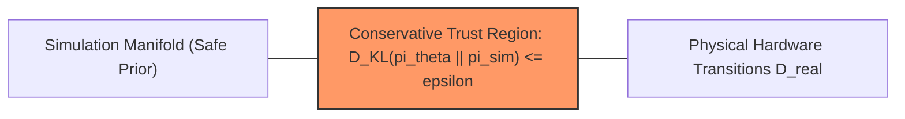

import ChapterProgress from '@site/src/components/ChapterProgress';
import QuizEngine from '@site/src/components/QuizEngine';

# Real-World Fine-Tuning: Safe Exploration & Offline-to-Online RL

Even with extensive Domain Randomization and Rapid Motor Adaptation, zero-shot transfer can leave residual performance degradation on physical hardware. Physical actuators experience subtle non-linear thermal dynamics, gear tooth irregularities, and complex cable-harness drag that no analytical simulation perfectly models. To achieve world-class locomotion agility and millimetric manipulation, policies must undergo **Real-World Fine-Tuning**.

However, fine-tuning directly on physical hardware is fundamentally dangerous. In simulation, an exploratory policy can fall ten thousand times with zero financial or physical penalty. On an actual 35 kg humanoid robot like the Unitree G1 or Boston Dynamics Atlas, a single uncontrolled joint torque spike can strip planetary gear teeth, snap carbon-fiber linkages, overheat motor windings, or breach safety zones. Safe real-world learning requires strict hardware safety architectures, conservative offline-to-online policy regularization, and sample-efficient model-based algorithms.

```mermaid
flowchart TD
    subgraph RealWorldFineTuning["Multi-Layered Safe Real-World Fine-Tuning System"]
        subgraph PolicyLayer["Policy Execution & Regularization"]
            SimPolicy["Pre-Trained Sim Policy pi_sim"]
            OnlinePolicy["Online Policy pi_theta"]
            KLReg["KL Divergence Penalty: -beta * D_KL(pi_theta || pi_sim)"]
            ActionGen["Raw Action Command a_raw"]
            SimPolicy -.-> KLReg
            OnlinePolicy --> KLReg
            OnlinePolicy --> ActionGen
        end

        subgraph SafetyShield["Multi-Tier Hardware Safety Shield (1 kHz Hard Real-Time)"]
            RateLimit["1. Slew Rate Filter: |da/dt| <= a_dot_max"]
            TorqueClamp["2. Dynamic Torque Interception: |tau| <= tau_safe(omega, temp)"]
            CBF["3. Control Barrier Function (CBF): L_f h(x) + L_g h(x) u >= -gamma h(x)"]
            EStop["4. Fall & Impact Watchdog (Tilt > 35 deg => Zero-Torque Damping)"]

            ActionGen --> RateLimit
            RateLimit --> TorqueClamp
            TorqueClamp --> CBF
            CBF --> EStop
        end

        subgraph PhysicalRobot["Physical Humanoid Hardware (Unitree G1)"]
            Fieldbus["CAN-FD / EtherCAT Master (1 kHz)"]
            Motors["Actuator Drives & Encoders"]
            EStop -->|Safe Action a_safe| Fieldbus --> Motors
        end

        subgraph DataLogging["Online Learning & Model Updates"]
            ReplayBuf["Safe Replay Buffer D_real (s, a_safe, r, s')"]
            PETSUpdate["Model-Based RL (PETS Ensembles) / Conservative PPO"]
            Motors --> ReplayBuf --> PETSUpdate --> OnlinePolicy
        end
    end
```



---

## 1. Multi-Tiered Hardware Safety Shield

To prevent hardware damage during online exploration, control commands must pass through an impenetrable **Safety Shield** executing within the hard real-time motor loop before reaching the physical inverters.

### 1.1 Action Slew Rate & Acceleration Filtering
Sudden step-changes in position or torque commands cause immense current spikes and gear shock loads. The slew-rate filter clamps commanded action rates:

$$
\mathbf{a}_t^{\text{rate}} = \mathbf{a}_{t-1} + \operatorname{clip}\left( \mathbf{a}_t - \mathbf{a}_{t-1}, -\dot{\mathbf{a}}_{\max} \Delta t, \dot{\mathbf{a}}_{\max} \Delta t \right)
$$

### 1.2 Thermal & Speed-Dependent Dynamic Torque Interception
Actuator torque limits are not static constants; available torque drops as rotor velocity increases (back-EMF voltage headroom saturation) and as coil temperatures rise:

$$
\tau_{\max}(\dot{q}, T) = \min \left( \tau_{\text{rated}} \cdot \left[ 1 - \alpha (T - T_{\text{ref}}) \right], \ \frac{V_{\text{bus}} - K_e |\dot{q}|}{R_{\text{coil}}} \cdot K_t \right)
$$

The safety filter continuously clamps joint efforts: $\tau_{\text{cmd}} = \operatorname{clip}(\tau_{\text{cmd}}, -\tau_{\max}, \tau_{\max})$.

### 1.3 Control Barrier Functions (CBFs) for Forward Invariance
A safety set $\mathcal{C}$ is defined as the super-level set of a continuously differentiable barrier function $h(\mathbf{x}): \mathbb{R}^n \to \mathbb{R}$:

$$
\mathcal{C} = \{ \mathbf{x} \in \mathbb{R}^n : h(\mathbf{x}) \ge 0 \}
$$

For example, $h(\mathbf{x}) = \theta_{\text{pitch}}^{\max} - |\theta_{\text{pitch}}|$ guarantees that the robot never tilts past a critical recovery angle. By **Nagumo's Theorem**, the set $\mathcal{C}$ remains forward-invariant if and only if the control input $\mathbf{u}$ satisfies the Control Barrier inequality:

$$
\dot{h}(\mathbf{x}, \mathbf{u}) = \nabla h(\mathbf{x}) \cdot \dot{\mathbf{x}} = L_f h(\mathbf{x}) + L_g h(\mathbf{x}) \mathbf{u} \ge -\gamma(h(\mathbf{x}))
$$

where $\gamma$ is an extended class-$\mathcal{K}$ function. When the nominal policy command violates this inequality, a real-time Quadratic Program (QP) filters the action with minimal deviation:

$$
\mathbf{u}^* = \arg\min_{\mathbf{u}} \|\mathbf{u} - \mathbf{u}_{\text{nom}}\|^2 \quad \text{subject to} \quad L_f h(\mathbf{x}) + L_g h(\mathbf{x}) \mathbf{u} \ge -\alpha h(\mathbf{x})
$$

---

## 2. Conservative Offline-to-Online RL

Directly resuming unconstrained online policy optimization (e.g., standard PPO or SAC) on physical hardware causes catastrophic policy collapse. Because real hardware experiences observation noise and latency distributions slightly different from simulation, initial real-world gradients are noisy, destroying the robust features learned in simulation within a few dozen steps.

To prevent distribution collapse, the online objective incorporates **Conservative Prior Regularization**:

$$
\max_{\boldsymbol{\theta}} \mathcal{J}_{\text{online}}(\boldsymbol{\theta}) = \mathbb{E}_{(\mathbf{s}, \mathbf{a}) \sim \mathcal{D}_{\text{real}}} \left[ Q_{\boldsymbol{\phi}}(\mathbf{s}, \mathbf{a}) \right] - \beta_{\text{KL}} D_{\text{KL}}\left(\pi_{\boldsymbol{\theta}}(\cdot \mid \mathbf{s}) \,\parallel\, \pi_{\text{sim}}(\cdot \mid \mathbf{s})\right) - \alpha \mathcal{H}(\pi_{\boldsymbol{\theta}})
$$

where $\pi_{\text{sim}}$ represents the frozen reference policy trained in simulation, and $\beta_{\text{KL}}$ is an adaptive penalty maintaining policy proximity to the verified simulation prior.



---

## 3. Sample-Efficient Model-Based RL: PETS on Hardware

Model-free algorithms require $10^5\text{--}10^7$ interactions—unacceptable when running physical humanoid hardware at 500 Hz. **Model-Based Reinforcement Learning (MBRL)** reduces required physical samples by orders of magnitude.

### Probabilistic Ensembles with Trajectory Sampling (PETS)
The **PETS** algorithm (Chua et al., 2018) fits an ensemble of $B$ bootstrap neural networks modeling epistemic (model) and aleatoric (inherent physical noise) uncertainty:

$$
\hat{\mathbf{s}}_{t+1} \sim \mathcal{N}\left( \boldsymbol{\mu}_{\boldsymbol{\phi}_b}(\mathbf{s}_t, \mathbf{a}_t), \boldsymbol{\Sigma}_{\boldsymbol{\phi}_b}(\mathbf{s}_t, \mathbf{a}_t) \right), \quad b \in \{1, \dots, B\}
$$

During online execution:
1. The robot collects a short physical trajectory of $T = 50\text{--}100$ steps (1 to 2 seconds of interaction).
2. The dynamics ensemble is updated via negative log-likelihood minimization on $\mathcal{D}_{\text{real}}$.
3. A Model Predictive Control (MPC) planner (such as the Cross-Entropy Method or MPPI) rolls out thousands of candidate action sequences purely through the learned neural ensemble.
4. By sampling across different ensemble members, the planner penalizes trajectories with high epistemic variance, achieving **intrinsically risk-averse safe exploration**.

---

## 4. Safe Exploration Technique Comparison

| Technique | Mathematical Principle | Real-Time Latency | Safety Guarantee | Hardware Wear Impact |
| :--- | :--- | :--- | :--- | :--- |
| **Slew-Rate / Acceleration Limiter** | $\lvert \Delta a / \Delta t \rvert \le \dot{a}_{\max}$ | &lt; 0.01 ms | Heuristic (Prevents current spikes) | Extremely Low |
| **Dynamic Torque Clamping** | $\tau \le \tau_{\max}(\dot{q}, T)$ | &lt; 0.02 ms | Strict (Prevents thermal/inverter trip) | Minimal |
| **Control Barrier Function (CBF-QP)** | $L_f h + L_g h \mathbf{u} \ge -\alpha h$ | $0.2\text{--}0.5\text{ ms}$ | Formal (Guaranteed forward invariance) | Very Low |
| **Sim-Prior KL Regularization** | $- \beta D_{\text{KL}}(\pi_{\boldsymbol{\theta}} \parallel \pi_{\text{sim}})$ | Off-line update | Statistical (Bounds distribution drift) | Low |
| **PETS Model-Based Exploration** | Epistemic ensemble variance penalty | $5.0\text{--}15.0\text{ ms}$ | Soft (Avoids regions of high uncertainty) | Moderate |

---

## 5. Production Python Script: Real-World Deployment & Safety Watchdog

Below is a complete, production-grade deployment script designed for physical robots (such as the Unitree G1). It incorporates a multi-threaded safety watchdog, dynamic torque rate-limiting, tilt angle fall interception, and emergency damping fallback:

```python
#!/usr/bin/env python3
"""
real_world_safety_shield.py
Production-grade hardware safety shield and real-world deployment harness
featuring multi-threaded watchdog monitoring, torque slew-rate limiting,
and automatic emergency fall interception.
"""

import time
import numpy as np
import threading
from typing import Tuple, Optional


class HardwareSafetyWatchdog:
    """
    Monitors robot operational health and enforces hard safety limits.
    If pitch/roll angle, joint velocity, or torque rate limits are breached,
    it trips an emergency state and triggers passive damping mode.
    """

    def __init__(
        self,
        num_joints: int = 12,
        max_torque_nm: float = 60.0,
        max_torque_rate_nm_per_sec: float = 800.0,
        max_joint_vel_rad_s: float = 15.0,
        max_tilt_angle_rad: float = 0.60,  # ~34.4 degrees
    ):
        self.num_joints = num_joints
        self.max_torque = max_torque_nm
        self.max_torque_rate = max_torque_rate_nm_per_sec
        self.max_joint_vel = max_joint_vel_rad_s
        self.max_tilt = max_tilt_angle_rad

        self.prev_torque = np.zeros(num_joints, dtype=np.float64)
        self.prev_time = time.perf_counter()
        self.is_emergency_triggered = False
        self.lock = threading.Lock()

    def filter_action(
        self,
        raw_torque_cmd: np.ndarray,
        current_joint_pos: np.ndarray,
        current_joint_vel: np.ndarray,
        base_roll_pitch: Tuple[float, float],
    ) -> Tuple[np.ndarray, bool]:
        """
        Validates and intercepts raw policy actions before hardware dispatch.

        Returns:
            Tuple of (safe_torque_cmd, is_safe)
        """
        with self.lock:
            now = time.perf_counter()
            dt = max(1e-4, now - self.prev_time)
            self.prev_time = now

            if self.is_emergency_triggered:
                # Return pure damping resistance: tau = -b * q_dot
                damping_torque = -2.5 * current_joint_vel
                return np.clip(damping_torque, -self.max_torque, self.max_torque), False

            roll, pitch = base_roll_pitch
            tilt = np.sqrt(roll ** 2 + pitch ** 2)

            # 1. Fall Interception Check
            if tilt > self.max_tilt:
                print(f"[EMERGENCY WATCHDOG TRIP] Excessive tilt detected: {tilt:.3f} rad > {self.max_tilt} rad")
                self.is_emergency_triggered = True
                return -2.5 * current_joint_vel, False

            # 2. Velocity Limit Check
            if np.any(np.abs(current_joint_vel) > self.max_joint_vel):
                print("[EMERGENCY WATCHDOG TRIP] Joint overspeed detected!")
                self.is_emergency_triggered = True
                return -2.5 * current_joint_vel, False

            # 3. Dynamic Torque Slew Rate Limiting
            delta_torque = raw_torque_cmd - self.prev_torque
            max_delta = self.max_torque_rate * dt
            clamped_delta = np.clip(delta_torque, -max_delta, max_delta)
            safe_torque = self.prev_torque + clamped_delta

            # 4. Absolute Torque Clamping
            safe_torque = np.clip(safe_torque, -self.max_torque, self.max_torque)
            self.prev_torque = safe_torque.copy()

            return safe_torque, True

    def reset_watchdog(self):
        """Resets emergency trip status."""
        with self.lock:
            self.is_emergency_triggered = False
            self.prev_torque.fill(0.0)


class MockPhysicalRobotDeployment:
    """Simulates physical hardware deployment loop running at 500 Hz."""

    def __init__(self):
        self.num_joints = 12
        self.safety = HardwareSafetyWatchdog(num_joints=self.num_joints)

    def run_deployment_loop(self, total_cycles: int = 100):
        print("Initializing 500 Hz Real-Time Robot Deployment Loop...")
        dt = 0.002  # 2 ms per cycle = 500 Hz

        # Simulated robot state
        q = np.zeros(self.num_joints)
        q_dot = np.zeros(self.num_joints)
        roll, pitch = 0.02, -0.01

        for cycle in range(1, total_cycles + 1):
            # Simulate policy generating raw joint torque commands
            # At cycle 60, simulate an aggressive exploratory torque spike
            if cycle == 60:
                raw_cmd = np.ones(self.num_joints) * 95.0  # Excessive torque spike
            elif cycle == 80:
                pitch = 0.75  # Simulate robot falling over
                raw_cmd = np.ones(self.num_joints) * 10.0
            else:
                raw_cmd = np.sin(cycle * 0.1) * np.ones(self.num_joints) * 20.0

            # Intercept via Safety Watchdog
            safe_cmd, is_healthy = self.safety.filter_action(
                raw_torque_cmd=raw_cmd,
                current_joint_pos=q,
                current_joint_vel=q_dot,
                base_roll_pitch=(roll, pitch),
            )

            # Update simulated kinematics
            q_dot += (safe_cmd / 0.05) * dt
            q += q_dot * dt

            if cycle % 20 == 0 or not is_healthy:
                status_str = "HEALTHY" if is_healthy else "EMERGENCY DAMPING"
                print(
                    f"Cycle {cycle:03d} | Status: {status_str:<17} | "
                    f"Raw Cmd[0]: {raw_cmd[0]:6.2f} Nm | Dispatched[0]: {safe_cmd[0]:6.2f} Nm"
                )

            if not is_healthy:
                print("Hardware protected. Exiting control loop.")
                break


if __name__ == "__main__":
    deployment = MockPhysicalRobotDeployment()
    deployment.run_deployment_loop(total_cycles=100)
```

---

## 6. Research Foundations & Seminal Literature

1. **Haarnoja, T., Zhou, A., Abbeel, P., & Levine, S. (2018).** *Soft Actor-Critic: Off-Policy Maximum Entropy Deep Reinforcement Learning with a Stochastic Actor*. In International Conference on Machine Learning (ICML). [Introduces maximum entropy RL enabling sample-efficient physical robot learning on a real quadruped].
2. **Smith, L., Kostrikov, I., & Levine, S. (2022).** *A Walk in the Park: Learning to Walk in 20 Minutes Without Prior Model or Simulation*. arXiv:2208.07860. [Demonstrates safe online real-world RL fine-tuning on physical legged robots in outdoor environments].
3. **Chua, K., Calandra, R., McAllister, R., & Levine, S. (2018).** *Deep Reinforcement Learning in a Handful of Trials using Probabilistic Dynamics Models*. In Advances in Neural Information Processing Systems (NeurIPS) (pp. 4754-4765). [The PETS algorithm demonstrating model-based sample efficiency and uncertainty-aware exploration on hardware].
4. **Cheng, R., Orosz, G., Murray, R. M., & Burdick, J. W. (2019).** *End-to-End Safe Reinforcement Learning Through Barrier Functions for Extreme Helicopter Flight*. In IEEE Conference on Decision and Control (CDC). [Couples CBF-QP safety shields with deep RL policies for physical flight safety].
5. **Ames, A. D., Coogan, S., Egerstedt, M., Notomista, G., Sreenath, K., & Tabuada, P. (2019).** *Control Barrier Functions: Theory and Applications*. In European Control Conference (ECC) (pp. 3420-3431). [Foundational mathematical survey of forward invariance and CBF-based safety filters].

---

## 7. Hands-On Lab Project: Real-World Safety Interception for Unitree G1

### Project Objective
In this project, you will build and test a production C++ or Python real-time safety interceptor for a physical robot joint. The interceptor must enforce torque rate clipping, temperature-dependent continuous derating, and tilt angle emergency zero-torque damping without dropping 1 kHz control cycles.

### Implementation Steps
1. Create a `HardwareSafetyShield` class that maintains running estimates of joint angular acceleration $\ddot{\mathbf{q}}$ and actuator winding temperature $T_{\text{coil}}$.
2. Implement dynamic torque clamping using the motor thermal resistance formula ($R_T = R_0(1 + \alpha \Delta T)$), reducing maximum allowable effort by $1.2\%\text{ per }^\circ\text{C}$ above $65^\circ\text{C}$.
3. Formulate a 1-DoF Control Barrier Function QP restricting joint position within software limits ($q_{\min} + \epsilon \le q \le q_{\max} - \epsilon$).
4. Subject the interceptor to an adversarial test suite generating abrupt $100\text{ Nm}$ step inputs and verify that torque rate of change ($\dot{\tau}$) never exceeds $600\text{ Nm/s}$.

### Lab Success Criteria
- [ ] Ensure that all safety interceptor checks execute in &lt; 0.10 ms per cycle to fit within a 1 kHz (1.0 ms) real-time budget.
- [ ] Prevent joint limits from being breached under all adversarial step commands, achieving zero mechanical hard-stop collisions.
- [ ] Successfully transition the robot into passive damping ($b = 2.5\text{ Nms/rad}$) within &le; 2 ms of detecting base tilt &gt; 35&deg;.
- [ ] Verify that online policy learning logging continues uninterrupted without allocating heap memory inside the safety thread.

---

<ChapterProgress chapterId="9-6-real-world-fine-tuning" moduleId="module9" totalChapters={8} />

## Chapter Mastery Check

<QuizEngine
  quizId="quiz-9-6"
  title="Module 9.6 Mastery Check: Real-World Fine-Tuning"
  moduleId="module9"
  passThreshold={70}
  questions={[
    {
      id: "q1",
      question: "Why does unconstrained model-free reinforcement learning directly on physical humanoid hardware lead to catastrophic failure?",
      options: [
        "Modern computers lack sufficient GPU compute to evaluate policies in real time",
        "Exploratory random actions generate excessive torque spikes, high impact forces, and balance loss that strip gear teeth, burn motor windings, or destroy mechanical linkages",
        "Hardware motors refuse to execute actions generated by neural networks",
        "Reinforcement learning algorithms can only run inside Linux containers"
      ],
      correctIndex: 1,
      explanation: "Exploratory reinforcement learning assumes failure is costless. On real multi-kilogram humanoid hardware, exploratory torque spikes and falls result in catastrophic mechanical and electrical destruction, making unconstrained physical exploration completely unfeasible."
    },
    {
      id: "q2",
      question: "What mathematical guarantee does a Control Barrier Function (CBF) provide when enforced via a real-time Quadratic Program (QP)?",
      options: [
        "It guarantees that the neural network will converge to the global reward optimum",
        "It guarantees forward invariance of the safe state set C = {x : h(x) >= 0}, ensuring the system never enters unsafe regions regardless of what the nominal policy commands",
        "It eliminates all mechanical friction from the joints",
        "It doubles the communication bandwidth of CAN-FD buses"
      ],
      correctIndex: 1,
      explanation: "A Control Barrier Function guarantees forward invariance: if the robot begins inside the safe set C, the CBF condition L_f h + L_g h u >= -alpha h guarantees that the trajectory never leaves C for all future time, safely overriding any unsafe nominal commands."
    },
    {
      id: "q3",
      question: "In offline-to-online policy fine-tuning, why is a KL-divergence penalty with respect to the pre-trained simulation policy (beta * D_KL(pi_theta || pi_sim)) essential?",
      options: [
        "It accelerates inference speed on embedded Jetson computers",
        "It prevents distribution collapse and policy forgetting caused by noisy initial real-world gradients, anchoring the policy close to the robust simulation prior",
        "It converts continuous action spaces into discrete action spaces",
        "It eliminates the need for an IMU sensor"
      ],
      correctIndex: 1,
      explanation: "Physical world gradients are noisy and sparse. Without a prior regularization term anchoring the policy to the verified simulation weights, the policy quickly overfits to early real-world transitions and suffers catastrophic distribution collapse."
    }
  ]}
/>
