import ChapterProgress from '@site/src/components/ChapterProgress';
import QuizEngine from '@site/src/components/QuizEngine';

# Sim-to-Real Transfer Benchmarks & Cross-Morphology Retargeting

In academic literature, claims of successful sim-to-real transfer are ubiquitous. Yet, until recently, evaluating transfer success lacked standardized quantitative rigor. Roboticists frequently reported cherry-picked video demonstrations or custom reward metrics that obscured massive real-world performance drops. A policy achieving $98\%$ task success in simulation might only achieve $40\%$ success on physical hardware—a massive degradation that unstandardized benchmarks fail to diagnose.

To elevate robotics to an empirical science, the field has established standardized benchmarks and rigorous transfer metrics, most notably the **Policy Transfer Degradation Ratio (PTDR)** and open cloud robotic testbeds like the **RealRobot Challenge**. Furthermore, as robotic fleets diversify, learning individual policies from scratch for every distinct robot model is economically intractable. **Cross-Morphology Retargeting** transfers policies across completely different kinematic topologies—such as transferring bipedal gait primitives from Cassie to Digit, or retargeting quadrupedal trot stabilization to full-sized humanoids like the Unitree G1.

```mermaid
flowchart TD
    subgraph RetargetingPipeline["Cross-Morphology Retargeting & Standardized Benchmarking Pipeline"]
        subgraph SourceDomain["Source Embodiment (e.g., Cassie Biped / Unitree Quadruped)"]
            SourcePolicy["Source Policy pi_src(a | s_src)"]
            SourceKinematics["Source State: q_src, q_dot_src, tau_src"]
            SourcePolicy --> SourceKinematics
        end

        subgraph KinematicRetargeting["Kinematic & Dynamic Alignment Layer"]
            CartesianMap["End-Effector Task-Space Mapping:\n x_ee_target = T_retarget(x_ee_source)"]
            IK_QP["Whole-Body Inverse Kinematics / QP Solver:\n min ||q_tgt - q_ref||^2 s.t. Kinematic Limits"]
            SourceKinematics --> CartesianMap --> IK_QP
        end

        subgraph TargetDomain["Target Embodiment (e.g., Unitree G1 Humanoid)"]
            TargetJoints["Target State: q_tgt, q_dot_tgt, tau_tgt"]
            IK_QP --> TargetJoints
            TargetHardware["Physical Humanoid Deployment"]
            TargetJoints --> TargetHardware
        end

        subgraph BenchmarkHarness["Standardized Transfer Evaluation Engine"]
            SimPerformance["Simulated Return J_sim(pi)"]
            RealPerformance["Physical Return J_real(pi)"]
            PTDRMetric["Policy Transfer Degradation Ratio:\n PTDR = 1 - (J_real / J_sim)"]
            StratifiedCI["Stratified Bootstrap Confidence Intervals (95% CI)"]

            SourcePolicy -.-> SimPerformance
            TargetHardware --> RealPerformance
            SimPerformance --> PTDRMetric
            RealPerformance --> PTDRMetric
            PTDRMetric --> StratifiedCI
        end
    end
```



---

## 1. Quantifying Sim-to-Real Transfer: Metrics & Degradation Ratios

A single scalar return value is insufficient to diagnose why a transfer failed. Transfer quality must be evaluated across multiple statistical dimensions.

### 1.1 Policy Transfer Degradation Ratio (PTDR)
The primary standardized metric for evaluating sim-to-real transfer is the **Policy Transfer Degradation Ratio (PTDR)**:

$$
\text{PTDR} = 1 - \frac{J_{\text{real}}(\pi)}{J_{\text{sim}}(\pi)}, \quad \text{where } J(\pi) = \mathbb{E}_{\tau \sim \pi} \left[ \sum_{t=0}^T \gamma^t R(s_t, a_t) \right]
$$

Interpreting the PTDR score:
- $\text{PTDR} = 0.0$: **Ideal Zero-Shot Transfer**. Real-world physical performance matches simulation expectations identically.
- $0.0 < \text{PTDR} \le 0.15$: **High-Fidelity Transfer**. Minor degradation attributable to nominal sensor noise and ambient variations.
- $0.15 < \text{PTDR} \le 0.40$: **Moderate Degradation**. Demonstrates basic viability, but suffers from unmodeled friction, phase delay, or compliance.
- $\text{PTDR} > 0.40$: **Catastrophic Failure / Negative Transfer**. The policy has overfitted to simulator-specific artifacts.
- $\text{PTDR} < 0.0$: **Conservative Simulation Effect**. Occurs when simulation domain randomization is overly severe; the physical robot encounters easier dynamics than simulated training environments.

### 1.2 Multi-Dimensional Transfer Scorecard
Beyond scalar return, rigorous benchmarks evaluate:
1. **Physical Success Rate (SR)**: Percentage of trials satisfying terminal goal criteria without human safety intervention.
2. **Kinematic Tracking RMSE**: Root mean square error between commanded and realized joint trajectories:
   $$
   \text{RMSE}_q = \sqrt{\frac{1}{T \cdot N} \sum_{t=1}^T \sum_{i=1}^N \left( q_{i, \text{cmd}}[t] - q_{i, \text{meas}}[t] \right)^2}
   $$
3. **Cost of Transport (CoT)**: Energetic efficiency of locomotion across distance $d$:
   $$
   \text{CoT} = \frac{E_{\text{electrical}}}{m_{\text{robot}} g d} = \frac{\int_0^T \sum_{i=1}^N |\tau_i(t) \dot{q}_i(t)| dt}{m_{\text{robot}} g d}
   $$
4. **Failure Mode Entropy**: Distribution of failure causes (e.g., foot collision, torque saturation, thermal trip, state estimation drift).

---

## 2. Standardized Community Benchmarking Platforms

To eliminate the "lab-specific hardware bias" where only the team that built the robot can reproduce results, the robotics community has developed standardized, remotely accessible benchmarking platforms:

| Benchmark Platform | Hardware Architecture | Primary Task Domain | Remote Cloud Access | Standard Baseline Algorithms |
| :--- | :--- | :--- | :--- | :--- |
| **RealRobot Challenge (MPI)** | TriFinger 3-DoF Robotic Hands | Dexterous In-Hand Manipulation (Cubes, Balls) | Yes (Automated 24/7 cloud execution) | Residual PPO, Model-Based MPC, DiffPhysics |
| **RoboSuite / Robomimic** | Franka Emika Panda, Kinova Gen3 | Tabletop Manipulation, Peg-in-Hole, Assembly | Partial (Simulation with standardized hardware logs) | Diffusion Policy, ACT, SAC, BC |
| **Legged Gym Benchmark** | Unitree A1, Go1, Cassie, G1 | Dynamic Locomotion, Rough Terrain, Stairs | No (Requires physical robot deployment) | PPO, RMA, DreamWaQ, Asymmetric AC |
| **Open X-Embodiment (RT-X)** | 22 Heterogeneous Embodiments | Generalist Manipulation & Object Navigation | Open Dataset ($1\text{M}+$ real robot trajectories) | VLA (RT-1, RT-2, Octo, OpenVLA) |

---

## 3. Cross-Morphology Policy Retargeting

When developing policies for a new robot morphology (e.g., retargeting a stable quadruped or bipedal policy from a Cassie robot to a Unitree G1 humanoid), training from scratch requires millions of GPU steps. **Cross-Morphology Retargeting** leverages kinematic and dynamic mappings to reuse existing policy representations.


### 3.1 Kinematic Mapping Formulation
Let $\mathbf{q}_{\text{src}} \in \mathbb{R}^{n_{\text{src}}}$ and $\mathbf{q}_{\text{tgt}} \in \mathbb{R}^{n_{\text{tgt}}}$ denote the joint coordinates of the source and target robots. When degrees of freedom differ, direct joint mapping is ill-posed. Instead, retargeting is formulated in **operational task space**:

$$
\mathbf{x}_{\text{task}} = f_{\text{FK}, \text{src}}(\mathbf{q}_{\text{src}}), \quad \mathbf{x}_{\text{task}} \in \mathbb{R}^6 \text{ (End-effector pose or foot placement)}
$$

The target joint trajectory is recovered by solving a real-time Quadratic Program (QP) subject to target joint limits and torque bounds:

$$
\min_{\dot{\mathbf{q}}_{\text{tgt}}} \left\| \mathbf{J}_{\text{tgt}}(\mathbf{q}_{\text{tgt}}) \dot{\mathbf{q}}_{\text{tgt}} - \dot{\mathbf{x}}_{\text{task}} \right\|_{\mathbf{W}_x}^2 + \lambda \|\dot{\mathbf{q}}_{\text{tgt}}\|_{\mathbf{W}_q}^2
$$

subject to:

$$
\mathbf{q}_{\min} \le \mathbf{q}_{\text{tgt}} + \dot{\mathbf{q}}_{\text{tgt}} \Delta t \le \mathbf{q}_{\max}, \quad |\boldsymbol{\tau}_{\text{tgt}}| \le \boldsymbol{\tau}_{\max}
$$

### 3.2 Dynamic Inertia Compensation
Even if kinematics are aligned, divergent link mass distributions alter the required torques. The target feedforward torque $\boldsymbol{\tau}_{\text{ff}}$ accounts for the ratio of link inertias:

$$
\boldsymbol{\tau}_{\text{tgt}} = \mathbf{M}_{\text{tgt}}(\mathbf{q}_{\text{tgt}}) \mathbf{J}_{\text{tgt}}^{\dagger} \left( \ddot{\mathbf{x}}_{\text{task}} - \dot{\mathbf{J}}_{\text{tgt}} \dot{\mathbf{q}}_{\text{tgt}} \right) + \mathbf{C}_{\text{tgt}} \dot{\mathbf{q}}_{\text{tgt}} + \mathbf{g}_{\text{tgt}}
$$

---

## 4. Production Python Script: Automated Sim-to-Real Benchmark Suite

Below is a complete, production-grade benchmarking harness in Python. It ingests paired simulated and real robot trial logs, computes the Policy Transfer Degradation Ratio (PTDR), calculates 95% stratified bootstrap confidence intervals, and exports standardized evaluation metrics:

```python
#!/usr/bin/env python3
"""
transfer_benchmarks.py
Production-grade Sim-to-Real transfer evaluation suite computing
Policy Transfer Degradation Ratio (PTDR), Cost of Transport (CoT),
and Stratified Bootstrap Confidence Intervals across trials.
"""

import numpy as np
from typing import Dict, List, Tuple


class TransferBenchmarkEvaluator:
    """Computes rigorous statistical transfer benchmarks from trial logs."""

    def __init__(self, bootstrap_samples: int = 2000, alpha_ci: float = 0.05):
        self.n_boot = bootstrap_samples
        self.alpha = alpha_ci

    def compute_ptdr(
        self, sim_returns: np.ndarray, real_returns: np.ndarray
    ) -> Tuple[float, Tuple[float, float]]:
        """
        Computes Policy Transfer Degradation Ratio (PTDR) with 95% bootstrap CI.

        PTDR = 1 - (mean(J_real) / mean(J_sim))
        """
        assert len(sim_returns) > 0 and len(real_returns) > 0

        mean_sim = np.mean(sim_returns)
        mean_real = np.mean(real_returns)

        ptdr_point = 1.0 - (mean_real / mean_sim)

        # Stratified bootstrap resampling
        boot_ptdr = np.zeros(self.n_boot)
        n_s = len(sim_returns)
        n_r = len(real_returns)

        for b in range(self.n_boot):
            sample_sim = np.random.choice(sim_returns, size=n_s, replace=True)
            sample_real = np.random.choice(real_returns, size=n_r, replace=True)
            boot_ptdr[b] = 1.0 - (np.mean(sample_real) / np.mean(sample_sim))

        low_ci = float(np.percentile(boot_ptdr, 100.0 * (self.alpha / 2.0)))
        high_ci = float(np.percentile(boot_ptdr, 100.0 * (1.0 - self.alpha / 2.0)))

        return float(ptdr_point), (low_ci, high_ci)

    def compute_cost_of_transport(
        self,
        joint_torques: np.ndarray,
        joint_velocities: np.ndarray,
        robot_mass_kg: float,
        distance_meters: float,
        dt: float = 0.002,
    ) -> float:
        """
        Calculates Dimensionless Cost of Transport (CoT):
        CoT = E_electrical / (m * g * d) = sum(|tau * omega|) * dt / (m * g * d)
        """
        assert joint_torques.shape == joint_velocities.shape
        # Total mechanical energy
        power = np.sum(np.abs(joint_torques * joint_velocities), axis=-1)  # (T,)
        energy_joules = np.sum(power) * dt

        gravity = 9.81
        cot = energy_joules / (robot_mass_kg * gravity * distance_meters)
        return float(cot)

    def evaluate_full_benchmark(
        self,
        sim_eval_data: Dict[str, np.ndarray],
        real_eval_data: Dict[str, np.ndarray],
        robot_mass_kg: float = 35.0,
        trial_distance_m: float = 5.0,
    ) -> Dict[str, any]:
        """
        Runs comprehensive multi-dimensional transfer evaluation.
        """
        sim_returns = sim_eval_data["returns"]
        real_returns = real_eval_data["returns"]

        ptdr, (ptdr_low, ptdr_high) = self.compute_ptdr(sim_returns, real_returns)

        # Real-world success rate (return threshold >= 80% nominal sim mean)
        success_threshold = 0.80 * np.mean(sim_returns)
        success_rate = float(np.mean(real_returns >= success_threshold) * 100.0)

        # Cost of Transport comparison
        sim_cot = self.compute_cost_of_transport(
            sim_eval_data["torques"],
            sim_eval_data["velocities"],
            robot_mass_kg,
            trial_distance_m,
        )
        real_cot = self.compute_cost_of_transport(
            real_eval_data["torques"],
            real_eval_data["velocities"],
            robot_mass_kg,
            trial_distance_m,
        )

        return {
            "ptdr_point": ptdr,
            "ptdr_ci_95": (ptdr_low, ptdr_high),
            "sim_mean_return": float(np.mean(sim_returns)),
            "real_mean_return": float(np.mean(real_returns)),
            "real_success_rate_pct": success_rate,
            "sim_cot": sim_cot,
            "real_cot": real_cot,
            "cot_inflation_pct": float(((real_cot - sim_cot) / sim_cot) * 100.0),
        }


if __name__ == "__main__":
    np.random.seed(42)

    evaluator = TransferBenchmarkEvaluator(bootstrap_samples=2000)

    # 1. Synthesize 50 evaluation trials in simulation
    n_trials = 50
    sim_returns = np.random.normal(loc=450.0, scale=25.0, size=n_trials)

    # 2. Synthesize 50 physical evaluation trials (showing 18% degradation and higher variance)
    real_returns = np.random.normal(loc=369.0, scale=45.0, size=n_trials)

    # Synthetic torque and velocity data for a 12-DoF biped over 2500 steps (5 sec @ 500 Hz)
    timesteps = 2500
    n_joints = 12
    sim_torques = np.random.normal(15.0, 5.0, size=(timesteps, n_joints))
    sim_velocities = np.random.normal(2.0, 0.5, size=(timesteps, n_joints))

    real_torques = sim_torques * 1.15  # Real robot requires 15% more torque due to friction
    real_velocities = sim_velocities * 0.98

    sim_data = {"returns": sim_returns, "torques": sim_torques, "velocities": sim_velocities}
    real_data = {"returns": real_returns, "torques": real_torques, "velocities": real_velocities}

    results = evaluator.evaluate_full_benchmark(
        sim_data, real_data, robot_mass_kg=35.0, trial_distance_m=5.0
    )

    print("=== Sim-to-Real Benchmark Evaluation Report ===")
    print(f"  Sim Return Mean:          {results['sim_mean_return']:.2f}")
    print(f"  Real Return Mean:         {results['real_mean_return']:.2f}")
    print(f"  PTDR Score:               {results['ptdr_point']:.4f} (95% CI: [{results['ptdr_ci_95'][0]:.4f}, {results['ptdr_ci_95'][1]:.4f}])")
    print(f"  Real-World Success Rate:  {results['real_success_rate_pct']:.1f}%")
    print(f"  Sim Cost of Transport:    {results['sim_cot']:.4f}")
    print(f"  Real Cost of Transport:   {results['real_cot']:.4f} (+{results['cot_inflation_pct']:.1f}% energy inflation)")
```

---

## 5. Research Foundations & Seminal Literature

1. **Wüthrich, M., Widmaier, F., Bauer, F., Akpo, J., Mehrjou, A., Agrawal, P., Rätsch, G., & Schölkopf, B. (2020).** *TriFinger: An Open-Source Robot for Learning Dexterous Manipulation*. In Conference on Robot Learning (CoRL). [Establishes the RealRobot Challenge standardized cloud robotics testbed].
2. **Julian, R., Swanson, K., Sukhatme, G. S., Levine, S., Finn, C., & Hausman, K. (2020).** *Never Stop Learning: The Effectiveness of Fine-Tuning in Robotic Reinforcement Learning*. In Conference on Robot Learning (CoRL). [Formulates quantitative degradation tracking across simulation pre-training and real-world execution].
3. **Peng, X. B., Coumans, E., Zhang, T., Lee, T. W., Tan, J., & Levine, S. (2020).** *Learning agile robotic locomotion skills by imitating animals*. ACM Transactions on Graphics (TOG), 39(4), 1-14. [Defines cross-morphology kinematic retargeting from animal motion capture to quadruped robots].
4. **Siekmann, J., Godse, L., Fern, A., & Hurst, J. (2021).** *Sim-to-Real Transfer of Blind Bipedal Locomotion for Cassie With Neural Delay Modeling*. In IEEE/RSJ International Conference on Intelligent Robots and Systems (IROS). [Validates standardized bipedal benchmarks across varied outdoor terrains].
5. **Agarwal, R., Schwarzer, M., Castro, P. S., Courville, A. C., & Bellemare, M. (2021).** *Deep Reinforcement Learning at the Edge of the Statistical Precipice*. In Advances in Neural Information Processing Systems (NeurIPS). [Seminal statistical methodology advocating stratified bootstrap confidence intervals and performance profiles for RL benchmarking].

---

## 6. Hands-On Lab Project: Computing PTDR Across Robot Embodiments

### Project Objective
In this lab, you will evaluate a sim-to-real transfer pipeline across paired simulation and physical hardware logs. You will compute the empirical Policy Transfer Degradation Ratio (PTDR), generate stratified bootstrap confidence intervals, and retarget an end-effector trajectory between two distinct robotic arm configurations.

### Implementation Steps
1. Ingest simulated and physical robot trajectory logs (100 trials each) recorded during an obstacle avoidance locomotion task.
2. Calculate the Point PTDR and construct a 95% stratified bootstrap confidence interval using 2,000 resamples.
3. Formulate an operational space kinematic retargeting mapping matrix $\mathbf{T}_{\text{map}}$ to adapt foot-swing trajectories from an 8-DoF quadruped leg onto a 6-DoF humanoid leg.
4. Verify that retargeted joint kinematics remain strictly within physical position and torque limits.

### Lab Success Criteria
- [ ] Correctly compute the Policy Transfer Degradation Ratio (PTDR) within $\pm 0.001$ numerical tolerance.
- [ ] Generate 95% bootstrap confidence intervals verifying that the point estimate lies strictly within the interval bounds.
- [ ] Successfully solve the operational space Inverse Kinematics QP at 500 Hz with zero kinematic joint limit violations.
- [ ] Export a comprehensive JSON benchmark summary report complying with the NeurIPS RL reporting standards.

---

<ChapterProgress chapterId="9-7-transfer-benchmarks" moduleId="module9" totalChapters={8} />

## Chapter Mastery Check

<QuizEngine
  quizId="quiz-9-7"
  title="Module 9.7 Mastery Check: Transfer Benchmarks & Retargeting"
  moduleId="module9"
  passThreshold={70}
  questions={[
    {
      id: "q1",
      question: "How is the Policy Transfer Degradation Ratio (PTDR) mathematically formulated, and what does a value of PTDR = 0.0 indicate?",
      options: [
        "PTDR = J_real / J_sim; 0.0 indicates complete policy failure",
        "PTDR = 1 - (J_real / J_sim); 0.0 indicates ideal zero-shot transfer where physical performance perfectly matches simulation expectations",
        "PTDR = J_sim - J_real; 0.0 indicates the robot has zero mass",
        "PTDR = log(J_real); 0.0 indicates infinite reward"
      ],
      correctIndex: 1,
      explanation: "PTDR is defined as 1 - (J_real / J_sim). When physical return J_real equals simulated return J_sim, PTDR = 0.0, representing flawless zero-shot transfer without degradation."
    },
    {
      id: "q2",
      question: "Why are stratified bootstrap confidence intervals required when evaluating robotic reinforcement learning transfer?",
      options: [
        "Because Python cannot compute standard deviations on robot data",
        "Because small sample sizes (e.g., 20-50 physical trials) with heavy-tailed, non-Gaussian performance distributions render simple mean and standard deviation metrics misleading",
        "Because bootstrap intervals eliminate the need to run physical experiments",
        "To satisfy CAN bus protocol requirements"
      ],
      correctIndex: 1,
      explanation: "Physical robot trials are costly and limited in count, resulting in skewed, heavy-tailed return distributions. Bootstrap percentile intervals provide statistically valid confidence bounds without relying on invalid Gaussian assumptions."
    },
    {
      id: "q3",
      question: "When retargeting policies across divergent robot morphologies (e.g., Cassie biped to Unitree G1 humanoid), why is retargeting formulated in operational task space rather than joint space?",
      options: [
        "Because joint spaces have different numbers of degrees of freedom, link lengths, and joint axis orientations, making direct joint-to-joint mapping geometrically invalid",
        "Because operational space does not require linear algebra",
        "Because task space eliminates all joint friction",
        "Because humanoid robots lack joint encoders"
      ],
      correctIndex: 0,
      explanation: "Different robot morphologies have completely different joint configurations, kinematics, and DoFs. Operational task space (e.g., foot placement relative to the pelvis or end-effector trajectories) provides a common physical coordinate frame that can be resolved into target joints via inverse kinematics."
    }
  ]}
/>
