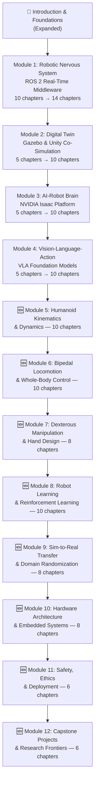
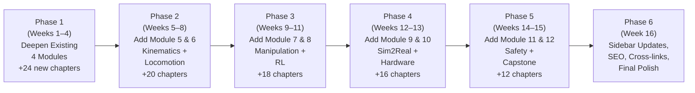

# 🤖 Master Plan: World's Best Humanoid Robotics Open Curriculum
### Physical AI & Humanoid Robotics — Complete Expansion Blueprint

> [!IMPORTANT]
> This master plan expands the existing 4-module, ~26-chapter curriculum into a **12-module, 100+ chapter definitive engineering treatise** — the world's most comprehensive open-access humanoid robotics textbook.

---

## 📊 Current State vs. Target State

| Dimension | Current | Target |
|:---|:---|:---|
| Modules | 4 | **12** |
| Total Chapters | ~26 | **100+** |
| Intro Depth | Medium | **World-class (graduate-level)** |
| Math Coverage | Basic | **Full derivations, proofs, pseudocode** |
| Code Examples | Limited | **Complete, runnable lab projects** |
| Hardware Specs | Tables | **Deep teardown + circuit analysis** |
| Research Papers | ~12 refs | **200+ curated citations** |
| Practice Projects | Minimal | **48 hands-on lab projects** |
| Difficulty Levels | Advanced only | **Beginner → Research-Frontier** |

---

## 🗺️ Full Curriculum Architecture (12 Modules)



---

## 📘 PHASE 1: Deepen Existing Modules

---

### Module 1: The Robotic Nervous System (ROS 2)
**Current: 10 chapters | Target: 14 chapters**

#### ✅ Existing Chapters — Depth Enhancement Plan

| File | Current Title | Enhancement Actions |
|:---|:---|:---|
| `1-1-introduction.mdx` | Introduction to ROS 2 | Add: Full history (DARPA UGV → ROS 1 → ROS 2), DDS protocol stack deep-dive, side-by-side comparison with OROCOS & YARP, full bandwidth math |
| `1-2-ros2-core-concepts.mdx` | Core Concepts | Add: RTPS wire protocol diagrams, QoS policy matrix (all 22 policies), multicast vs unicast discovery, security SROS2 encryption |
| `1-3-ros2-workspace.mdx` | Workspace Setup | Add: Colcon build system internals, ament_cmake vs ament_python deep comparison, cross-compilation for Jetson, Docker dev containers |
| `1-4-nodes.mdx` | Nodes | Add: Executor threading models (SingleThreaded, MultiThreaded, StaticSingleThreaded), callback groups, lockless data structures, node composition |
| `1-5-topics.mdx` | Topics | Add: Zero-copy intra-process comms, Iceoryx shared memory deep-dive, ringbuffer design, message serialization CDR vs XCDR2 |
| `1-6-services.mdx` | Services | Add: Synchronous vs async clients, timeout handling, service introspection middleware, real-time safe service calls |
| `1-7-actions.mdx` | Actions | Add: State machine diagram, cancelation protocol, feedback throttling, SimpleActionServer patterns for bipedal gait requests |
| `1-8-parameters.mdx` | Parameters | Add: Dynamic reconfigure patterns, parameter YAML schemas, staged loading for actuator PID gains, parameter events |
| `1-9-rclpy-rclcpp.mdx` | rclpy & rclcpp | Add: Memory allocators, rcl layer internals, real-time rclcpp with POSIX SCHED_FIFO + mlockall(), Python GIL considerations |
| `1-10-best-practices.mdx` | Best Practices | Add: Security SROS2 PKI setup, rosbag2 recording strategies, ROS 2 lifecycle production patterns, CI/CD integration with colcon-mixin |

#### 🆕 New Chapters for Module 1

**`1-11-ros2-control.mdx`** — ros2_control Hardware Abstraction
- Hardware Interface: `ActuatorInterface`, `JointInterface`, `SensorInterface`
- Controller Manager: `controller_manager` lifecycle, spawning controllers
- Writing a custom `ActuatorHardwareInterface` for servo buses (EtherCAT, CAN-FD)
- Real-time joint state broadcaster, effort controller, diff-drive controller
- Full code: EtherCAT master + ros2_control integration

**`1-12-dds-internals.mdx`** — DDS & RTPS Protocol Deep Dive
- DDSI-RTPS specification: wire-level packet anatomy
- Entity GUIDs, Participant Discovery Protocol (PDP), Endpoint Discovery (EDP)
- Reliability protocol (HEARTBEAT, ACKNACK, GAP messages)
- CycloneDDS vs FastDDS vs ConnextDDS benchmark for 1 kHz control loops
- Wireshark DDS packet capture walkthroughs

**`1-13-real-time-linux.mdx`** — Real-Time Linux for Robotics
- PREEMPT_RT kernel patches and configuration
- CPU isolation (`isolcpus`, `nohz_full`, `rcu_nocbs`)
- Memory locking (`mlockall`), stack pre-faulting
- Priority Inversion: Priority Inheritance Mutex (PI-Mutex)
- Latency benchmarking with `cyclictest`, `oslat`, `rt-tests`
- Full setup guide for Jetson AGX Orin with real-time kernel

**`1-14-ros2-diagnostics-and-monitoring.mdx`** — Observability & System Monitoring
- `diagnostic_updater` framework architecture
- `robot_health_monitor`: watchdog patterns, heartbeat nodes
- ROS 2 tracing with LTTng and `ros2_tracing`
- Grafana + Prometheus integration for humanoid fleet monitoring
- Topic latency profiling, message drop detection

---

### Module 2: The Digital Twin (Gazebo & Unity)
**Current: 5 chapters | Target: 10 chapters**

#### ✅ Existing Chapters — Depth Enhancement Plan

| File | Current Title | Enhancement Actions |
|:---|:---|:---|
| `2-1-introduction-to-digital-twins.mdx` | Introduction | Add: Full taxonomy (geometry, physics, sensor, software twin), industrial DT standards (ISO 23247), Siemens Xcelerator & AWS IoT TwinMaker comparison, latency budgets |
| `2-2-gazebo-simulation-engine.mdx` | Gazebo | Add: ODE/Bullet/DART solver internals, constraint formulation (LCP), contact model (Coulomb + Boussinesq), SDF format complete reference, GZ_SIM_RESOURCE_PATH |
| `2-3-sensor-simulation.mdx` | Sensor Simulation | Add: IMU Allan deviation noise model, LiDAR beam-divergence Monte Carlo, RGB-D structured-light noise, barometric pressure, force-torque sensor sim |
| `2-4-unity-for-high-fidelity-visuals.mdx` | Unity HDRP | Add: ROS-TCP-Connector full setup, coordinate frame transforms (Z-up vs Y-up), Unity shader graph for sensor domain, Unity Perception Package architecture |
| `2-5-hands-on-exercises.mdx` | Exercises | Add: 10 full project specs with evaluation rubrics, grading criteria, expected output videos |

#### 🆕 New Chapters for Module 2

**`2-6-urdf-and-sdf-mastery.mdx`** — Robot Description Formats
- URDF: links, joints, visual/collision/inertial
- Calculating inertia tensors from CAD meshes (Meshlab, OpenSCAD)
- SDF: nested models, plugins, world elements
- Xacro macros for parametric humanoid models
- ros2_description package patterns
- Lab: Full URDF for 28-DOF humanoid from scratch

**`2-7-physics-engine-deep-dive.mdx`** — Multi-Body Dynamics & Contact Physics
- Newton-Euler equations for rigid body trees
- Featherstone's Articulated Body Algorithm (ABA) — full derivation
- Contact dynamics: LCP formulation, cone constraint projection
- Friction models: Coulomb, cone, Dahl (pre-sliding)
- Numerical integration: Euler, RK4, Runge-Kutta-Fehlberg
- Comparison: MuJoCo vs DART vs Bullet vs Drake contact solvers

**`2-8-synthetic-data-generation.mdx`** — SDG & Domain Randomization
- Isaac Sim Replicator framework architecture
- Procedural scene graphs: randomized lighting, textures, poses
- Domain Randomization taxonomy: visual, physical, sensor, latency
- Automatic annotation: segmentation masks, bounding boxes, depth GT
- Dataset export: COCO, KITTI, Open Images, custom LMDB formats
- Evaluation: Sim-to-Real gap measurement metrics

**`2-9-drake-and-mujoco.mdx`** — Advanced Simulators for Control Research
- Drake: systems framework, MultibodyPlant, SceneGraph
- MuJoCo: XML format, contacts, tendons, muscles
- PyDrake trajectory optimization: SNOPT/IPOPT solvers
- MuJoCo + dm_control environment design
- When to use each: Drake for optimization, MuJoCo for RL

**`2-10-digital-twin-data-loop.mdx`** — Closing the Real↔Sim Loop
- Sim-to-Real gap sources: perception, physics, latency, partial observability
- State estimation fusion: EKF merging sim state with real IMU/encoders
- Shadow robot patterns: maintaining sim state synchronized with real
- Hardware-in-the-Loop (HIL) testing architectures
- OTA update workflows: deploying sim-validated controllers to fleet

---

### Module 3: The AI-Robot Brain (NVIDIA Isaac)
**Current: 5 chapters | Target: 10 chapters**

#### ✅ Existing Chapters — Depth Enhancement Plan

| File | Enhancement Actions |
|:---|:---|
| `3-1-introduction-to-isaac-platform.mdx` | Add: Isaac SDK vs Isaac ROS vs Isaac Sim distinction, CUDA architecture review, Jetson hardware family comparison (Orin NX vs AGX Orin vs Thor), TensorRT optimization pipeline |
| `3-2-isaac-sim-for-humanoids.mdx` | Add: OmniGraph action graph nodes, PhysX 5 articulation joints, Lula kinematics solver, articulation controller deep-dive, Python scripting Nucleus assets |
| `3-3-isaac-ros-perception-pipeline.mdx` | Add: NITROS bridge full architecture, cuDNN vs TensorRT paths, YOLO-NAS vs NanoOWL benchmark, stereo SGBM vs FoundationStereo depth |
| `3-4-nav2-for-bipedal-movement.mdx` | Add: 3D Elevation Map (grid_map), Capture Point formulation with math, footstep lattice planner (ARA*), ZMP preview controller, terrain adaptation |
| `3-5-hands-on-exercises.mdx` | Add: 10 graded projects, checkpoint evaluations |

#### 🆕 New Chapters for Module 3

**`3-6-cuvslam-and-state-estimation.mdx`** — Visual-Inertial Odometry
- cuVSLAM architecture: GPU-accelerated stereo feature matching
- IMU preintegration on manifold (Forster et al. 2017)
- Tight coupling: IMU factor + visual reprojection factor in factor graph
- GTSAM & Ceres Solver integration
- Loop closure detection: DBoW2, NetVLAD
- Degenerate case handling: dark corridors, textureless floors

**`3-7-semantic-perception.mdx`** — Semantic Understanding for Robots
- Instance segmentation: Mask R-CNN, SAM 2 (Segment Anything)
- 6-DOF object pose estimation: FoundationPose, MegaPose
- Language-driven open-vocabulary detection: Grounding DINO, NanoOWL
- Panoptic fusion: combining semantic + geometric maps (3D scene graph)
- Real-time optimization: TensorRT FP8 quantization, pruning, sparsity

**`3-8-force-torque-sensing.mdx`** — Tactile & Force Perception
- 6-axis force/torque sensor principles (ATI, Robotiq)
- Foot-contact detection: load cells + contact state machine
- Whole-body tactile skin: BioTac, Matrix-based arrays
- Force estimation from motor current: disturbance observer (DOB)
- Contact-rich manipulation: force-based assembly, insertion

**`3-9-multi-sensor-fusion.mdx`** — Probabilistic Sensor Fusion
- Kalman Filter → Extended KF → Unscented KF derivations
- Factor Graph SLAM: gtsam, g2o fundamentals
- LiDAR-Camera-IMU fusion: LVIO-SAM, LIO-SAM
- Radar integration for adverse weather humanoid operation
- ROS 2 `robot_localization` package deep configuration

**`3-10-edge-inference-optimization.mdx`** — Deploying AI to Jetson
- TensorRT full pipeline: ONNX → parsing → engine build → inference
- INT8 calibration: entropy, percentile, MinMax calibrators
- Tensor Core utilization for Transformer attention layers
- Jetson power profiles: 15W vs 60W trade-offs
- Multi-DLA (Deep Learning Accelerator) offload strategies

---

### Module 4: Vision-Language-Action (VLA) Systems
**Current: 5 chapters | Target: 10 chapters**

#### ✅ Existing Chapters — Depth Enhancement Plan

| File | Enhancement Actions |
|:---|:---|
| `4-1-introduction-to-vla-systems.mdx` | Add: Full evolution timeline RT-1→RT-2→OpenVLA→π0→π0.5, action space taxonomy (Cartesian vs joint space vs delta actions), token-per-action vs diffusion head comparison |
| `4-2-voice-to-action-pipeline.mdx` | Add: Whisper streaming latency analysis, semantic chunking for robot commands, intent slot filling with function calling, multi-turn dialogue state machine |
| `4-3-cognitive-planning-with-llms.mdx` | Add: Chain-of-Thought robot planning (SayCan), affordance-grounded task graphs, PDDL generation from LLMs, re-planning on failure |
| `4-4-multimodal-interaction.mdx` | Add: 3D spatial grounding (SpatialVLM), Gemini 2.5 Pro API integration, visual question answering for robot situational awareness |
| `4-5-hands-on-exercises.mdx` | Add: 10 graded projects, evaluation pipeline |

#### 🆕 New Chapters for Module 4

**`4-6-foundation-model-architectures.mdx`** — VLA Architecture Deep Dive
- Vision encoder: CLIP ViT-L/14, SigLIP, DinoV2 comparison
- Language model backbone: PaLM-E, Llama 3, Gemma 2
- Action head variants: MLP, diffusion head, flow matching head
- Tokenization strategies: discretized bins (RT-1), VQ-VAE (OpenVLA)
- Cross-attention vs prefix-conditioning architectural choices
- Training data: Open X-Embodiment dataset (900K+ trajectories)

**`4-7-diffusion-policies.mdx`** — Diffusion Policies & Flow Matching
- Score-based diffusion: DDPM, DDIM, DPM-Solver math
- Diffusion Policy (Chi et al. 2023): architecture, training, inference
- Flow Matching: Conditional Flow Matching (CFM) on action manifold
- π0 architecture: VLM backbone + flow matching action expert
- Action chunk prediction: temporal ensemble, receding horizon
- Latency vs accuracy: distillation to consistency models

**`4-8-imitation-learning.mdx`** — Learning from Demonstrations
- Behavioral Cloning (BC): compounding error analysis
- DAgger: dataset aggregation for sequential decisions
- Teleoperation systems: SpaceMouse, Apple Vision Pro, exoskeleton
- ACT (Action Chunking with Transformers): architecture, CVAE loss
- LEROBOT framework: data format, training pipeline, evaluation
- Demonstration collection: HDF5 format, data quality filtering

**`4-9-reward-shaping-and-rlaif.mdx`** — RL from Human/AI Feedback
- RLHF for robotics: preference learning from evaluator rankings
- Reward Model training for dexterous manipulation
- RLAIF: using VLMs as reward critics (EurekaVerse)
- Safe RL: constraint satisfaction, Lyapunov-based safety filters
- Curriculum RL: task graph, automatic environment generation

**`4-10-deployment-and-safety.mdx`** — Production VLA Deployment
- Closed-loop VLA: action feedback, error detection, re-planning
- Out-of-distribution detection: uncertainty quantification (MC Dropout, ensembles)
- Action safety filters: joint limit enforcement, force thresholds
- Multi-robot coordination: shared VLA inference server
- Evaluation benchmarks: LIBERO, RoboSuite, AgiBot World, DROID

---

## 📗 PHASE 2: Six Brand New Modules

---

### 🆕 Module 5: Humanoid Kinematics & Dynamics
**New Module | 10 chapters**
**Path:** `ai-book-docs/module5-kinematics-dynamics/`

> [!NOTE]
> This module provides the mathematical bedrock missing from the current curriculum. Every engineer building humanoids must master this material.

**`5-1-introduction-to-robot-kinematics.mdx`**
- Coordinate frames: position, orientation, homogeneous transforms
- Rotation representations: SO(3), rotation matrices, Euler angles, quaternions
- Why quaternions matter: gimbal lock, interpolation (SLERP), numerical stability
- Denavit-Hartenberg (DH) convention: standard and modified
- Lab: Build a 7-DOF arm kinematic chain in Python using NumPy

**`5-2-forward-kinematics.mdx`**
- Product of Exponentials (PoE) formulation vs DH convention
- Lie group SE(3): homogeneous transform composition
- Spatial transformations: `pinocchio`, `modern_robotics` Python library
- Forward kinematics for 28-DOF humanoid (Tesla Optimus skeleton)
- Jacobian geometric vs analytical: position + orientation Jacobian derivation
- Lab: Real-time FK visualization in ROS 2 + RViz2

**`5-3-inverse-kinematics.mdx`**
- Jacobian-based IK: damped least-squares (DLS), pseudoinverse, task-space control
- Null-space projection: redundancy resolution for humanoid arms
- Optimization-based IK: TRAC-IK, KDL, BioIK benchmarks
- Neural IK networks: IKFlow (normalizing flows for fast IK)
- Whole-body IK with contact constraints: QP formulation
- Lab: 6-DOF IK solver with collision avoidance in `pinocchio`

**`5-4-rigid-body-dynamics.mdx`**
- Newton-Euler equations: force-torque propagation through kinematic chains
- Euler-Lagrange mechanics: kinetic/potential energy, generalized forces
- Recursive Newton-Euler Algorithm (RNEA): inverse dynamics O(n)
- Composite Rigid Body Algorithm (CRBA): mass matrix computation
- Featherstone's ABA: forward dynamics O(n) — full derivation
- Lab: `pinocchio` RNEA + CRBA for torque computation

**`5-5-spatial-algebra.mdx`**
- Spatial vectors (Featherstone 2008): velocity, acceleration, force 6-vectors
- Spatial inertia matrix: 6×6 representation
- Spatial cross-product operators: `×` and `×*`
- Plücker coordinates for line geometry
- Practical advantages: unified Newton-Euler in one pass
- Implementation: `spatial_v2` Python library

**`5-6-humanoid-skeleton-modeling.mdx`**
- Anthropometric measurements: segment length ratios, mass distributions
- Kinematic chain topology: open chain vs floating base
- Floating base dynamics: 6 unactuated DOFs + N actuated DOFs
- Operational space formulation (Khatib 1987)
- Contact Jacobians: foot, hand, full-body contact model
- Lab: Parameterize a floating-base humanoid model in `pinocchio`

**`5-7-trajectory-planning.mdx`**
- Joint-space trajectories: cubic/quintic spline interpolation
- Minimum-jerk trajectories: flash-hogan formulation
- Task-space Cartesian trajectories: SE(3) geodesic interpolation
- Time-optimal trajectories: TOTP (Pham-Quang-Cuong 2018)
- Spline-based motion primitives for bipedal gait
- Lab: Smooth swing-leg trajectory generator in Python

**`5-8-differential-kinematics.mdx`**
- Velocity kinematics: twist propagation through serial chains
- Manipulability ellipsoids: Yoshikawa measure
- Singularity analysis: rank deficiency, Jacobian condition number
- Singular Value Decomposition (SVD) for robot analysis
- Kinematic calibration: identification of DH parameter errors
- Lab: Manipulability visualization for humanoid arm in RViz2

**`5-9-contact-mechanics.mdx`**
- Contact geometry: point contact, soft finger, line contact
- Grasp matrix formulation: wrench space, force closure
- Friction cone and linearized polyhedral cone approximations
- Impact dynamics: coefficient of restitution, impulsive forces
- Ground reaction force (GRF) feasibility constraints
- Zeno behavior in hybrid dynamical systems (bipedal gait)

**`5-10-computational-tools.mdx`**
- `pinocchio`: rigid body dynamics library — complete API guide
- `drake` MultibodyPlant: systems framework for humanoids
- `scipy` optimize for IK / trajectory optimization
- Symbolic math with `sympy` for deriving robot equations
- Code-generation: `casadi` CasADi for fast optimal control
- Benchmarking: 1 kHz dynamics computation on Jetson AGX Orin

---

### 🆕 Module 6: Bipedal Locomotion & Whole-Body Control
**New Module | 10 chapters**
**Path:** `ai-book-docs/module6-bipedal-locomotion/`

> [!NOTE]
> The crown jewel of humanoid robotics. This module covers every locomotion paradigm from ZMP to deep RL end-to-end policies.

**`6-1-introduction-to-bipedal-locomotion.mdx`**
- History: Waseda WABOT-1 (1973) → Honda ASIMO → Atlas → Optimus
- Why bipedal is hard: Underactuation + intermittent contact + 3D balance
- Stability criteria overview: static, dynamic, orbital stability
- Locomotion taxonomy: walking, running, jumping, stair climbing, recovery
- Benchmark metrics: DARPA Robotics Challenge lessons
- Reference platforms: Cassie, Digit, Atlas Electric

**`6-2-zero-moment-point.mdx`**
- ZMP definition: D'Alembert principle, effective COP
- 3D Linear Inverted Pendulum Model (3D-LIPM): derivation and assumptions
- Preview Control (Kajita 2003): look-ahead COM trajectory generation
- ZMP margin as stability criterion
- Limitations of ZMP: flat-ground assumption, no running
- Lab: ZMP preview controller simulation in Python + Matplotlib

**`6-3-capture-point-and-dcm.mdx`**
- Capture Point (CP) / Instantaneous Capture Point (ICP): Pratt et al. 2006
- Divergent Component of Motion (DCM): orbital stability analysis
- Push Recovery strategies: ankle, hip, step strategies
- CP-based step planning: feasibility constraints
- N-Step Capturability: Koolen et al. 2012
- Lab: DCM-based push recovery controller in Gazebo

**`6-4-model-predictive-control.mdx`**
- MPC fundamentals: prediction horizon, control horizon, cost function
- Convex MPC for legged robots (Di Carlo et al. 2018): full derivation
- Contact scheduling: binary contact variables, mixed-integer programming
- Warm-starting solvers: OSQP, qpOASES for real-time 500 Hz MPC
- Nonlinear MPC (NMPC): CasADi + ACADOS for full-body dynamics
- Lab: Convex MPC gait controller for planar biped

**`6-5-whole-body-control.mdx`**
- Hierarchical Task Space Control (Sentis & Khatib 2005)
- QP-based Whole-Body Control: joint torque + contact forces as decision variables
- Task hierarchy: CoM position → swing foot → posture
- Constraint handling: friction cone, joint limits, actuator limits
- Operational Space Controller (OSC) implementation
- Lab: OSC in `pinocchio` + simulation in MuJoCo

**`6-6-reinforcement-learning-locomotion.mdx`**
- RL for locomotion: reward function design taxonomy
- PPO algorithm: policy gradient derivation, clipping, entropy bonus
- Isaac Gym/Lab: 4096+ parallel environments on single GPU
- Curriculum learning: progressive difficulty scheduling
- Terrain curriculum: flat → slope → stairs → stepping stones
- Lab: Train walking policy with `legged_gym` on flat terrain

**`6-7-sim-to-real-locomotion.mdx`**
- Sim-to-Real gap sources for locomotion: actuator latency, ground compliance
- Domain Randomization (DR): mass, friction, motor parameters
- Actuator Net (AN): learned residual correction for motor nonlinearity
- Privileged Learning (Asymmetric Actor-Critic): teacher-student distillation
- Adaptation module: RMA (Rapid Motor Adaptation, Kumar et al. 2021)
- Lab: Deploy Isaac Lab policy to Unitree G1 (complete guide)

**`6-8-advanced-locomotion-skills.mdx`**
- Running: Spring-Loaded Inverted Pendulum (SLIP) model
- Jumping: impulsive control, flight phase dynamics
- Stair climbing: footstep planning with elevation map
- Rough terrain: perception-aware footstep lattice
- Jumping over obstacles: trajectory optimization with CHOMP
- Parkour: University of Zurich Neural Parkour policies

**`6-9-gait-analysis-and-biomechanics.mdx`**
- Human gait phases: stance, swing, double support
- Ground Reaction Forces (GRF): vGRF, fGRF patterns
- Energetics: specific cost of transport (COT) for different gaits
- Ankle-push-off: elastic energy storage and return
- Comparative biomechanics: human vs Boston Dynamics Atlas
- Motion Capture: Vicon, OptiTrack for gait ground truth

**`6-10-motion-capture-and-reference.mdx`**
- MoCap system setup: marker placement for humanoid retargeting
- AMASS dataset: motion capture archive for RL reference
- Adversarial Motion Priors (AMP): discriminator-guided natural motion
- Motion retargeting: human DOF → robot DOF mapping
- Video-to-motion: extracting reference from monocular video (VideoMoCap)
- Lab: AMP locomotion training with AMASS clips

---

### 🆕 Module 7: Dexterous Manipulation & Hand Design
**New Module | 8 chapters**
**Path:** `ai-book-docs/module7-dexterous-manipulation/`

**`7-1-introduction-to-dexterous-manipulation.mdx`**
- Manipulation taxonomy: grasping, re-grasping, in-hand manipulation, assembly
- DOF analysis: human hand has 21 DOF, typical robot hands 6–16 DOF
- Challenge hierarchy: pick-and-place → insertion → screwing → deformable
- Gripper vs dexterous hand trade-offs for humanoid tasks
- Key papers: Fagg et al., Rus, Ficuciello manipulation surveys

**`7-2-grasp-theory.mdx`**
- Contact mechanics: point contact, soft-finger, line contact models
- Grasp matrix G: relating contact wrenches to object wrench
- Wrench space: form closure vs force closure
- Grasp quality metrics: GWS volume, Ferrari-Canny metric
- Grasp synthesis: analytical for prismatic/cylindrical objects
- Lab: Grasp quality computation in Python using convex hull

**`7-3-robotic-hand-design.mdx`**
- Underactuated hands: Robotiq 2F-85, human-inspired tendon routing
- Dexterous hands: Shadow Dexterous Hand (24 DOF, 40 muscles)
- Actuator selection: servos vs DC motors vs pneumatics vs SEAs
- Tendon routing: routing matrix, velocity transmission, force transmission
- Flexure joints vs pin joints for lightweight fingers
- 3D printing and rapid prototyping: TPU fingertips, compliance design

**`7-4-tactile-sensing.mdx`**
- Tactile sensor technologies: capacitive, piezoresistive, optical (GelSight)
- Tactile signal processing: contact localization, force estimation
- GelSight deep-dive: photometric stereo reconstruction
- Tactile servo control: maintaining contact force during manipulation
- Slip detection: frequency-domain analysis of shear forces
- Lab: GelSight depth reconstruction from gel images using OpenCV

**`7-5-motion-planning-for-manipulation.mdx`**
- Configuration space (C-space): obstacles, free space, path
- Sampling-based planning: RRT, RRT*, PRM — complexity analysis
- Moveit 2: planning pipeline, OMPL, collision objects, scene
- Task and Motion Planning (TAMP): PDDLStream, BHPN
- Riemannian Motion Policies (RMPs): obstacle avoidance geometry
- Lab: 7-DOF arm pick-and-place with MoveIt 2 in ROS 2

**`7-6-learning-based-manipulation.mdx`**
- Grasp pose estimation: GraspNet-1Billion, Anygrasp
- 6-DOF grasp: SE(3) equivariant networks (Deng et al.)
- Dexterous manipulation RL: Bi-DexHands benchmark, in-hand rotation
- Demonstration-guided manipulation: ACT for bimanual tasks
- Sim-to-Real for manipulation: tactile domain randomization
- Lab: Train ACT policy on LEROBOT for block stacking

**`7-7-assembly-and-contact-rich-tasks.mdx`**
- Peg-in-hole: impedance control, search strategy, force feedback
- Screw insertion: torque sensing, spiral search, compliance control
- Deformable object manipulation: cloth, cables, food items
- Dual-arm coordination: synchronized trajectories, shared workspace
- Force control modes: position, force, hybrid (Mason 1981)
- Lab: Peg-in-hole assembly controller using force feedback in Gazebo

**`7-8-manipulation-benchmarks.mdx`**
- RoboSuite benchmark: standardized task evaluation
- ManiSkill3: GPU-parallelized manipulation environments
- DROID dataset: 76,000 trajectories across diverse environments
- BridgeData V2: diverse household manipulation
- AgiBot World Challenge: standardized humanoid manipulation
- Creating custom evaluation protocols for proprietary tasks

---

### 🆕 Module 8: Robot Learning & Reinforcement Learning
**New Module | 10 chapters**
**Path:** `ai-book-docs/module8-robot-learning/`

**`8-1-foundations-of-reinforcement-learning.mdx`**
- MDP formulation: state, action, reward, transition, discount
- Bellman equations: value function V(s), action-value Q(s,a)
- Dynamic Programming: policy iteration, value iteration
- Monte Carlo methods: on-policy, off-policy, importance sampling
- Temporal Difference: TD(0), TD(λ), Eligibility traces

**`8-2-deep-rl-algorithms.mdx`**
- DQN: experience replay, target network, Huber loss
- Policy Gradient: REINFORCE, baseline variance reduction
- Actor-Critic: A2C, A3C — asynchronous parallel workers
- PPO: clipped surrogate objective — full derivation and hyperparameter guide
- SAC: entropy regularization, automatic temperature tuning
- TD3: twin critics, delayed policy updates, target smoothing

**`8-3-rl-for-continuous-control.mdx`**
- Continuous action spaces: policy parameterization (Gaussian, mixture)
- Action space design for humanoids: joint deltas vs absolute joints vs Cartesian
- Reward engineering: dense vs sparse, potential-based shaping
- Reward hacking: identification and mitigation strategies
- Sim-to-Real reward transfer: privileged critic training
- Lab: SAC for reaching task in dm_control

**`8-4-massively-parallel-training.mdx`**
- Isaac Gym / Isaac Lab architecture: GPU vectorized environments
- CUDA-accelerated physics: 10,000+ parallel environments
- Sample efficiency scaling: PPO with 4096 envs on A100
- Mixed-precision training: FP16 rollouts, FP32 policy update
- Distributed RL: Ray RLlib multi-node training
- Lab: Isaac Lab locomotion training from scratch

**`8-5-curriculum-learning.mdx`**
- Curriculum design principles: task graphs, difficulty metrics
- Automatic Curriculum Learning (ACL): RIAC, ALP-GMM, PAIRED
- Self-play: adversarial curriculum generation
- Procedural terrain generation: wave function collapse, Perlin noise
- Tracking-based curricula: imitation + RL hybrid
- Lab: Progressive terrain curriculum for bipedal walking

**`8-6-offline-rl-and-imitation.mdx`**
- Dataset collection: teleoperation, kinesthetic teaching, play data
- Behavioral Cloning (BC): covariate shift, DAgger solution
- Offline RL algorithms: CQL, IQL, TD3+BC
- Decision Transformer: sequence modeling for offline RL
- Cal-QL: conservative offline RL with calibration
- Lab: IQL training on D4RL locomotion datasets

**`8-7-model-based-rl.mdx`**
- World models: latent dynamics learning (Dreamer V3)
- MBPO: Model-Based Policy Optimization — rollout branching
- PETS: probabilistic ensembles with trajectory sampling
- Latent imagination: planning in latent space
- Applications to humanoid: sample-efficient real-robot learning
- Lab: Dreamer V3 for quadruped locomotion

**`8-8-multi-task-and-meta-learning.mdx`**
- Multi-task RL: shared representations, task embeddings
- MTRL: Multi-Task RL benchmarks and architecture patterns
- Meta-RL: MAML (Model-Agnostic Meta-Learning) — gradient-level
- RL2: fast adaptation via recurrent policy
- Context-conditioned policies: task-id vs inferred context
- Lab: Meta-RL for adaptation to varied terrain parameters

**`8-9-safe-reinforcement-learning.mdx`**
- Constrained MDP (CMDP): Lagrangian dual optimization
- Safe RL algorithms: CPO, PPO-Lagrangian, TRPO-L
- Lyapunov-based safety: Lyapunov stability conditions as constraints
- Safety filters: Control Barrier Functions (CBF), Hamilton-Jacobi reachability
- Sim-to-Real safety: conservative sim validation, safety envelopes
- Lab: CBF-augmented locomotion controller

**`8-10-evaluation-and-benchmarking.mdx`**
- Evaluation metrics: mean episode reward, task success rate, COT
- Statistical significance: seed variance, confidence intervals
- Benchmark suites: MuJoCo Gymnasium, dm_control, Brax, Isaac Lab
- Creating reproducible RL experiments: MLflow, Weights & Biases
- Ablation study design: isolating contribution of each component
- Reporting standards: NeurIPS RL checklist compliance

---

### 🆕 Module 9: Sim-to-Real Transfer & Domain Randomization
**New Module | 8 chapters**
**Path:** `ai-book-docs/module9-sim-to-real/`

**`9-1-the-reality-gap.mdx`**
- Sources of the sim-to-real gap: taxonomy and magnitude estimates
- Physics fidelity: actuator latency, joint friction, gear backlash
- Perception gap: lighting, texture, sensor noise distributions
- Latency gap: communication delays, computational jitter
- Partial observability: what sensors don't capture in real world
- Gap quantification: distribution distance metrics (FID, Wasserstein)

**`9-2-domain-randomization.mdx`**
- OpenAI Dactyl DR breakthrough: 128 physics parameters
- DR parameter taxonomy: visual, physical, sensor, action, observation
- Uniform vs log-uniform vs Gaussian DR distributions
- Adaptive Domain Randomization (ADR): automatic range expansion
- DR schedule: annealing from narrow to wide distribution
- Lab: Parameterize DR in Isaac Lab for locomotion policy

**`9-3-system-identification.mdx`**
- Black-box sysID: input-output data, least-squares fitting
- Rigid body parameter identification: inertia, CoM, mass
- Actuator dynamics identification: frequency sweep, Bode plot
- Friction identification: LuGre model parameter fitting
- Bayesian optimization for sysID: GP-based model fitting
- Lab: Identify Unitree G1 actuator parameters from log data

**`9-4-privileged-learning.mdx`**
- Asymmetric Actor-Critic: teacher with privileged info, student policy
- RMA architecture (Kumar et al. 2021): full two-stage training
- DreamWaQ: privileged visual terrain map distillation
- PKD (Privileged Knowledge Distillation): generalization
- E2E privileged distillation for dexterous hands (Handa et al.)
- Lab: Implement RMA for terrain-aware locomotion

**`9-5-adaptation-modules.mdx`**
- Online system identification: Bayesian inference, particle filters
- Learned adaptation: LSTM/Transformer context encoder
- Zero-shot transfer: direct deployment without fine-tuning
- Few-shot adaptation: 10–100 real-world transitions
- Continuous adaptation: online SGD with replay buffer
- Lab: Train and deploy adaptation module for joint friction

**`9-6-real-world-fine-tuning.mdx`**
- Safe exploration: constraint violation detection
- Sample-efficient real-world RL: MBRL + PETS on robot
- Offline-to-online RL: pre-training then fine-tuning pipeline
- Human-in-the-loop RL: preference feedback, corrections
- Real-robot learning infrastructure: data logging, safety stops
- Lab: Fine-tune Isaac Lab policy on physical robot (Unitree G1)

**`9-7-transfer-benchmarks.mdx`**
- Sim-to-Real transfer metrics: policy performance degradation ratio
- Hardware evaluation: Unitree G1, Atlas, Spot reference scenarios
- RealRobot Challenge: community standardized evaluation
- Transfer across morphologies: retarget policies between robots
- Zero-shot generalization to new objects in manipulation

**`9-8-digital-twin-feedback-loop.mdx`**
- Real-to-sim adaptation: updating sim parameters from real data
- Differentiable simulation: JAX-based physics (MJX, Brax)
- Gradient-based sysID: differentiating through physics engine
- Neural physics: hybrid neural + analytical dynamics models
- Autonomous sim update pipeline: model-free anomaly detection → sim update

---

### 🆕 Module 10: Hardware Architecture & Embedded Systems
**New Module | 8 chapters**
**Path:** `ai-book-docs/module10-hardware-architecture/`

**`10-1-humanoid-mechanical-design.mdx`**
- Design philosophy: anthropomorphic vs functional optimization
- Degree-of-freedom allocation: minimal vs redundant configurations
- Kinematic topology: serial vs parallel linkages for legs
- Weight distribution: CoM optimization, swing limb inertia
- Material selection: aluminum vs carbon fiber vs titanium
- Teardown analysis: Tesla Optimus Gen 2, Unitree G1, Digit

**`10-2-actuator-technologies.mdx`**
- Motor fundamentals: BLDC torque constant, back-EMF, efficiency maps
- Quasi-Direct Drive (QDD): low gear ratio, back-drivability, impact tolerance
- Harmonic Drive: wave generator, flex spline, circular spline — zero backlash
- Series Elastic Actuator (SEA): spring compliance, force transparency
- Hydraulic actuators: Boston Dynamics legacy, flow control
- Actuator selection matrix: QDD vs Harmonic vs SEA for each joint

**`10-3-power-electronics-and-motor-control.mdx`**
- Field Oriented Control (FOC): Clarke and Park transforms
- Space Vector PWM (SVPWM): modulation index, switching losses
- Current control loop: PI tuning, anti-windup, 20 kHz bandwidth
- Gate driver design: bootstrap circuits, dead-time insertion
- Battery management: Li-ion cell chemistry, BMS state-of-charge estimation
- Bus voltage architecture: 48V vs 24V trade-offs for humanoids

**`10-4-communication-buses.mdx`**
- EtherCAT: Ethernet frame time-slicing, cycle time ≤ 250 µs
- CAN-FD: 8 Mbit/s, extended frame format, bit stuffing
- RS-485/Modbus RTU: legacy servo bus protocol
- USB-to-servo: Dynamixel U2D2, ODrive native USB
- High-speed inter-board: PCIe, MIPI CSI-2 for cameras
- Practical wiring harness design for 28-DOF humanoid

**`10-5-compute-platforms.mdx`**
- NVIDIA Jetson family: Orin NX vs AGX Orin vs Thor benchmark
- Jetson hardware accelerators: 2×DLA, Tensor Cores, PVA
- Alternative platforms: Qualcomm RB5, Amlogic A311D, Rockchip RK3588
- Multi-board architectures: dedicated perception + control boards
- FPGA co-processors: Xilinx Zynq UltraScale for EtherCAT master
- Power consumption profiling: idle vs full-inference Jetson workloads

**`10-6-sensor-hardware.mdx`**
- Stereo cameras: OAK-D, ZED X, Intel RealSense D455 — hardware teardown
- IMU: ICM-42688-P, BMI088 — noise density, Allan deviation specs
- LiDAR: Livox Mid-360, Ouster OS0 — beam divergence, scan patterns
- Force-Torque sensors: ATI Gamma, Robotiq FT 300 — calibration
- Tactile sensors: BioTac, Xela uSkin — signal conditioning
- Sensor synchronization: hardware triggers, PPS, IEEE 1588 PTP

**`10-7-real-time-embedded-software.mdx`**
- FreeRTOS for motor controllers: task scheduling, ISR design
- EtherCAT slave controller: LAN9252 + STM32 integration
- Microcontroller selection: STM32G4, TI C2000, Renesas RA6
- CAN-FD firmware: FDCAN peripheral, priority arbitration
- Safety-critical firmware: IEC 61508 SIL 2 compliance patterns
- Hardware-in-Loop (HIL) testing with dSPACE / SPEEDGOAT

**`10-8-system-integration-and-testing.mdx`**
- Bring-up procedure: power sequencing, joint calibration, homing
- Functional safety: E-stop design, force limits, joint limit switches
- EMI/EMC: shielding for BLDC drives near perception sensors
- Thermal management: heat pipe routing, fan control
- Endurance testing: MTBF estimation, accelerated life testing
- Production test fixtures: automated joint characterization

---

### 🆕 Module 11: Safety, Ethics & Deployment
**New Module | 6 chapters**
**Path:** `ai-book-docs/module11-safety-ethics/`

**`11-1-robot-safety-standards.mdx`**
- ISO 10218-1/2: industrial robot safety requirements
- ISO/TS 15066: collaborative robot (cobot) speed-force limits
- ISO 13849: safety-related control systems, PL categories
- IEC 62061: functional safety for machinery
- ANSI/RIA R15.08: mobile robot safety
- Applying standards to humanoid deployments: gap analysis

**`11-2-functional-safety-architecture.mdx`**
- Safety Integrity Level (SIL): SIL 1–4 for humanoid systems
- Safety architecture: safety PLC, dual-channel monitoring
- Watchdog patterns: heartbeat timeout, force threshold monitors
- Safe state design: gravity compensation fallback, locked joints
- Failure mode analysis (FMEA) for humanoid systems
- Fault tree analysis (FTA): probability of dangerous failure on demand

**`11-3-human-robot-interaction-safety.mdx`**
- Collision detection: momentum observer, power/force limiting
- Safe speed zones: ISO/TS 15066 speed-separation monitoring
- Physical HRI: impedance control for soft interaction
- Voice and gesture stop commands: fail-safe design
- Social proximity: proxemics, personal space models
- Emergency stop: software + hardware dual-channel E-stop design

**`11-4-ethics-of-autonomous-humanoids.mdx`**
- IEEE Ethically Aligned Design: principles for autonomous systems
- Job displacement: economic impact analysis of humanoid deployment
- Privacy: continuous video recording in homes and workplaces
- Algorithmic bias: fairness in face recognition, gesture interpretation
- Responsibility assignment: who is liable when a humanoid causes harm
- International regulatory landscape: EU AI Act, US Executive Order 14110

**`11-5-privacy-and-data-governance.mdx`**
- Data minimization: what sensor data must be retained
- Edge-only inference: ensuring no raw video leaves the robot
- Differential privacy for federated robot learning
- GDPR compliance for humanoids in EU deployments
- Data retention policies: logs, trajectories, interaction records
- Threat model: adversarial attacks on humanoid perception

**`11-6-deployment-operations.mdx`**
- Fleet management: OTA update pipelines, A/B policy deployment
- Digital twin shadow: maintaining sim replica for each deployed unit
- Monitoring dashboards: joint health, battery SoH, anomaly detection
- Incident response: remote kill switch, teleoperation takeover
- Regulatory approval workflows: CE marking, UL certification
- Case study: Agility Robotics Digit at Amazon warehouse deployment

---

### 🆕 Module 12: Capstone Projects & Research Frontiers
**New Module | 6 chapters**
**Path:** `ai-book-docs/module12-capstone-frontiers/`

**`12-1-capstone-project-guide.mdx`**
- Project tiers: Beginner / Intermediate / Advanced / Research
- Full-stack project #1: Autonomous Tabletop Manipulation (pick → sort → place)
- Full-stack project #2: Stair Climbing with Terrain-Aware RL Policy
- Full-stack project #3: Voice-Commanded Home Assistant Humanoid
- Full-stack project #4: Real-Time Remote Teleoperation System
- Evaluation rubrics, demo video requirements, grading criteria

**`12-2-research-frontiers-locomotion.mdx`**
- Parkour & agile locomotion: MIT Cheetah, CMU Legged Lab
- Loco-manipulation: simultaneous locomotion + manipulation (Spot ARM)
- Soft robotics: compliant structures for safe humanoid interaction
- Exoskeletons: human augmentation vs autonomous operation
- Underwater humanoids: OceanOne, TORO in unstructured environments
- Open research problems: list of 20 unsolved challenges

**`12-3-research-frontiers-ai.mdx`**
- World models for robotics: Dreamer V3, RSSM, GWM
- Embodied foundation models: GR00T, OpenVLA-OFT
- Neural radiance fields (NeRF) for robot scene understanding
- 3D Gaussian Splatting: real-time novel view synthesis for robot planning
- CLIP-based reward shaping: language-conditioned skill acquisition
- Open research problems: 20 unsolved AI challenges for robotics

**`12-4-the-future-of-humanoid-robotics.mdx`**
- 2025–2030 roadmap: key capability milestones
- General-purpose humanoid timeline: Boston Dynamics, Figure AI, 1X
- Economic projections: Goldman Sachs humanoid market forecast
- AGI and embodied intelligence: when does general reasoning emerge
- Synthetic data scaling laws: how data-rich are humanoid policies
- Philanthropic and open-source ecosystem: Open X-Embodiment, LEROBOT

**`12-5-contributing-to-open-source.mdx`**
- Key open-source projects: ROS 2, Isaac Lab, LeRobot, MuJoCo MJX
- How to contribute: issue triage, PR process, documentation
- Building a research paper: from idea to arXiv submission
- Conference landscape: ICRA, IROS, CoRL, NeurIPS, RSS
- Building a robotics startup: hardware, software, go-to-market
- Community resources: Robotics Discord, Open Robotics forums

**`12-6-reference-and-bibliography.mdx`**
- Complete annotated bibliography: 200+ curated papers
- Textbook recommendations by topic
- Online courses: MIT OCW, Stanford CS329, CMU 16-831
- Datasets: Open X-Embodiment, DROID, AMASS, BridgeData V2
- Hardware suppliers: Dynamixel, ODrive, Unitree, Trossen Robotics
- Simulation assets: NVIDIA Omniverse Nucleus, Gazebo Fuel

---

## 🏗️ Implementation Roadmap



---

## 📁 Final Directory Structure

```
ai-book-docs/
├── intro.mdx                          ← Expanded (3x content)
├── sidebar.ts                         ← Updated with all 12 modules
│
├── module1-ros2/                      ← 10 → 14 chapters
│   ├── 1-1  through 1-10 (enhanced)
│   └── 1-11 through 1-14 (new)
│
├── module2-digital-twin/              ← 5 → 10 chapters
│   ├── 2-1 through 2-5 (enhanced)
│   └── 2-6 through 2-10 (new)
│
├── module3-ai-robot-brain/            ← 5 → 10 chapters
│   ├── 3-1 through 3-5 (enhanced)
│   └── 3-6 through 3-10 (new)
│
├── module4-vla/                       ← 5 → 10 chapters
│   ├── 4-1 through 4-5 (enhanced)
│   └── 4-6 through 4-10 (new)
│
├── module5-kinematics-dynamics/       ← 🆕 10 chapters
│   └── 5-1 through 5-10
│
├── module6-bipedal-locomotion/        ← 🆕 10 chapters
│   └── 6-1 through 6-10
│
├── module7-dexterous-manipulation/    ← 🆕 8 chapters
│   └── 7-1 through 7-8
│
├── module8-robot-learning/            ← 🆕 10 chapters
│   └── 8-1 through 8-10
│
├── module9-sim-to-real/               ← 🆕 8 chapters
│   └── 9-1 through 9-8
│
├── module10-hardware-architecture/    ← 🆕 8 chapters
│   └── 10-1 through 10-8
│
├── module11-safety-ethics/            ← 🆕 6 chapters
│   └── 11-1 through 11-6
│
└── module12-capstone-frontiers/       ← 🆕 6 chapters
    └── 12-1 through 12-6
```

---

## 📐 Per-Chapter Content Standard

Every chapter in the expanded curriculum must meet this quality bar:

| Element | Requirement |
|:---|:---|
| **Opening** | Real-world motivating example (1–2 paragraphs) |
| **Theory** | Full mathematical derivations with LaTeX |
| **Diagrams** | Mermaid architecture diagrams or ASCII art |
| **Code** | Minimum 1 complete, runnable Python or C++ snippet |
| **Comparison Table** | Algorithm/tool/hardware comparison matrix |
| **Research References** | 3–8 seminal papers with brief annotations |
| **Lab Project** | Hands-on project with clear success criteria |
| **Summary** | Bullet-point key takeaways |
| **Further Reading** | 3–5 deep-dive resources |
| **Next Chapter** | Explicit bridge sentence to next chapter |

---

## 🎯 Quality Differentiators vs. Existing Resources

| Feature | MIT OpenCourseWare | Coursera | This Curriculum |
|:---|:---|:---|:---|
| Humanoid-specific | Partial | No | **Full focus** |
| ROS 2 + Isaac integrated | No | No | **End-to-end** |
| VLA / Foundation models | No | No | **Full module** |
| Running code examples | Some | Yes | **100% runnable** |
| Hardware teardowns | No | No | **Deep analysis** |
| RL + Sim-to-Real | Partial | Partial | **Full pipeline** |
| Open access & free | Yes | Partial | **100% free** |
| AI assistant integrated | No | No | **Built-in RAG** |

---

> [!TIP]
> **Recommended start**: Use `/teamwork` to dispatch multiple subagents to write chapters in parallel — dramatically accelerating content production. Each subagent can own one module.
